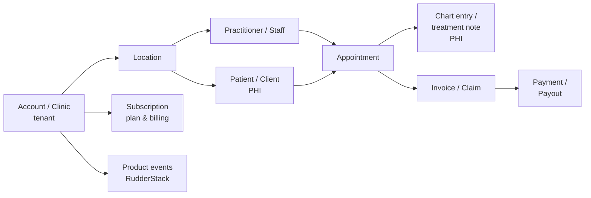

# Jane App — BI Rebuild & the Analytics Engineer Focus Areas

> Research memo / interview-positioning doc.
> **Scope:** Jane Software Inc. ("Jane App"), its current BI rebuild, the three focus areas behind it, and the concrete focus areas that define the Analytics Engineer space around them.
> **Evidence base:** Jane's live Ashby job board (`jobs.ashbyhq.com/jane`, 27 open roles, retrieved 27 October 2026) plus Jane's public careers and product pages. No confidential Jane material is used.
> **Companion docs:** `../SQL_PLAYBOOK/1_SQL_PLAYBOOK.md`, `../SQL_PLAYBOOK/2_Advanced_SQL_Knowledge.md`.
> **Status:** public-postings-only. Quoted text is verbatim; interpretation is labelled where it matters (§3 note, §9).

---

## 0. Executive summary

Jane is rebuilding its BI function, not extending it. The mandate comes from a hiring manager and the co-CEO, and it is being staffed as a *foundation* programme rather than a dashboard programme: a Staff Engineer anchors ingestion into Snowflake, dbt standards, data quality/observability and the AI framework the whole analytics org will build on, while a Product-focused analyst role builds the technical foundation that lets Product teams answer their own questions with confidence.

Everything in the public postings collapses into **three focus areas**:

| # | Focus area | One-line definition | Who owns it publicly |
|---|---|---|---|
| 1 | **Trusted data foundation** | Ingestion → Snowflake → modelled, certified data products and a semantic layer that every consumer shares | Staff Analytics Engineer; Staff/Senior Data Engineer |
| 2 | **Data quality, governance & observability** | Standards, testing, CI/CD, monitoring, documentation and certification so the foundation stays trustworthy | Staff Analytics Engineer |
| 3 | **Self-service + AI-augmented analytics** | Governed metrics and semantic definitions consumed by dashboards, ad-hoc analysis *and* AI, with AI also accelerating the build loop | Staff Analytics Engineer; Staff Product Data Analyst |

For an Analytics Engineer, the space that opens up is wider than "write dbt models". It spans twelve areas — from event instrumentation and Snowflake cost architecture through PHI-safe governance to text-to-SQL evaluation. Those twelve are the body of this document (§4), with a capability matrix (§5), a 90-day plan (§6) and interview angles drawn from Jane's own wording (§7).

The single most under-appreciated fact: **Jane's data is PHI.** This is not generic SaaS clickstream. Multi-tenant clinic data includes patient identity, appointment reasons, chart notes, insurance and payments, across HIPAA (US), PIPEDA/PHIPA (Canada) and UK regimes. Any architecture answer that ignores that will read as junior at Staff level.

---

## 1. Company context

| Dimension | Fact |
|---|---|
| Product | Cloud practice-management, EMR/EHR and billing platform for health, wellness, mental-health and allied-health practitioners: booking, charting, scheduling, billing, payments, payroll, websites, reporting |
| Founded | 2014, North Vancouver, BC |
| Ownership | Founder-led, private; valued at **$1.8B** in May 2025 with TCV backing |
| Scale | **70,000+ businesses**, **250,000+ practitioners** daily, 75+ countries; 800+ employees |
| Model | Remote-first across Canada, US and UK; explicitly not hybrid; 10+ years of profitability |
| Growth vector | Pushing into new disciplines across North America and the UK in 2026; AI is the stated strategic bet |
| Customers | Primarily small-to-medium clinics — physio, massage, chiro, psychology, naturopathy, nurse practitioners, medical aesthetics |

### Why the BI function is being rebuilt now

Jane grew its analytics the way most profitable SaaS companies do: incrementally, embedded in teams, with whoever needed a number building the number. The postings say this out loud, which is unusual and useful:

> "The infrastructure that powers Jane's customer decisions exists today, but it's been built incrementally, across teams, without dedicated ownership… Some of what exists will stay. Some will be replaced. All of it needs a cohesive strategy." — *Staff Data Engineer, Customer Signals & Instrumentation*

> "We've reached a point where event instrumentation, attribution, and identity resolution need dedicated ownership to take the next step." — same posting

> "Now we're at an inflection point where we're thinking bigger about data strategy, governance at scale, and how to enable the whole company through better access and insights." — *Senior Data Engineer, Data Performance and Tooling*

Three structural pressures follow from that: (a) the company is now big enough that inconsistent metrics cost real money, (b) AI features need trustworthy, well-described data or they produce confident nonsense, and (c) health-data compliance makes ad-hoc copies of patient data an actual liability rather than an untidiness.

---

## 2. Evidence base — the live roles

All five data roles open on 27 October 2026. The split is the story: two sit in **Operations** (the BI/analytics org), two in **Development** (the data platform engineering org), which tells you the rebuild is deliberately bridging analytics and platform engineering.

| Role | Team | Location | URL |
|---|---|---|---|
| **Staff Analytics Engineer** | Operations | Canada/US | `jobs.ashbyhq.com/jane/aad68bb2-49b3-4d45-b08d-aab8076cd5c3` |
| Staff Product Data Analyst | Operations | Canada/US | `jobs.ashbyhq.com/jane/50006239-8506-4b56-b78c-a8c1114bd2da` |
| Senior Data Analyst (Finance & Payments) | Operations | Canada/US | `jobs.ashbyhq.com/jane/a00a85b2-deb7-49e9-94d6-be9bf29b95e7` |
| Staff Data Engineer — Customer Signals & Instrumentation | Development | Canada/US | `jobs.ashbyhq.com/jane/6d4cd6e7-eae8-474f-938a-f61067f8a05b` |
| Senior Data Engineer — Data Performance and Tooling | Development | Canada | `jobs.ashbyhq.com/jane/e70c917f-ceb8-4c3c-aa05-c9db657e7015` |

**Compensation anchor (Staff Analytics Engineer):** Canada CAD $152,000–$237,500 (accomplished ≈ $180,500); US $149,600–$215,100 (accomplished ≈ $177,700); plus JSOP equity. Jane's bands are intentionally wide, so the "accomplished" midpoint is the realistic target.

### Confirmed stack

| Layer | What Jane uses / is evaluating | Source |
|---|---|---|
| Warehouse | **Snowflake** (also benchmarks against Redshift/BigQuery) | Staff AE: "modern cloud data platforms such as Snowflake, Redshift, or BigQuery" |
| Transformation | **dbt**, in production, git-based PR workflow, automated tests | Staff AE: "6+ years … modular data pipelines using dbt in a production environment" |
| BI / consumption | **Looker** incumbent; **Omni, Hex, Sigma** named as evaluated/modern | Senior Data Analyst (Looker); Staff Product Data Analyst (Looker, Omni, Hex, Sigma) |
| Collection / CDP | **RudderStack** today, stack under evaluation | Staff Data Engineer: "We currently run RudderStack and are evaluating the right long-term stack" |
| Lake / streaming | **Apache Iceberg**, **Kafka/MSK**, **Glue**, **Debezium**, **Flink**, **Spark**, **Terraform** | Senior Data Engineer |
| App | **Ruby on Rails** monolith (CDC source) | Senior Data Engineer: "Nice to have: … Ruby on Rails monolithic applications" |
| Version control | **GitHub**, branching/merging/PR review, CI | Staff AE |
| AI tooling | **Cursor, Claude Code** for modelling/testing/documentation; AI as a first-class consumer of data | Staff AE, Staff Product Data Analyst |

### What the postings say the BI team is for

> "Our BI team is central to how Jane understands and grows its business. We partner across Marketing, Sales, Support, Finance, Partnerships, and Product to turn billing, CRM, product, and support data into trusted insight."

That sentence is the domain map: **billing, CRM, product, support** as source domains; **Marketing, Sales, Support, Finance, Partnerships, Product** as consumers. Analytics Engineering sits in the seam between them.

---

## 3. The three focus areas, decoded

Your brief lists four things — ingestion into Snowflake, dbt standards, data quality/observability, the AI framework — grouped into three. The postings resolve the grouping.

### Focus area 1 — Trusted data foundation (ingestion → Snowflake → certified data products)

**Stated goal:** "Build and operate the core BI platform that powers reporting, analytics, self-service, and AI across Jane."

**What the JD actually asks for:**
- "Own data ingestion, integration, and platform architecture, making thoughtful trade-offs as our systems evolve."
- "Build and maintain enterprise data models, reusable business logic, and semantic layer definitions."
- "Review and certify data pipelines, data models, semantic layer definitions, and data products **before they are consumed by the business**."

**What it implies technically:** a landed/raw layer with source-freshness guarantees; a modelled layer with explicit grain, contracts and tests; a semantic layer that is the *only* place a metric is defined; and a certification workflow with a named owner per data product. The engineering-side roles complete the upstream half — RudderStack event pipelines, schema governance, identity resolution, attribution capture, and a lightweight review gate "before new events ship".

**What "good" looks like:** a PM opens a governed dataset, picks "Active clinics", and gets the same number as Finance's board deck, with lineage back to the Rails table it came from.

### Focus area 2 — Data quality, governance & observability

**Stated goal:** "establish standards for data quality, testing, governance, observability, documentation, and CI/CD across the analytics platform."

**What the JD actually asks for:**
- "Monitor the health of the analytics platform, identify pipeline failures and recurring issues, and implement scalable, long-term solutions to improve reliability."
- "6+ years … automated data quality testing."
- "Experience implementing data observability platforms."
- "Mentor Analytics Engineers through code reviews, design reviews, and engineering best practices."

**What it implies technically:** tests as code rather than tribal knowledge; freshness and volume monitors with routed alerts; an incident model with runbooks; reconciliation against source systems (especially Payments and billing); and a deprecation path so models die instead of accreting.

**What "good" looks like:** a broken upstream field is caught by a test before a stakeholder notices, and the fix ships through a reviewed PR with a tested rollback — not a Slack apology.

### Focus area 3 — Self-service + AI-augmented analytics

**Stated goal:** "a more self-service, AI-augmented analytics experience" built on "governed datasets, reusable business logic, and trusted metric definitions."

**What the JD actually asks for:**
- "Experience designing semantic models and enabling self-service analytics through governed datasets, reusable business logic, and trusted metric definitions."
- "Experience using AI tools to improve the analytics engineering development process, including accelerating data modeling, testing, documentation, and code development."
- Product-side mirror: "Build semantic models, standardized business logic, and governed metric definitions that ensure consistent product metrics across **dashboards, self-service, and AI**."

**What it implies technically:** one semantic definition consumed by three surfaces (the BI tool, a notebook/Hex, and an LLM); rich descriptive metadata — descriptions, synonyms, units, allowed values, freshness, owner — because that metadata *is* the retrieval layer for text-to-SQL; and an evaluation harness so AI answers are scored rather than vibed.

**What "good" looks like:** a non-technical stakeholder asks a question in natural language and gets an answer that agrees with the certified dashboard, and says "I don't know" rather than inventing a join when it can't.

> **Note on the framing in your brief.** "Ingestion into Snowflake, dbt standards, data quality and observability, and the AI framework" maps onto areas 1, 1+2, 2 and 3 respectively. If Jane counts *four* pillars internally, the fourth is almost certainly **governance / PHI compliance** — it runs through every posting but never appears as a headline bullet. Treat it as an implicit fourth pillar, because it is where a health-data company will interview hardest.

---

## 4. Key focus areas for the Analytics Engineer space

Twelve areas. Each is written so it can be lifted straight into an interview answer or a 30-60-90 conversation. Areas 1–3 are table stakes to get hired; 4–7 are what distinguishes a Staff candidate; 8–12 are what distinguishes someone who would *own* the function rather than work in it.

### 4.1 Ingestion & source integration
**Why Jane needs it:** "Today there are multiple independently configured sources with different conventions; you'll bring consistency and reliability." Four source domains — billing, CRM, product, support — plus a Rails monolith and a RudderStack CDP.
**What you'd own:** connector inventory and ownership; extraction strategy per source (EL vs. ELT, full vs. incremental, CDC via Debezium/Kafka for the Rails DB); landing/raw conventions (`_airbyte`/`_fivetran`/custom meta-columns, loaded-at, source-updated-at); source freshness SLAs per domain; schema-drift handling and quarantine tables instead of silent truncation.
**Failure mode to name:** an upstream API silently changes a field type, dbt casts it, and a revenue dashboard is wrong for three weeks. The fix is a drift test on the raw layer, not a better model.

### 4.2 Snowflake architecture, performance & cost
**Why Jane needs it:** "Proven experience designing schemas and optimizing query performance on modern cloud data platforms" — and Jane is simultaneously building an Iceberg-based data lake, so warehouse and lake have to be coherent.
**What you'd own:** database/schema/role hierarchy mapped to environments (raw/staging/marts × dev/prod); warehouse sizing and auto-suspend policy per workload class (ELT vs. BI vs. ad-hoc vs. AI agents); clustering keys only where pruning actually pays; materialisation strategy (view vs. table vs. incremental) chosen by cost-per-query × freshness need; query-history-driven tuning rather than folklore.
**Failure mode to name:** one oversized warehouse behind a dashboard that refreshes every five minutes. Cost grows linearly with adoption and nobody notices because it's "just Snowflake credits".

### 4.3 dbt project architecture & standards
**Why Jane needs it:** the single most repeated requirement in the posting, and the thing a Staff AE is expected to *set*, not follow.
**What you'd own:** layer contract — staging (1:1 with source, renamed/cast only) → intermediate (business logic, not exposed) → marts (business-facing, documented, tested); naming and folder conventions enforced by CI; `dbt_project.yml` per-layer defaults; model contracts on certified marts; `access: private/protected/public` and cross-project refs; macro and package governance (pin versions, own the forks); exposures declared so downstream Looker/Hex content is traceable; versioned models for breaking changes; deprecation dates in `schema.yml`.
**Failure mode to name:** 400 models with three different definitions of "revenue" and no rule about which layer may join to which.

### 4.4 Domain modelling for a practice-management SaaS
**Why Jane needs it:** generic e-commerce modelling patterns do not survive contact with a clinic. The grain is multi-tenant and the entity chain is long.
**What you'd own:** a documented entity model and grain catalogue, plus the metrics that hang off each grain.



Candidate metric families, each needing one certified definition:

| Family | Example metrics | Grain & trap |
|---|---|---|
| Growth | New clinics, trial→paid conversion, logo churn, NRR | Account, not user; Jane sells to businesses |
| Engagement | Weekly active practitioners, appointments booked, chart completion | Practitioner, not clinic; a clinic "active" is a derived rollup |
| Monetisation | MRR/ARR, ARPU, payment volume, take rate | Invoice vs. payment vs. subscription — three different numbers people call "revenue" |
| Retention/health | Feature adoption (AI Scribe, online booking), support tickets per 1k clinics | Must survive clinic-level joins; ticket grain ≠ clinic grain |
| Operational | No-show rate, utilisation rate, fill rate | Appointment grain; cancellations mutate history — needs snapshotting |

**Failure mode to name:** "active clinic" defined three ways (logged in, had an appointment, paid an invoice) and used interchangeably in a board deck.

### 4.5 Semantic layer & metric governance
**Why Jane needs it:** "semantic layer definitions", "governed datasets", "trusted metric definitions", and consistency "across dashboards, self-service, and AI". This is the heart of the third focus area.
**What you'd own:** the decision record for where the semantic layer lives — dbt Semantic Layer/MetricFlow vs. LookML vs. the newer tool (Omni/Hex/Sigma) — including what that choice costs in duplication; a metric catalogue with owner, definition, grain, filters, and known caveats; a certification tier (certified / experimental / deprecated); a change process for a metric (versioned name, migration notice, both live during transition); a "no metric without a semantic definition" rule for new dashboards.
**Failure mode to name:** the same metric defined in dbt *and* in Looker *and* in a Hex notebook, drifting quietly by one filter.

### 4.6 Data quality, testing & observability
**Why Jane needs it:** "automated data quality testing", "data observability platforms", "monitor the health of the analytics platform, identify pipeline failures and recurring issues".
**What you'd own:** a test taxonomy — `unique`/`not_null`/`relationships`/`accepted_values` as baseline, plus custom tests for reconciliation (invoice totals vs. payments), referential integrity across PHI tables, and behavioural invariants (no appointment before a clinic's signup date); source freshness thresholds per domain; volume/anomaly monitors on high-value tables; severity tiers with routing (page vs. ticket vs. dashboard banner); incident runbooks; a weekly "recurring failures" review that ends in a fix, not a retry.
**Failure mode to name:** 2,000 tests that all run on every PR, take 40 minutes, and are ignored. Severity tiers exist so signal survives volume.

### 4.7 Governance, privacy & PHI compliance
**Why Jane needs it:** this is the area the postings *don't* headline but every design decision is constrained by. Jane holds patient identity, appointment reasons, clinical notes, insurance and payment data across HIPAA (US), PIPEDA/PHIPA (Canada) and UK requirements. A rebuild is the moment data sprawl gets regulated.
**What you'd own:** a data classification scheme (public / internal / confidential / PHI) applied as tags at the column level; masking and hashing policies for de-identified analytics; Snowflake row-access policies and secure views so a clinic-level user sees only their tenant; separation of identifiable from de-identified marts so 95% of analysis never touches PHI; retention and deletion that respects a patient deletion request across the warehouse (harder than it sounds — dbt incremental models retain deleted rows unless you design for it); access review cadence and audit trails; a rule that PHI never lands in a notebook, a BI extract, or an LLM prompt without an approved path.
**Failure mode to name:** PHI scraped into an ad-hoc CSV for a churn analysis, now sitting in someone's Downloads folder outside every control. The architectural answer is a de-identified `marts_core` layer that is *sufficient* for most questions, so the shortcut is never tempting.

### 4.8 CI/CD & release engineering
**Why Jane needs it:** "real comfort in production git workflows (branching, merging, pull request reviews) and automated data quality testing", plus "CI/CD across the analytics platform".
**What you'd own:** PR pipeline that runs `dbt build --select state:modified+` against a per-PR schema (Slim CI), plus `dbt-docs` generation and a lint/format check (sqlfluff); contract tests that fail the build rather than warn; environment promotion dev → prod on merge, with a documented rollback (git revert + full refresh of affected incrementals); a protected production branch with required reviewers; scheduled jobs owned in one place with alerting on failure; a changelog for model changes that consumers can subscribe to.
**Failure mode to name:** a full-refresh run on a 200M-row table because an incremental model changed grain, discovered in production at 9am on a Monday.

### 4.9 Documentation, lineage & self-service enablement
**Why Jane needs it:** the stated end-state is that Product and business teams "answer the questions they need to with confidence" — which is an enablement problem as much as a modelling one.
**What you'd own:** `schema.yml` descriptions that a non-engineer can read (what the row is, what's excluded, known caveats); exposures for every dashboard so lineage is bidirectional; a searchable catalogue with ownership and freshness; onboarding material and office hours; a "request a metric" intake with an SLA; training that teaches the semantic layer instead of teaching SQL.
**Failure mode to name:** a beautiful dbt project nobody outside the team can navigate, so stakeholders go back to asking an analyst for a CSV.

### 4.10 AI-readiness & the AI framework
**Why Jane needs it:** this is the explicit third pillar. "The AI framework our whole analytics org will build on top of." The posting is unusually specific: AI is both a *consumer* of the data ("self-service, AI") and a *tool* in the build loop ("using AI to build and improve dbt workflows", "Cursor, Claude Code").
**What you'd own, consumer side:** metadata as product — every model and column needs a description, synonyms, unit, grain and owner, because retrieval quality is upstream of answer quality; a semantic layer exposed over MCP/API so an agent queries *definitions*, not raw tables; a read-only, cost-capped warehouse role for agents with per-query limits; an evaluation set of 50–200 real business questions with certified answers, so text-to-SQL accuracy is regressed on every prompt/schema change; guardrails that refuse rather than guess (no PHI in prompts, no unbounded scans, no writes).
**What you'd own, build side:** AI-assisted dbt development with a review standard — generated models still get contracts, tests and a human reviewer; documentation generation from column profiling; a macro/test scaffolder; and a policy on what may never be pasted into a model prompt (PHI, credentials, customer names).
**Failure mode to name:** shipping a chatbot that answers confidently from `raw_` tables and quietly exposes another clinic's data. The fix is architectural (agent only sees certified, tenant-scoped semantic objects), not a better prompt.

### 4.11 Reliability, SLAs and FinOps
**Why Jane needs it:** "Monitor the health of the analytics platform… implement scalable, long-term solutions to improve reliability" and "operational stability and clear trade-offs between speed and reliability".
**What you'd own:** freshness SLAs published per mart and wired to monitors; an on-call or escalation model proportionate to team size; a service catalogue showing which dashboards depend on which models; cost attribution by team/workload with a monthly review; a quota on ad-hoc query spend; capacity planning ahead of known spikes (month-end finance close, quarter end, product launches).
**Failure mode to name:** a stakeholder discovers staleness before the team does, because nobody monitors the *dashboard's* freshness — only the model's.

### 4.12 Team operating model (the Staff differentiator)
**Why Jane needs it:** "Mentor Analytics Engineers through code reviews, design reviews, and engineering best practices", and this is a *founding* function — "help define where we're headed". Staff scope is standards and direction, not throughput.
**What you'd own:** an RFC/design-review habit for anything cross-domain; an intake and prioritisation model for analytics requests (so work is chosen, not absorbed); a competency ladder for AEs with concrete artefacts at each level; pairing and review rotation; a quarterly platform roadmap tied to business outcomes; written decision records so the next hire inherits reasoning, not just code.
**Failure mode to name:** the Staff engineer becomes the most expensive ticket-taker on the team, and every standard exists only in their head.

---

## 5. Capability matrix

Read this as the hiring bar, area by area. "Must-have" is what the posting asks for; "how to evidence" is what you should be able to point at in a portfolio, a story, or a whiteboard.

| # | Area | Must-have | How to evidence it |
|---|---|---|---|
| 1 | Ingestion | Connector ownership, incremental + CDC, freshness SLAs, drift handling | Walk through one broken-source incident end to end; show a raw-layer contract with meta-columns |
| 2 | Snowflake architecture | Schema/role design, pruning, materialisation trade-offs, cost control | Query-history-driven tuning story: before/after cost or runtime, with the mechanism named |
| 3 | dbt standards | 6+ yrs production dbt, layering, contracts, macros, exposures, versions | A repo structure you can defend; a PR template; a deprecation you actually ran |
| 4 | Domain modelling | Grain discipline, conformed dimensions, multi-tenant modelling | The metric-family table in §4.4, with the traps explained |
| 5 | Semantic layer | Governed metrics consumed by BI + ad-hoc + AI | One metric, one definition, three surfaces; the migration plan between tools |
| 6 | Quality & observability | Test taxonomy, severity tiers, alert routing, incident response | A runbook; a test that caught a real bug; your false-positive policy |
| 7 | Governance / PHI | Classification, masking, row-access, retention, deletion | A de-identified layer design; how a deletion request propagates through incrementals |
| 8 | CI/CD | Slim CI, `state:modified+`, promotion, rollback | A pipeline diagram and the failure it prevents |
| 9 | Documentation | Readable `schema.yml`, lineage, catalogue, enablement | A doc a non-engineer understood; an onboarding path |
| 10 | AI-readiness | Metadata for retrieval, semantic exposure, evals, guardrails | Your eval set design and the metric you'd regress on |
| 11 | Reliability / FinOps | SLAs, cost attribution, capacity planning | Month-end spike plan; cost-per-team view |
| 12 | Operating model | Mentoring, RFCs, intake, roadmap | A standard you introduced and the behaviour change it produced |

**Where the bar is highest for a Staff AE at Jane:** areas 3, 5, 6 and 10. Those are the four named in the "what impact" bullets, and they are the ones where a wrong architectural choice is expensive to reverse.

---

## 6. First 90 days — the plan a Staff AE would actually propose

The postings are explicit that some of the existing stack stays and some is replaced. So the first month is an audit, not a rebuild. The credible answer in an interview is "I'd earn the right to set standards by measuring the current state first".

| Phase | Focus | Concrete outputs | Signal to leadership |
|---|---|---|---|
| **0–30 days: audit** | Inventory, not opinions | Source-system map; dbt model inventory with layer violations; top-20 models by query cost and by downstream dashboards; test coverage per mart; list of metrics with >1 definition; PHI touchpoints | "Here are the five things that are actually costing us, ranked" |
| **30–60 days: stabilise** | Stop the bleeding where it hurts | Freshness + volume monitors on the top-20 models; severity tiers and alert routing; one reconciliation test on Payments; a PR template + Slim CI; kill or fix the noisiest recurring failure | "The platform now tells us when it breaks before a stakeholder does" |
| **60–90 days: standardise** | Write the rules and make them automatic | Layering + naming standard enforced in CI; model contracts on the first certified marts; semantic definitions for the top-10 company metrics; certification tier and owner list; first de-identified mart so PHI access shrinks; an RFC for the AI/agent access path | "The next hire inherits a system, not a conversation" |

Two things to say out loud in that conversation: (a) you will *not* rewrite the whole project in the first quarter, and (b) you will deliberately choose one or two domains — Finance/billing or Product — to go deep on first, because a thin layer done everywhere is worth less than a trusted layer done somewhere.

---

## 7. Interview angles

Ten questions that follow directly from Jane's own wording. For each, the note is what a strong answer covers.

1. **"How would you decide whether a metric lives in dbt's semantic layer or in LookML?"** — Duplication cost vs. tool lock-in; one source of truth, not two; what happens to the losers during migration; governance of the definition itself.
2. **"A new feature ships next sprint. Walk me through how its events get instrumented."** — Event spec agreed *before* build, naming/versioning, QA in staging, validation in the pipeline, ownership, and a review gate so unvalidated events never reach a shared schema.
3. **"You inherit 400 dbt models with three definitions of revenue. What's week one?"** — Inventory, usage data, and *not* refactoring. Find the certified candidate, instrument both, then retire with notice.
4. **"How do you test PHI exposure?"** — Not just access grants: column tags, policy enforcement in a test, a probe query as a low-privilege role in CI, and a check that no de-identified model leaks a re-identifiable combination.
5. **"Your pipeline failed at 6am and Finance needs the number by 9. Go."** — Triage (is it upstream or ours?), communicate early with an ETA, fix-forward vs. rollback decision, and the follow-up that stops the recurrence. Staff-level answers include the comms plan.
6. **"How do you keep Snowflake cost down as adoption grows?"** — Workload-separated warehouses, auto-suspend, materialisation chosen by refresh need, query tagging for attribution, budgets and alerts, and a monthly review with names attached.
7. **"What does 'certified data product' mean here?"** — Owner, documented grain, tests, contract, freshness SLA, lineage to source, a named consumer set, and a deprecation policy. Certification is a *contract*, not a badge.
8. **"How would you make this data usable by an LLM without it hallucinating?"** — Semantic layer over raw tables, rich metadata, read-only scoped role, eval set with certified answers, refusal behaviour, and cost caps.
9. **"How do you mentor an Analytics Engineer who writes correct but unmaintainable SQL?"** — Review as teaching: grain, layering, naming, tests; pair on one model; give them the standard to enforce on someone else's PR. Behaviour change over correction.
10. **"We said 'trusted insight'. Convince me your definition of trusted is operational, not aspirational."** — Trusted = monitored + tested + owned + reconcilable + versioned. Name the mechanism for each.

**Two questions to ask them** (they signal Staff-level thinking): *"Which of the existing systems are you keeping, and which are you replacing?"* and *"When the AI framework ships, who is allowed to query PHI, and what does that access look like technically?"*

---

## 8. Mapping to existing work (portfolio evidence)

What already exists in this repo and which of the twelve areas it evidences:

| Artefact | Evidences | Gap to close before an interview |
|---|---|---|
| `Project_Portfolio/Project 3` — demand-forecast pipeline (dbt models + model training) | 3 (dbt architecture), 4 (grain), 8 (CI) | Show the *test and contract* layer, not just the model tree; quantify a modelling decision |
| `Project_Portfolio/Project 4` — support-QA ETL | 1 (ingestion), 4 (domain modelling), 6 (quality) | Add an observability artefact: what monitor, what threshold, what alert routes where |
| `SQL_PLAYBOOK/1_SQL_PLAYBOOK.md`, `2_Advanced_SQL_Knowledge.md` | 2 (performance), 4 (grain discipline), 6 (correctness) | Keep as the technical-depth proof; it is dialect-aware, which matches Jane's "Snowflake, Redshift, or BigQuery" framing |

**Three gaps worth building** (each is small and directly answers a JD bullet):

1. **Semantic-layer demo** — one domain, 8–10 metrics, defined once and served to a BI surface *and* a notebook *and* a text-to-SQL endpoint, with a note on how you keep them from diverging. This is the single highest-signal artefact for Jane's focus area 3.
2. **PHI-safe layer demo** — a synthetic clinic dataset with column tags, masking, row-access policy, and a de-identified mart; plus a written answer to "how does a deletion request propagate through an incremental model?". Nobody else will bring this.
3. **AI eval harness** — 50 questions, certified answers, a runner that scores text-to-SQL accuracy, and a schema change that visibly regresses the score. That is the "AI framework" bullet made concrete.

---

## 9. Assumptions, confidence and open questions

**Assumptions made**

- The three focus areas are **reconstructed from public postings**, triangulated across five roles. They are consistent and mutually reinforcing, but they are not a quoted internal strategy document.
- Text in quotation marks is verbatim from the live postings. The three focus areas and the twelve-area breakdown are my synthesis, not a published Jane document.
- The audience is interview and positioning prep, so the emphasis is on competencies and artefacts rather than industry commentary.
- Compensation figures are the published bands as of 27 October 2026 and will drift.

**High confidence:** the stack (Snowflake, dbt, Looker, RudderStack, AWS/Iceberg), the three focus areas, the PHI constraint, the "founding/rebuild" framing, the mentorship expectation at Staff level.

**Medium confidence:** whether governance is a named fourth pillar internally; whether the semantic layer will be dbt-native or tool-native (the postings mention both Looker and Omni/Hex/Sigma, which suggests the decision is still open); the exact split of ownership between the Operations BI team and the Development data-platform team.

**Open questions worth asking in the process**

1. Which of ingestion, modelling, or the AI layer is the first 90-day priority — and who owns the other two?
2. Is the semantic layer decision already made, or is it part of this role's mandate?
3. Are PHI and de-identified data already separated, or does that have to be built?
4. How many Analytics Engineers exist today, and what is the intended shape of the team in 12 months?
5. What does "certified" mean today, if anything — and who has the authority to certify?

---

## 10. Sources

Retrieved 27 October 2026. All public.

| Source | Used for |
|---|---|
| `https://jane.app/careers` | Company scale, mission, remote-first model, AI positioning, 250k+ practitioners / 70k+ businesses, $1.8B valuation |
| `https://jane.app/careers/open-roles` → Ashby board `jobs.ashbyhq.com/jane` | The 27 open roles and the five data roles |
| `https://jobs.ashbyhq.com/jane/aad68bb2-49b3-4d45-b08d-aab8076cd5c3` — Staff Analytics Engineer | Focus areas 1–3 verbatim; Snowflake/dbt/semantic layer/observability/AI requirements; compensation bands |
| `https://jobs.ashbyhq.com/jane/50006239-8506-4b56-b78c-a8c1114bd2da` — Staff Product Data Analyst | The rebuild framing ("We're rebuilding how we manage data and analytics at Jane"); instrumentation; Looker/Omni/Hex/Sigma; "dashboards, self-service, and AI" |
| `https://jobs.ashbyhq.com/jane/a00a85b2-deb7-49e9-94d6-be9bf29b95e7` — Senior Data Analyst | Looker + dbt + Finance/Payments reconciliation; "modernization of our data architecture" |
| `https://jobs.ashbyhq.com/jane/6d4cd6e7-eae8-474f-938a-f61067f8a05b` — Staff Data Engineer, Customer Signals | RudderStack; event schema governance; identity resolution; attribution; "built incrementally, across teams, without dedicated ownership" |
| `https://jobs.ashbyhq.com/jane/e70c917f-ceb8-4c3c-aa05-c9db657e7015` — Senior Data Engineer, Data Performance & Tooling | Iceberg lake, MSK/Glue/Terraform/Kafka/Debezium/Flink, Rails, "inflection point… data strategy, governance at scale" |
| `https://jane.app/` (features: Reporting & Analytics, AI Scribe, Payments, Billing) | Product surface and the source domains BI must model |

### How to re-verify this document

```bash
# Refresh the role list (Ashby public posting API)
curl -sL -A 'Mozilla/5.0' \
  'https://api.ashbyhq.com/posting-api/job-board/jane?includeCompensation=true' \
  | python3 -c "import json,sys; d=json.load(sys.stdin); print(len(d['jobs']),'roles'); [print('-', j['title'],'|', j['team'],'|', j['location']) for j in d['jobs'] if 'data' in j['title'].lower() or 'analytic' in j['title'].lower()]"
```

If that list no longer contains **Staff Analytics Engineer**, the role has closed and §2 and the compensation anchor are stale. The three focus areas in §3 remain valid as long as the rebuild itself is still in flight.

---

*Prepared 27 October 2026. Public-source research only; no Jane confidential material used.*
