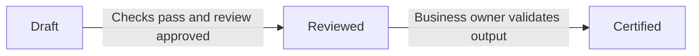
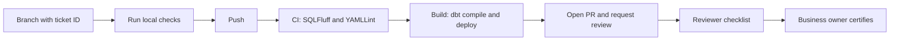

# PR Standard and Certification Process

This document explains how we review and certify data work in
`da-etl-analytics-engineering` (AE) before the business uses it.
It covers pipelines, dbt models, semantic layer definitions, and data products.
It also explains how to rebuild the setup from scratch.

Each rule names its source in the repo, so you can check it.
Items marked **[to confirm]** are not written down anywhere yet.

---

## 1. Purpose

1. Nothing reaches business users until it is reviewed and certified.
2. Analytics engineers learn through code reviews, design reviews, and shared standards.
3. Every PR is judged against the same standard.

---

## 2. Scope

| Item | Examples | Covered in |
|------|----------|------------|
| Pipelines | Airflow DAGs in `morpheus-jobs`, Datastream, CDL loads | Section 5.3 |
| dbt models | `stg_`, `base_`, `int_`, `fct_`, `dim_` | Sections 4, 5.1, 6 |
| Semantic layer | Metric and dimension definitions (work in progress) | Section 5.2 |
| Data products | Tables or views handed to a business team | Section 5.4 |

---

## 3. Certification levels

Every change moves through three levels. The level is recorded in the PR.



| Level | Meaning | Requirements |
|-------|---------|--------------|
| **Draft** | Built and tested by the author. Not trusted yet. | Build passes, tests pass, PR template filled in |
| **Reviewed** | A teammate has checked the code and design. | Reviewer checklist (section 7.2) passes, CI and Build pass |
| **Certified** | Safe for business use. | Business owner checks output against a known source or report **[to confirm: who signs off]** |

Only Certified data is used in business reporting.

---

## 4. Naming and structure

1. Domain folders live under `dbt/models/`. A new domain is a new top-level folder, never a subfolder of `ae_customer/`.
   *Source: `CLAUDE.md`, Identity.*
2. Staging models are named `stg_<source>_<entity>.sql`. Surrogate keys start with an underscore: `_key_<entity>`.
   *Source: `CLAUDE.md`, Model naming conventions.*
3. Every model has a paired `_<model_name>.yml` file in the same folder.
   *Source: `CLAUDE.md`. Enforced by the pre-commit hook `check-model-has-properties-file`.*

Layers:

- **Staging:** one-to-one with the source. Rename, cast, and filter only. Avoid joins.
- **Intermediate:** split heavy logic into smaller, reusable steps.
- **Marts:** the final entities business users read (`fct_`, `dim_`).

Materialize in this order: start as a view, move to a table when queries get slow, then go incremental when table builds get slow.
*Source: DBT Workflow doc, section 2 (Materialization).*

---

## 5. What "certified" means for each item

### 5.1 dbt models

1. **Primary key has `unique` and `not_null`.** Applies to every staging and mart model.
   *Source: DBT Workflow doc, "Mandatory Rule".*
2. **At least two tests per model.** Enforced by the pre-commit hook `check-model-has-tests` with `--test-cnt 2`.
3. **Every column has a description and a `data_type`.** *Source: `CLAUDE.md`, YAML conventions.*
4. **No hardcoded table names.** Use `ref()` and `source()` only. Enforced by the hook `check-script-has-no-table-name`.
5. **The table tier is set in the model config.** Each model sets `table_tier` in `config(labels=...)`. For example, `dbt/models/skip_plus/marts/skip_plus_membership.sql` has:

   ```sql
   labels={'team': 'analytics-engineering', 'table_tier': 'gold'},
   ```

   The repo uses two tier values:
   - `silver`: intermediate and cleaned models, such as `int_skip_plus_membership.sql` and `stg_skip_instacart_embedded_discounts_daily.sql`.
   - `gold`: business-ready marts, such as `skip_plus_membership.sql` and `skip_plus_monthly_active_summary.sql`.

   The repo has **no `bronze` tier**. Raw data is read through `source()` (defined in `dbt/models/sources.yml`) and is not labelled.

   > **Conflict:** `CLAUDE.md` says all models are `silver`, but the skip_plus marts are `gold`. The files are the current truth. See open item 3 in section 13.

6. **Tags select models that run together.** For example, the promotions models use `tags=['ae_offers']`. The DAG `morpheus-jobs/analytics_engineering/ae_offers/dag.yaml` runs them with `select: [tag:ae_offers, ...]`.
7. **Column descriptions are the docs.** They are written in the `.yml` file. `CLAUDE.md` says `persist_docs` pushes them to BigQuery, so they are visible there.

### 5.2 Semantic layer (work in progress)

The semantic layer is being built. Only one file exists: `dbt/models/marts/promotions_and_offers/sem_promotions.yml`. Use it as the example, not as a finished standard.

1. **One owner and one definition per metric.**
   - *How it works now:* each metric is defined once under `metrics:` in `sem_promotions.yml`. For example, `marketing_spend_cad` is a `simple` metric that filters `total_spend_cad` to `budget_category = 'Marketing Spend'`. A second metric with the same name would be a duplicate.
   - *Gap:* metrics have no `owner` field. The only owner is the team in `dag.yaml` (`owner: analytics-engineering`). **[to confirm: add a per-metric owner field]**
2. **The grain is written down.**
   - *How it works now:* the semantic model description says "One row per order-promo combination." The primary entity is `order_promo` with `expr: fact_pk`.
   - *Rule:* the description states the grain, and the primary entity is a unique key tested under section 5.1.
3. **The metric matches the underlying model on a known sample.**
   - *How it works now:* **not in place for the semantic layer.** No test compares `sem_promotions` metrics with `promotions_and_offers_order`.
   - *Pattern to copy:* `dbt/tests/skip_plus/test_skip_plus_active_members_parity.sql` compares the new gold mart count with the legacy count. It returns the rows that differ, so the test fails when the numbers disagree.
   - *Rule:* each metric has a parity test before it is Certified. **[to confirm: which known sample to compare against]**

### 5.3 Pipelines

1. **Failures alert someone.**
   - Every DAG in `morpheus-jobs` points to a `notifications.yaml` file. I checked all 16 AE DAGs in `morpheus-jobs/analytics_engineering/`, and each one has `notifications: notifications.yaml`.
   - On failure, the alert goes to:
     - Slack channel `#alerts-ae`, for both `qa` and `prod`, tagged to the group `@analytics-engineering`.
     - Email to `analytics-engineering@example.com`.

   ```mermaid
   flowchart LR
       F[Task fails] --> R{Retries left?}
       R -->|Yes| T[Retry task]
       R -->|No| S[Slack #alerts-ae]
       R -->|No| E[Email analytics-engineering@example.com]
   ```

   Retry counts differ by DAG:
   - `retries: 3` in 14 DAGs.
   - `retries: 1` in `ae_shop_and_pay_dwh`.
   - No setting in `ae_single_run`, so it uses the Morpheus default of 2.

2. **Rerun is written down.** See section 5.3.1 below.

3. **Upstream dependencies are listed.**
   - Each DAG lists them with `dependencies:`. For example, `ae_offers_promotions` depends on `ae_shared_dimensions`.
   - Selectors with `+` (such as `+promotions_and_offers_order`) also pull in every upstream dbt model.

#### 5.3.1 Rerun and full refresh

**How a DAG is set up.** Each AE DAG is a `dag.yaml` file. A task's `dbt_args` decides what dbt runs. Morpheus supports `full_refresh: true` inside `dbt_args`, and only for `run` tasks. Other teams use it, for example `other_team/full_refresh_example/dag.yaml`. **No AE DAG has a `full_refresh` flag today.** The only full-refresh setting is a variable, `full_refresh_start_date`, in `ae_offers/dag.yaml`. The incremental models read it in their `` branch.

**Three ways to rerun or full-refresh an AE pipeline:**

1. **Automatic retry.** Set by `retries` in `dag.yaml`. This is the first response to a failure.
2. **Manual trigger with config (no code change).** In the Airflow UI, open the DAG and choose **Trigger DAG w/ config**. Paste a JSON object that names the task `uid`:

   ```json
   {
       "dbt_task_param_overrides": {
           "skip_retail_media": {
               "rest": [],
               "full_refresh": true
           }
       }
   }
   ```

   - `skip_retail_media` is the task `uid` in `ae_skip_retail_media/dag.yaml`. Use the uid of the task you want to refresh.
   - `full_refresh: true` runs the selected models with `--full-refresh`. Set it to `false` for a normal run.
   - `rest` takes extra dbt arguments. Keep it `[]` unless you need one.
   - The trigger affects only this run. The DAG file does not change.
   - Some other teams pass `--vars` through `rest` to set a date range. Their example is in `other_team/search_history/dag.yaml`.
3. **Permanent full refresh (code change).** Add `full_refresh: true` under the task's `dbt_args` in `morpheus-jobs/analytics_engineering/<dag>/dag.yaml`, then open a PR to `morpheus-jobs`:

   ```yaml
   dbt_args:
     select: [my_model+]
     full_refresh: true
   ```

   Set it back to `false` after the run. This changes every future run of that task, so it is the last resort.

Use option 2 first. It needs no PR. Option 3 needs a PR and a prod approval.

---

### 5.4 Data products

1. **Named owner.**
   - *How it works now:* `owner: analytics-engineering` in each `dag.yaml`. This names a team, not a person or a product.
   - *Gap:* **[to confirm: a named owner for each data product]**
2. **Freshness target is written down.**
   - *How it works now:* only sources have one. `dbt/models/sources.yml` sets `warn_after: 2 days` and `error_after: 5 days` on `_updated_at` for several tables. Marts have no freshness target.
   - *Rule:* each data product states its target, and its DAG runs `source freshness` first, as `ae_customer_base` does.
3. **Known consumers are listed.**
   - *How it works now:* the repo has no `exposures:` block, so consumers are not written down. **[to confirm: where consumers are recorded, for example as dbt exposures]**
4. **Access rules are agreed.**
   - *How it works now:* no access rules are in the repo. **[to confirm: where access is agreed]**

---

## 6. Testing standard

Use the lowest tier that does the job.

| Tier | Tool | Use for |
|------|------|---------|
| Unit tests | dbt unit tests (YAML, offline fixtures) | Complex logic, such as `CASE WHEN` branches |
| Tier 1 | Built-in: `unique`, `not_null`, `accepted_values`, `relationships` | Every model (baseline) |
| Tier 2 | dbt-utils: `unique_combination_of_columns`, `equal_rowcount` | Composite keys, row counts |
| Tier 3 | dbt-expectations | String patterns, distributions, table shape |
| Singular | SQL file in `dbt/tests/` | One-off business rules, parity checks |

*Source: DBT Workflow doc, section 4 (Testing). The repo already has singular tests in `dbt/tests/`.*

Rules:

1. Test sources at ingestion (`sources.yml`), so bad data is caught early.
2. Unit test fixtures contain only the columns the logic uses.

> **Open item:** there are no written rules yet for when to use Tier 3 and singular tests.

---

## 7. Review process

### 7.1 Who reviews

1. Default owners come from `.github/CODEOWNERS`: `@data-platforms-users/analytics-engineering`.
2. Certifiers per data product: **[to confirm]**.

### 7.2 Reviewer checklist

A reviewer checks each item below. The source of each item is in brackets.

1. Grain is clear and correct. *(DBT Workflow doc, section 2.)*
2. Naming and layer placement follow section 4. *(`CLAUDE.md`, naming conventions; DBT Workflow doc, section 1.)*
3. Tests meet sections 5 and 6. *(`CLAUDE.md`, quality gates 2 and 3; DBT Workflow doc PR checklist: "All models and fields have tests".)*
4. Documentation is complete. *(DBT Workflow doc PR checklist: "descriptions/documentation".)*
5. Materialization is justified. *(DBT Workflow doc, section 2.)*
6. Joins are readable, with no more than 4 or 5 concepts in one model. *(DBT Workflow doc, section 3, "Limit Joins in a Single Mart".)*

The lint and build checks are in the PR template checklist, covered in section 8.

### 7.3 Design review

Write a short design note **before** coding when you:

1. add a new domain,
2. add a new data product,
3. add a new semantic metric, or
4. change a shared staging model that many models depend on.

**[to confirm: accept, change, or remove]**

### 7.4 Giving feedback

1. Explain the reason and link to this standard.
2. Mark each comment as **blocking** or **optional**.
3. Ask a question before you assume a mistake.

**[to confirm: accept, change, or remove]**

---

## 8. PR flow



What each section of the PR template means:

1. **PR Description:** what changed and why. Link the JIRA ticket.
2. **Quality Assurance:** proof that the models work. Examples: a dbt test, an ad-hoc query, a DAG screenshot.
3. **Checklist:** tick every box before you request review.

### 8.1 Slim CI (not in use yet)

**Current CI:**

1. `ci.yml` lints only the changed `.sql` files, using `git diff` against `origin/master`. It is not a dbt state build.
2. `ci.yml` runs YAMLLint on the whole repo.
3. `build.yml` runs a reusable workflow from the external repo `data-platform-pipelines`. I could not read that workflow, so I cannot confirm what it runs.
4. Nothing in `.github/`, `.claude/`, `CLAUDE.md`, or `README.md` contains `state:` or `--defer`.

**How to adopt Slim CI** when the team owns more data:

1. Save the `manifest.json` from each successful prod run as a build artifact. **Check this first.** No manifest is stored today.
2. In CI, download the saved manifest into a folder such as `prod-state/`.
3. Change the build step to `dbt build --select state:modified+ --defer --state prod-state`.
4. Compare the run time and result with a full build for two weeks before you make it the default.

---

## 9. PR template

The template lives at `.github/pull_request_template.md`. GitHub fills it in when you open a PR.

```text
## PR Description
<!---
Describe your changes, and why you're making them:
- Link a JIRA ticket, related Slack threads, another pull request etc.
-->


## Quality Assurance
<!---
Any outputs/screenshots that confirm the models do what is expected, such as:
- a dbt test like uniqueness or not null
- an ad-hoc query to validate data
- a screenshot of the relevant section of the updated DAG
-->


## Checklist

Before requesting a review: run local checks, then push. CI & Build run automatically on push.

- [ ] JIRA: Branch has ticket ID
- [ ] Local build: `dbt build -s "my_model+"` passes (modified models + downstream)
- [ ] Pre-commit: `pre-commit run --all-files` passes
- [ ] CI: Passes (SQLFluff, YAMLLint)
- [ ] Build: Passes (dbt compile, deploy workflow)
```

---

## 10. Rules to remember

1. The branch name includes the ticket ID, for example `AE-1234-short-description`.
2. Never push straight to `master`.
3. One PR per logical change.
4. CI and Build must pass before review.
5. Only Certified data is used in business reporting.

---

## 11. How to rebuild this setup

Follow these steps in order.

### 11.1 Prerequisites

1. Repo access to `da-etl-analytics-engineering`.
2. Set the environment variables:
   - `MORPHEUS__ENV=local`
   - `DBT_CUSTOM_DEV_SCHEMA=ae_dev_<first>_<last>`

### 11.2 Local environment

1. `source venv/bin/activate`
2. `pip install -r requirements.txt`
3. `dbt deps`
4. `dbt debug`
5. `pre-commit install`

### 11.3 Claude Code setup (files in `.claude/`)

1. `CLAUDE.md` at the repo root: project context and commands.
2. `.claude/rules/`: SQL, YAML, and dimensional model conventions. Each loads only for its file type.
3. `.claude/agents/sql-reviewer.md`: read-only review subagent.
4. `.claude/skills/develop/SKILL.md`: the `/develop <source> <entity>` scaffolding command.
5. `.claude/settings.json`: allowed dbt, sqlfluff, and git commands.

### 11.4 Build loop

1. Create a branch with the ticket ID.
2. Scaffold with `/develop <source> <entity>`, or write the model by hand.
3. Add `table_tier` to the model's `config(labels=...)`.
4. Run `sqlfluff fix dbt/models/`.
5. Run `dbt build -s "my_model+"`.
6. Run `pre-commit run --all-files`.

### 11.5 Review loop

1. Run `@sql-reviewer` on the changed files.
2. Open the PR using the template in section 9.
3. Attach QA evidence.
4. Request review from the CODEOWNERS team.

### 11.6 Deploy and rollback (morpheus-jobs)

The pipeline runs in this order. Each step is a reusable workflow in `github-actions/data-platform-pipelines`:

1. **Tag.** A build in the AE repo creates a Git tag through `_tagging.yml`. The tag is the version of the dbt project.
2. **Manifest.** `manifest_analytics_engineering.yml` runs after the tagging workflow succeeds. It collects the latest tag of the AE dbt repo, using `_generate_manifest.yml`.
3. **Deploy.** `deploy_analytics_engineering.yml` calls `_apply_dbt_dags.yml`. It deploys the DAGs and the dbt project to dev, then qa, then prod.
4. **Approval.** Dev and qa deploy automatically. Prod waits for approval from the owning team. The approval gate is the GitHub environment `<env>_analytics_engineering`. Approval must happen within 28 days, or the build artifacts expire and the run fails.
5. **Rollback.** `rollback_analytics_engineering.yml` takes two inputs, `env` (dev, qa, or prod) and `tag`. It rejects the run if the tag does not contain the env name, then redeploys that tag.

Key rules from the Morpheus docs:

1. A deploy always uses the latest code on `master` of `morpheus-jobs` and the latest AE tag that existed before the manifest step ran.
2. Deploys only affect the DAGs of the business function they run for.
3. If several deploys wait for approval, approving any one of them deploys the latest code. The others add nothing and can be cancelled. GitHub also expires pending runs after 30 days.

### 11.7 Certification loop

1. The reviewer confirms the checklist in section 7.2.
2. The business owner checks output against a known source.
3. A parity test exists for each metric.
4. Record the level (Draft, Reviewed, or Certified) in the PR.

---

## 12. Agentic tools

1. `/develop` and `@sql-reviewer` support the review. They do not replace it.
2. A human reviewer approves every PR.

---

## 13. Open items

1. **Folder layout conflict:** the workflow guide uses `staging/`, `intermediate/`, and `marts/` folders, with `int_` in marts. `CLAUDE.md` uses domain folders with `base_`, `stg_`, and `temp_` prefixes. Pick one.
2. **Docs file conflict:** the workflow guide suggests one central docs file per domain. `CLAUDE.md` requires a `_<model_name>.md` file next to each model.
3. **Tier conflict:** `CLAUDE.md` says all models are `silver`, but the skip_plus marts are `gold`. Update `CLAUDE.md`.
4. **Stale examples:** the old local-check commands use `skip_topsort` paths. Replace them with current paths.
5. **Numbering:** the workflow guide has duplicate section numbers.
6. **Semantic layer owner:** add an owner field and rule for metrics.
7. **Semantic layer parity:** write a parity test for `sem_promotions` metrics.
8. **Certifiers:** name the business owner for each data product.
9. **Consumers and access:** decide where consumers and access rules are recorded.
10. **Full-refresh trigger:** confirm the `rest` value for an AE full refresh, and test it on dev.
11. **Advanced tests:** write rules for Tier 3 and singular tests.
12. **Source of truth:** the Google Drive copy of `.claude/` is not the reference. Use the GitHub repo.
13. **Slim CI:** adopt state-based builds (`--select state:modified+`) when the team owns more data. Follow the steps in section 8.1.
14. **Design review and feedback norms** (sections 7.3 and 7.4): accept or remove.
