# Project 1: Skip Retail Media — TopSort Campaign Reporting

## Summary

| | |
|---|---|
| **Situation** | Skip partnered with TopSort to create a new revenue stream by enabling restaurants to run targeted ad campaigns directly on the Skip app. This required the campaign data to flow back into Skip's data platform, so that restaurants could see whether their ads worked. [Details](#1-situation--context-and-facts) |
| **Task** | Build that data flow and deliver it to a campaign performance dashboard in the Partners' Portal: automatic, in local time, and ready for a fixed mid-July launch. The plan for how TopSort would deliver the data changed twice, and the last change landed on me. [Details](#2-task--the-obstacleproblem) |
| **Action** | I built the pipelines end to end: a self-repairing daily extraction from TopSort, dbt models that clean and link the data, and our own customer segment history when TopSort's segments proved unreliable. I reused an existing stream, set up an agent-ready dbt project, pushed correctness of the data join back to TopSort, and built a semantic layer prototype. [Details](#3-action--what-i-did-and-why) |
| **Result** | The project launched on time and all objectives were met. Restaurants use accurate metrics to plan their marketing budget and review campaigns, and the system keeps generating additional income for Skip. [Details](#4-result--outcome-and-learning) |

---

## 1. Situation — Context and Facts

**1.1 The business.** Skip, a Canadian food delivery platform (part of Just Eat Takeaway), partnered with TopSort to create a new revenue stream by enabling restaurants to run targeted ad campaigns directly on the Skip app. 

TopSort’s commerce-native auction engine replaces traditional ad servers, integrating into Skip’s platform to monetize search results and listings. 

While Skip provides customer data for targeting and offers performance analytics, TopSort manages campaign execution and targeting decisions to help restaurants drive more orders.


*Sponsored banners on the Skip customer app: the ad placements whose performance partners need to see.*

**1.2 What existed before.** The original project plan was for TopSort's Reporting API to deliver parquet files to an S3 bucket for the Restaurant application team, with no data engineers involved. This did not materialize.

In February 2026, BI analysts were asked to set up the first egress job, which sends customer segmentation data from BigQuery to TopSort as files, so TopSort could target specific customers. It was a quick way to start. TopSort's documentation describes a different way, an API called from the customer application, and a dedicated customer data platform on Skip's side did not exist yet.


**The starting point at a glance:**

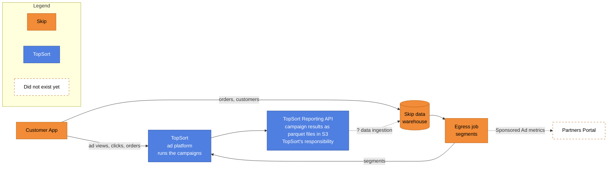

*Orange = Skip, blue = TopSort, dashed = did not exist yet. Dotted arrows show what was missing: how the results would get into Skip's data platform, and the data reaching the Partners Portal.*


**1.3 Why it mattered.** Without the data, partners could not see whether their ads worked (orders, spend, return), and Skip could not report the revenue the partnership generated.

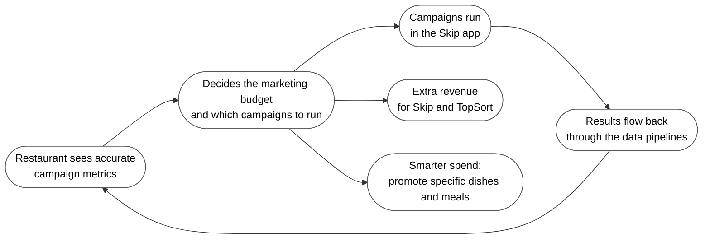


---

## 2. Task — The Obstacle/Problem

**2.1 The ask.** Use the data provided by TopSort to build a campaign performance dashboard in the Partners' Portal, with automated syncs so the reporting data is always available.

**2.2 The first requirements.**
1. Consume the parquet files that TopSort provides, from internal S3.


**2.3 How the scope grew.** The design changed several times as the project went on:


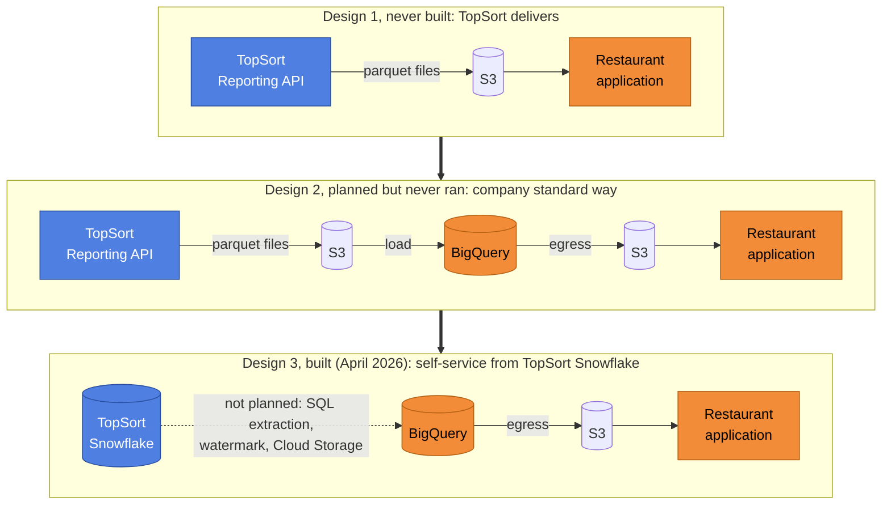

*Blue = TopSort, orange = Skip. The dotted arrow is the part nobody planned and I built.*

- **The design for getting reporting data to Skip changed twice, and the last design was handed to me when I joined.** The first design, made without data engineers, was for TopSort's Reporting API to write parquet files to S3 for the Restaurant application team. It was never built. 

    The second design brought in Skip's data engineers (requested, but no engineer had been assigned yet), the company's standard way: load the files from S3 into BigQuery, then export the processed data back to S3 for the Restaurant application. It was planned but never ran. 

    Then, in April 2026, TopSort introduced Snowflake as its data warehouse and single source of truth, and recommended that clients migrate to it and extract their data themselves. That became the third design, the one actually built. It was not planned, it changed how data had to be ingested, and it meant writing the extraction SQL and the pipeline myself (see [Decision 1](#decision-1)).

- **Customer segments to TopSort.** In February 2026, before I joined, it was decided to send customer segments (returning, winback, Skip Plus) to TopSort incrementally through the egress job, so campaigns could target specific customers. The alternative, building the integration in the customer application so Skip keeps the data and sends it through TopSort's documented API, was not taken (see [Decision 2](#decision-2)). The returned reporting data then had to carry the segment for each purchase.
- Restaurant promotion data from Skip's own app had to be combined with TopSort's data.
- A prototype semantic layer was added for self-service analysis.


**2.4 Constraints.** The launch was fixed for mid-July. The data must stay correct when TopSort delivers late or changes old rows. Customer-level data must be handled carefully, and the work had to be built end to end by one engineer.

---

## 3. Action — What I Did and Why

### 3.1 Architecture at a glance

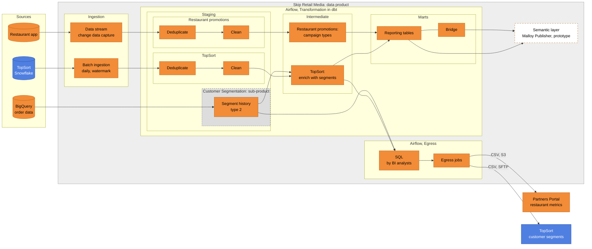

*Orange = Skip, blue = TopSort, dashed = prototype. Grey area = the data product, dotted outline = its sub-product.*

**The data product at a glance**

| | |
|---|---|
| **What it is** | The analytics data product for restaurant advertising on Skip: which restaurants run campaigns, what they spend, and whether the ads lead to orders. Canada only. |
| **Layers** | A cleaned layer of deduplicated tables, and a reporting layer of linked tables for analysts, the portal and the semantic layer. |
| **Freshness** | Refreshed daily. |
| **Owner** | The analytics engineering team. |
| **Data classification** | Internal business performance data. Aggregate metrics, with customers identified only by internal keys. |

**What I did, and the decision behind each step**

| Stage | When | What exists | What it leads to | Decisions&nbsp;&nbsp;&nbsp;&nbsp;&nbsp;&nbsp;&nbsp;&nbsp;&nbsp;&nbsp;&nbsp;&nbsp;&nbsp;&nbsp;&nbsp;&nbsp;&nbsp;&nbsp;&nbsp;&nbsp;&nbsp;&nbsp;&nbsp;&nbsp;&nbsp;&nbsp;&nbsp;&nbsp;&nbsp;&nbsp;&nbsp;&nbsp;&nbsp;&nbsp;&nbsp;&nbsp;&nbsp;&nbsp;&nbsp;&nbsp;&nbsp;&nbsp;&nbsp;&nbsp;&nbsp;&nbsp;&nbsp;&nbsp;&nbsp;&nbsp;&nbsp;&nbsp;&nbsp;&nbsp;&nbsp;&nbsp;&nbsp;&nbsp;&nbsp;&nbsp; |
|---|---|---|---|---|
| 1. Ingest and clean | May to June 2026 | TopSort's Snowflake, **batch ingestion, the TopSort staging layer** (deduplicate, then clean), the BI SQL and **egress jobs reading the clean tables** to the Partners Portal. | **Expose clean tables fast, so the BI team can proceed**. Links to [Decision 1](#decision-1). | 1. Built a daily extraction from TopSort's Snowflake **with a self-repairing watermark** ([Decision 1](#decision-1))<br/>2. **Advised** the BI team on the egress, and **on sources and schedules** ([Decision 2](#decision-2))<br/>3. Landed the **money values as text** and converted them to cents later ([Decision 9](#decision-9))<br/>4. **Set up the dbt** project for people and **for agents** ([Decision 10](#decision-10)) |
| 2. Ready for launch | June to mid-July 2026 | **Adds the stream and restaurant promotions staging**, the TopSort combined table, the **segment history table** (with its dotted sub-product box), and the intermediate layer. Egress delivers to the portal and to TopSort. | The launch. Links to [Decision 3](#decision-3), [Decision 4](#decision-4) and [Decision 5](#decision-5). | 1. **Reused the existing stream** and added 12 tables ([Decision 3](#decision-3))<br/>2.**Pushed SQL/Table** - the join of purchases and hourly metrics back **to TopSort** ([Decision 4](#decision-4))<br/>3. **Built my own customer segment history**, replacing TopSort's segments ([Decision 5](#decision-5)) |
| 3. After launch | After mid-July 2026 | **Adds the marts (reporting tables and bridge)**, the Malloy Publisher semantic layer, and the full data product box. This is the same as the 3.1 diagram. | Experimentation toward self-service and AI access. Links to [Decision 6](#decision-6) and [Decision 7](#decision-7), and [Decision 8](#decision-8) for time zones. | 1. Designed **a linked reporting layer with shared keys and a bridge** ([Decision 6](#decision-6))<br/> 2. Built a **semantic layer prototype** for self-service and AI access ([Decision 7](#decision-7))<br/> 3. **Advised keeping UTC**, and TopSort agreed to support time zones ([Decision 8](#decision-8)) |

*Greyed-out boxes do not exist yet at that stage.*

**Stage 1: Ingest and clean (May to June 2026).** The first objective was to expose clean tables fast, so the BI team could proceed. See [Decision 1](#decision-1).

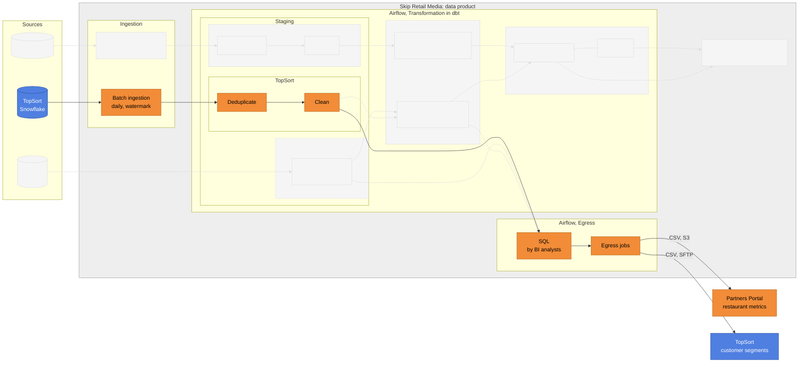

**Stage 2: Ready for launch (June to mid-July 2026).** The stream, the combined TopSort table and my own segment history were added. See [Decision 3](#decision-3), [Decision 4](#decision-4) and [Decision 5](#decision-5).

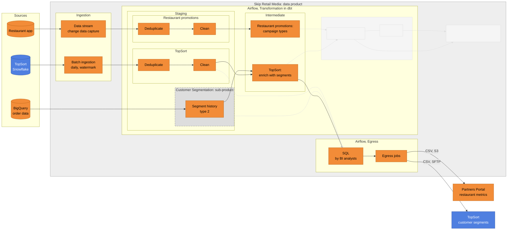

**Stage 3: After launch.** The linked reporting layer and the semantic layer prototype were added. See [Decision 6](#decision-6), [Decision 7](#decision-7) and, for time zones, [Decision 8](#decision-8).

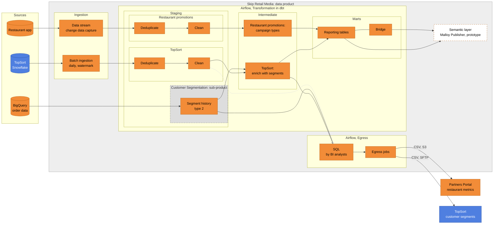

### 3.2 Key milestones and decisions

Each pivotal point changed the design, and led to the next one:

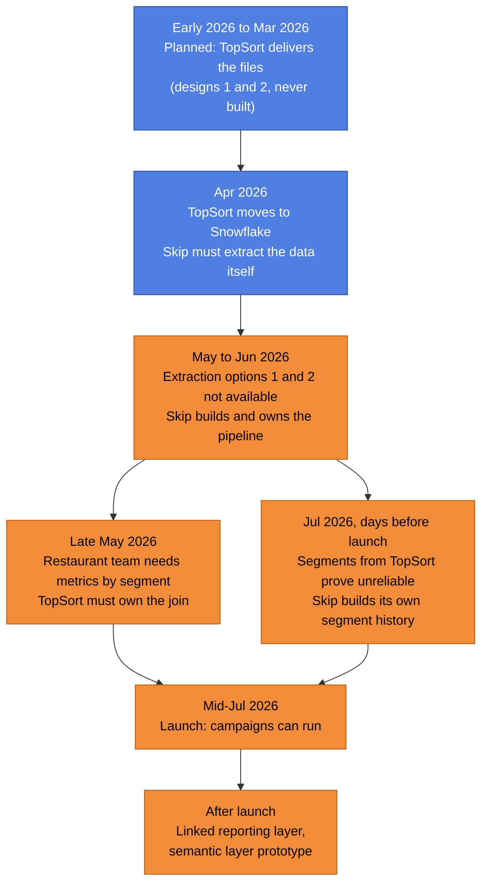

| When | Pivotal point | What it changed | Detail |
|---|---|---|---|
| Early 2026 | Design 1: TopSort's Reporting API delivers files to S3 | The starting plan. Decided without data engineers, never built. | |
| Feb to Mar 2026 | Design 2: Skip data engineers load the S3 files into BigQuery | The company's standard pattern. Planned, never ran. | |
| Feb 2026 | Customer segments are sent to TopSort incrementally through the egress job | Put customer data in the data team's hands, without full control of the exchange. TopSort documents a different way. | [Decision 2](#decision-2) |
| Apr 2026 | TopSort introduces Snowflake as its single source of truth | Skip must extract the data itself. This makes designs 1 and 2 obsolete. | [Decision 1](#decision-1) |
| Early May 2026 | I join the project | The extraction becomes my responsibility. | |
| May to Jun 2026 | Options 1 and 2 for extracting turn out not to be available | Skip data engineering builds and owns the pipeline: a watermark with a lookback window. | [Decision 1](#decision-1), [A.1](#a1-batch-ingestion) |
| Late May 2026 | Restaurant team asks for customers, purchases and amounts by segment | I push the join back to TopSort, which delivers the combined table (early July). Correctness is TopSort's. | [Decision 4](#decision-4) |
| Jun 2026 | I set up an agent-ready dbt project: folder structure, conventions in markdown files, and later automatic checks | Faster, more consistent development, especially of the properties files. | [Decision 10](#decision-10), [A.3](#a3-transformation-in-dbt) |
| Late Jun 2026 | First sandbox test: the amounts arrive in dollars, not in cents | Money values are extracted as text and converted to cents later, two weeks before production. | [Decision 9](#decision-9) |
| Jul 2026 | Restaurant portal team asks for related tables | I extend the existing stream with 12 tables and leave it with its owner. | [Decision 3](#decision-3), [A.2](#a2-stream-ingestion) |
| Jul 2026, days before launch | TopSort cannot provide reliable customer segments | I build my own segment history table. TopSort's segments are replaced. | [Decision 5](#decision-5), [A.3](#a3-transformation-in-dbt) |
| Mid-Jul 2026 | **Launch**, on the planned date | The product team's integration goes live and campaigns can run. The data side was ready, which I made possible. | |
| Aug 2026 | The BI analysts' egress queries switch to my segment history table | The more trusted source is used in both directions. | [A.4](#a4-transformation-in-the-legacy-system) |
| After launch | A linked reporting layer, with shared keys and a bridge | One data product, joined without custom queries. | [Decision 6](#decision-6) |
| After launch | A semantic layer prototype | Experimentation toward self-service and AI access. Still a prototype in a sandbox. | [Decision 7](#decision-7), [A.6](#a6-semantic-layer-prototype) |
| Recently | Discussion on moving the reporting to Pacific time | I advised keeping UTC and asking TopSort to support time zones in its budget distribution. TopSort agreed to implement it. | [Decision 8](#decision-8) |
| Sep 2026 | Documentation of the data products | Product pages, architecture diagram and this document. | |

### 3.3 Components (each is a deep dive)

| Component | One-line summary | Deep dive |
|---|---|---|
| Batch ingestion | Daily extraction of TopSort's data from Snowflake into BigQuery, with a watermark that repairs itself | [A.1](#a1-batch-ingestion) |
| Stream ingestion | Continuous copy of the restaurant application's promotion and campaign data, extended with 12 tables | [A.2](#a2-stream-ingestion) |
| Transformation (dbt) | Deduplicate, clean and enrich the data, keep the customer segment history, and expose linked reporting tables | [A.3](#a3-transformation-in-dbt) |
| Transformation (legacy system, for egress) | SQL queries by the BI analysts that shape the files for the restaurant portal and TopSort | [A.4](#a4-transformation-in-the-legacy-system) |
| Data egress | built and owned by the BI analysts; I advised on sources, schedules and filter windows | [A.5](#a5-data-egress) |
| Semantic layer (prototype) | prototype on a sandbox Cloud Run, work in progress due to infrastructure challenges | [A.6](#a6-semantic-layer-prototype) |

---

## 4. Result — Outcome and Learning

**4.1 Outcome.** The project launched on time in mid-July. The visible result is a feature in the Partners' Portal that shows restaurants accurate data about their ad campaigns. This matters because it lets a restaurant decide how much to put into its marketing budget, which campaigns to launch, and how to review how effective each one is on the key metrics:

| Group | Metrics |
|---|---|
| Money | Revenue (promoted sales), total ad spend, cost per order, cost per click, return on ad spend, average order value |
| Reach and response | Impressions, charged clicks, click-through rate, conversion, orders |
| Who bought | New, returning, winback and Skip Plus customers |

The cycle keeps running: restaurants spend more marketing budget, which brings extra revenue to Skip and TopSort, and they spend it more wisely, for example by promoting specific dishes and meals. The system is running and generating additional income for the company.

**Scale, without business numbers.** One daily batch pipeline loads four TopSort tables. One existing stream was extended with 12 tables. Four daily dbt jobs build nine linked reporting tables and a bridge, plus a customer segment history table. Ten decisions in this document shaped the design, and a semantic layer prototype sits on top.

**4.2 Were the objectives met?** Yes, all of them:

| Objective | Result |
|---|---|
| A campaign performance dashboard in the Partners' Portal | ✅ restaurants see their campaign metrics in the portal. |
| Automated syncs, so the data is always available | ✅ the pipelines run daily, and catch up on their own after a missed run. |
| Times shown in the partner's local timezone | ✅ local timestamps are carried through every layer next to the UTC ones. |

The way of getting the data changed on the way, from files delivered by TopSort to extraction from TopSort's Snowflake, but the objectives did not.

A recent discussion on moving the reporting to Pacific time ended with TopSort agreeing to support time zones in its budget distribution (see [Decision 8](#decision-8)).

**4.3 What I learned.**

*Project execution and cross-functional collaboration*

The conditions of this project were set before I joined: the early design decisions, no business analyst on the team, and a fixed launch date. These are the lessons I take from working within them.

1. **Bring data engineering in early, and write the requirements down.** Data engineers need to join before any decision that is hard to reverse. Every data requirement should be documented, and a business analyst should be part of the project. On this project the involvement came later, and several of the pivotal points in 3.2 followed from that.
2. **Inside a project, roles matter, titles do not.** There is no reporting hierarchy in a project team. A data engineer can be the business analyst or the project leader, and a manager can be invited in whatever role the project needs, for example subject matter expert, analyst or coordinator. If the project needs a task done by that person, the project's need decides, not the org chart. This is a change of behavior, and the project's success depends on it.
3. **Contribute, do not hand over tickets.** The mindset "how can I help the team" works better than a customer and supplier relationship between teams ("I submit a ticket, you do it").
4. **Treat third-party vendors as members of the cross-functional team.** A vendor treated only as a vendor creates friction and hidden problems, which delay the project. Hiding problems and a lack of transparency also damage the team's morale.
5. **Decide as a team, and fix the root cause.** Decisions in a meeting are made by the team, with everyone clear about what each side concedes, and without pushing work onto one team. Boundaries are respected. When something is wrong, the core issue is resolved, not covered with a quick patch.
6. **Run the project from one shared folder, and start every meeting with an agenda.** The folder holds: incoming communication and files, outgoing communication and files, organisational documents (hypothesis, plan, scope, deliverables), meeting notes and agendas, and results. Automatic note-taking helps, but what is most often missing is an agenda prepared before the meeting, shared in advance and shown on screen, with the decisions, the reasons, the owners and the next steps recorded in front of everyone.
7. **It is fine not to know.** Admitting "I don't know how to solve this" in front of a group can feel uncomfortable, but the leader's role is to bring everyone together: connect with the team that can help, or find someone who can, with clear assignment of resources and support.

*Technical*

1. **Make every load safe to repeat.** A watermark with a lookback window, deleting the overlap, and an all-or-nothing load mean a failed or missed run repairs itself, and nobody backfills by hand (see [Decision 1](#decision-1)).
2. **Keep history, not only today's state.** The segment history table (type 2) keeps what cannot be rebuilt later (see [Decision 5](#decision-5)).
3. **Test a vendor's logic before relying on it.** Porting TopSort's SQL and checking that the results were identical was cheap, and it paid off when TopSort's segments proved unreliable.
4. **Build joins once, not in every report.** Shared keys and a bridge let analysts and the semantic layer combine any tables without custom queries (see [Decision 6](#decision-6)).
5. **Reuse what exists.** Extending an existing stream is faster and safer than building a second one (see [Decision 3](#decision-3)).
6. **Agree column types in writing, and test with real data before building on them.** Where a number's format is uncertain, land it as text and convert it once it has landed, so a wrong assumption cannot cut or distort the data (see [Decision 9](#decision-9)).
7. **Write conventions where tools can read them.** When the rules live in files that an agent loads, and automatic checks enforce them, development is faster and more consistent (see [Decision 10](#decision-10)).

**4.4 Where I have used this learning since.** I apply the collaboration and project execution lessons as a habit on the projects I work on. The technical lessons that proved useful here, I continue to use.

---

# Appendix A — Deep Dives

Each deep dive follows the same pattern: **What it does → How it works (verified technology) → Decisions and trade-offs → What I changed.**

## A.1 Batch ingestion

[↑ Back to the summary](#summary)

**What it does:** every day it copies TopSort's campaign reporting data from Snowflake into BigQuery, so Skip's analytics and the partner dashboard always have fresh numbers.

**Schedule:** every day at 06:00 UTC. I verified the loaded BigQuery data against Snowflake, and checked the time at which TopSort refreshes its data (in UTC), before fixing this schedule.

**Repository layout (conceptual).** One folder per source, driven by configuration. Adding a table means one entry in the table list, one SQL file and one schema file:

```text
topsort pipeline/
├── dag definition       one file that builds the tasks for every table
├── schedule and defaults    schedule, retries, alerts
├── table list           per table: SQL file, partition column, watermark column, lookback days
├── sql/                 one extraction query per table
└── schemas/             BigQuery schema per table
```

**Technology:** Apache Airflow runs the job. Data moves from Snowflake to Google Cloud Storage as compressed JSON files, and then into BigQuery. The SQL queries and the whole DAG are my work. A small custom operator that reads from Snowflake and writes to Cloud Storage was built by the platform's batch-ingestion team.

**Where the work runs.** Airflow is the scheduler: it decides *what* runs and *when*. The actual work runs on Kubernetes, a system that starts a small, short-lived container (a "pod") for each task, gives it a fixed amount of CPU and memory, and removes it when the task finishes. Each daily run therefore starts pods that extract from Snowflake, write the files to Cloud Storage, and load them into BigQuery. Nobody keeps a server running between runs.

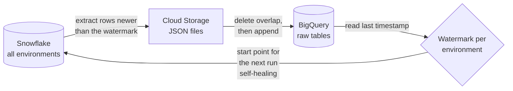

**The problem with the first version.** The first version (a prototype from another team) re-loaded a fixed window of recent days every run. That is simple, but it cannot tell when TopSort changes old rows or delivers data late. I considered reusing that approach as it was (not reinventing the wheel) and chose the watermark instead.

**My approach: a watermark with a lookback window.**
- The *watermark* is the newest timestamp already in BigQuery. Each run asks Snowflake only for rows newer than that.
- The *lookback window* moves the start back by a few days, so recent rows are fetched again and replaced. This catches late and corrected data.

| Table type | Lookback | Why |
|---|---|---|
| Hourly behavior summary | 2 days | TopSort can report an hour up to 24 hours late. |
| Purchase attribution, and behavior with segment purchases (the combined table from [Decision 4](#decision-4)) | 13 days | In a dedicated meeting, TopSort explained that it rewrites customer-segment columns every night for purchases up to 11 days old, and the timestamp does not change. I added 2 days of buffer: 11 + 2 = 13. |
| Vendors (small reference table) | whole table | Replaced fully every run. |

**What the "window" is.** For each table, the start of the window is:

> the newest timestamp of the *slowest active environment* already in BigQuery, minus the lookback days

and the window has no end: it reaches up to the latest data in Snowflake. Example: if the slowest environment is loaded up to 20 June and the lookback is 13 days, the run fetches everything after 7 June.

**Design decisions in this pipeline**

1. **One watermark per environment.** The Snowflake tables hold records of several environments (sandbox, staging and production) side by side, told apart by a marketplace ID. While we tested in staging and sandbox, those environments received new records at different times. A single global newest timestamp would have skipped records of any environment that was behind, so each environment gets its own newest timestamp and I use the *oldest* of them as the start point. After go-live only production received new records, and the other environments stopped. Their old timestamps would have pulled the start point back by months and forced a huge re-read on every run, so environments with no data for 30 days (and rows with no ID) are ignored.
2. **Self-healing.** The start point is always read from what is *already in BigQuery*, not from a calendar. If the DAG does not run for a few days (an outage, a pause, a failure), the next run starts from where the data stopped and catches up in one go. Nothing has to be re-run by hand.
3. **Delete the overlap, then append.** Before loading, the overlapping window is deleted from BigQuery and the fresh rows are appended. Re-running the job never creates duplicates.
4. **No data loss by design.** See the next section.
5. **Whole-table refresh for small reference data.** A very large lookback value (9,999 days) turns the same code into a full refresh. No second code path is needed.
6. **No file, no change.** If Snowflake returns no rows, no file is written and BigQuery is left untouched.
7. **Money values land as text.** TopSort's amounts arrived in dollars, not in cents as first agreed, and storing them as integers cut the decimals. They are now extracted and stored as text, and converted to cents in the dbt clean layer (see [Decision 9](#decision-9)).

**Why no data is lost.** The pipeline does not need a backup copy of the table, because Snowflake always still holds the original rows and every step can be repeated safely:

1. **One shared boundary.** The watermark is saved once, in a one-row helper table. The Snowflake extract and the BigQuery delete both read that same value, so the rows removed are exactly the rows that are re-fetched.
2. **Nothing is deleted without replacement.** If Snowflake returns no rows, no file is written, the check for the file soft-fails, and every later step (including the delete) is skipped.
3. **The delete only happens after the new file is safely in Cloud Storage.** The file stays there until the load succeeds and is removed only afterwards.
4. **The load is all-or-nothing.** A BigQuery load job either adds all rows or none (bad records are not tolerated), so the table never holds half a batch.
5. **Retries are safe.** A failed load is retried automatically (up to 2 times) from the file that is still in Cloud Storage.
6. **A failure between delete and load repairs itself.** The next run reads the watermark again from the rows that are left. Because the window was deleted, the watermark is now earlier, so the next run fetches the missing window again from Snowflake.

The cost is a short period (minutes) in which the window is missing from BigQuery if a run fails midway. A temporary staging table and a swap would remove that gap, but would double the writes for every run. I accepted the short gap.

**One run, step by step, with the safeguards (numbers match the list above):**

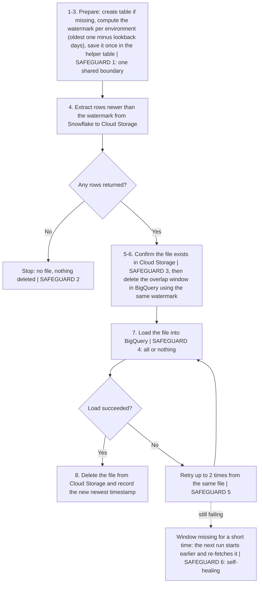

**Trade-off accepted:** each run re-reads and rewrites a few days of data. That costs extra compute and storage writes, in return for correct numbers when data arrives late or is corrected.


## A.2 Stream ingestion

[↑ Back to the summary](#summary)

**What it does:** it continuously copies the restaurant application's promotion and campaign data into BigQuery, so it can be combined with TopSort's reporting data. Batch ingestion brings the ad results in. This stream brings in what the restaurant application itself knows: which campaigns, vendors, budgets and promotions exist, and the campaign metrics shown to partners.

**Technology:** Google Cloud Datastream, a change-data-capture service. It reads the change log of the application's MySQL database and writes every change to BigQuery in append-only mode, so history is kept and nothing is overwritten. The stream is defined in one YAML file in a shared repository, with these settings: data is at most 5 minutes old (`data_freshness: 300s`), existing rows are backfilled when a table is added, the stream starts in the running state, and failures alert a team channel.

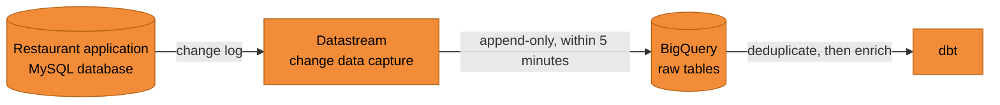

**What I changed.** I did not build this stream. The restaurant portal team asked me to ingest several related tables. Before starting, I researched how this had been done before and found that this stream already existed and was owned by the domain team that owns the restaurant promotion pipelines globally. I extended it with a small pull request: in July 2026, before the launch, I added 12 tables (see [Decision 3](#decision-3)):
- campaign setup: the corporate campaign, its restaurants and promotions, and the vendors;
- sponsored ad and its budget;
- the campaign metrics tables (hourly, daily, weekly, monthly);
- partner credits.

The campaign metrics tables hold numbers calculated by the egress job (see [A.5](#a5-data-egress)) and written to the restaurant application. The restaurant team asked for them to be brought back into BigQuery. It was later confirmed that this data was redundant, but at the time it was the request.

**Why it matters for the design.** Because the stream is append-only, a row can arrive many times as it changes. The dbt layer must therefore deduplicate it before use (see [A.3](#a3-transformation-in-dbt)).

## A.3 Transformation in dbt

[↑ Back to the summary](#summary)

**What it does:** it turns the raw ingested data into clean, trusted reporting tables that analysts and the Partners Portal can use: campaigns, vendors, budgets, ad performance, attributed purchases, and customer segments.

**Technology:** dbt Core 1.8 with the BigQuery adapter. The models are scheduled by the company's dbt scheduler on Airflow, with automatic tests after each model and up to 3 retries. I wrote the retail media and customer segmentation models.

**How I built it.** Providing data to the restaurant application was the priority. So batch ingestion came first. Once the data had landed in BigQuery I checked it against Snowflake, and I then moved to dbt. The first objective was to produce the first clean tables as fast as possible and expose them in the clean data lake, so the BI team could continue with the egress job. I followed the company's legacy standard of a *staging* folder with two steps: **deduplicate** (a row-number function keeps one copy of the same data) and **clean** (minimal transformation only). Richer logic came afterwards.

**Repository layout (conceptual).** The folders mirror the layers:

```text
models/
├── customer segmentation/
│   └── staging/             segment history tables
└── retail media/            the data product
    ├── topsort/
    │   ├── staging/         deduplicate, then clean
    │   └── intermediate/    enrich with segments
    ├── restaurant promotions/
    │   ├── staging/         deduplicate, then clean
    │   └── intermediate/
    └── reporting/           reporting tables and the bridge view
seeds/ and tests/            test data and data tests
```

**Layers.** Each layer has one job, so a problem can be found in one place:

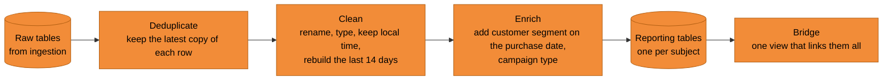

| Layer | What happens | Why |
|---|---|---|
| Deduplicate | Keeps the most recently ingested copy of each row. | Both the stream (append-only) and the batch pipeline (which re-loads a window) can deliver the same row more than once. |
| Clean | Renames and types the columns. Keeps both UTC and local timestamps. Converts the money values, which arrive as text in dollars, to numbers in cents. Rebuilds only the last 14 days, partition by partition. | Cost and speed: old days are not rebuilt. 14 days covers the 13-day lookback of the ingestion, plus one day. |
| Enrich | Adds the customer segment that was valid on the day of the purchase (returning, winback or Skip Plus, using the valid-from and valid-to dates), and the campaign type (corporate or individual). | Ad performance can then be split by customer type as it was at the moment of purchase. |
| Reporting tables and bridge | One table per subject, plus a bridge view that links every table through shared keys. | It fixes double-counting, because joining tables directly can duplicate rows and break totals. It also gives one standard way to join, so every report matches. This follows the *Unified Star Schema* idea. |

**Materialization.** The restaurant promotion models are views, the TopSort models are incremental (only recent days are rebuilt, for cost), and the reporting tables are tables in the reporting dataset.

**Metrics exposed.** Revenue (promoted sales), orders, ad spend, impressions, charged clicks, click-through rate, conversion, cost per order, cost per click, return on ad spend, average order value, and new, returning, winback and Skip Plus customers. They are defined once in the semantic layer prototype (see [A.6](#a6-semantic-layer-prototype)).

**Local time.** The source tables already carry the local timestamps (hour and purchase time in the partner's local time) next to the UTC ones, and the models pass both through. This covers the original requirement to show times in the partner's local timezone.

**Daily run order (UTC).** I chose these times myself, based on when TopSort refreshes its data and how long each step takes. Each step starts after the one before it, so the reporting tables never use half-updated inputs:

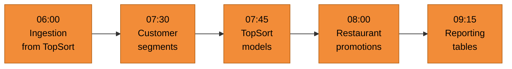

### Building dbt with an agentic workflow

I set up the dbt project so that people and an AI coding agent follow the same conventions. It was my own idea, in June 2026, once Claude was available. I built the first models, then the folder structure, then wrote the markdown files from what each iteration taught me. Pre-commit checks, SQL linting and naming checks came later.

```text
dbt project/
├── CLAUDE.md                         project memory, loaded at the start of every session
└── .claude/
    ├── settings.json                 shared permissions: what may run, what must never run
    ├── settings.local.json           personal overrides, not shared
    ├── rules/
    │   ├── sql-conventions.md        applies when a .sql file is edited
    │   ├── yaml-conventions.md       applies when a .yml file is edited
    │   └── dimensional-model-conventions.md   how to build dimension and mart tables
    ├── agents/
    │   └── sql-reviewer.md           a read-only reviewer, started on demand
    └── skills/
        └── develop/SKILL.md          a step-by-step recipe, run as the /develop command
```

| File | Purpose | How Claude Code uses it |
|---|---|---|
| `CLAUDE.md` | The team, the stack, commands, naming, quality gates, git workflow and off-limits folders. | Loaded automatically at the start of every session, so the agent knows the project before the first question. |
| `rules/` | Detailed conventions, one file per topic. | Loaded only when needed, for example the SQL rules when a `.sql` file is touched. This keeps the context small. |
| `agents/sql-reviewer.md` | A senior reviewer with read-only tools. It checks style, tests, naming and documentation, and reports errors, warnings and suggestions. | Started as a separate helper when a review is asked for. It cannot edit files. |
| `skills/develop` | A six-step recipe to scaffold a new staging model: ask for the source metadata, confirm the folder, create the SQL, create the properties file, run the checks, report. | Run as `/develop <source> <entity>`. It follows the steps in order and asks the developer at set points. |
| `settings.json` | Allows safe commands (dbt, linting, read-only git) and denies dangerous ones (`rm -rf`, force push). | Applied automatically, so the agent works without constant approval prompts and cannot do damage. |

**The naming and layer rules the agent follows**

| Layer | Prefix | Rule |
|---|---|---|
| Staging | `stg_` | Reads from `source()`; one-to-one with the source. |
| Intermediate | `int_` | Reads from `ref()`; lives under `intermediate/`. |
| Marts | business entity name | Gold tier; tables joined through `_key_` columns. |
| Keys | `_key_` | Surrogate key, generated by a macro, never `<entity>_id`. |

**Examples of key rules**
- Every model needs a properties file and at least two tests.
- No hardcoded table names: only `ref()` or `source()`.
- Never commit directly to the main branch.
- SQL style: uppercase keywords, lowercase names, explicit table aliases, CTEs instead of subqueries.
- Dimension tables are materialized as tables, never incremental, and their descriptions are persisted to BigQuery.

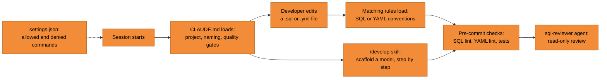

**What it changed in practice.** It sped up the properties files significantly: test and column descriptions became much easier and faster to write. It also captured best practices through the iterations (see [Decision 10](#decision-10)).

### How the dbt project took shape

1. **TopSort models first.** One folder with the TopSort models (deduplicate, clean, enrich up to the *intermediate* level). The BI analysts' egress job read exactly these intermediate tables. I did not own the egress job, so I made only small changes to cover the gap and advised the BI team to make the rest. Shortly after, I added the Skip Plus membership segment.
2. **Restaurant promotion models next.** A second folder with the data from the stream, so it was available for reporting.
3. **One umbrella, one data product.** I placed both folders under one parent, *retail media*, purely logically, so they form one data product. This is where I decided how to synchronize the runs (see the daily run order).
4. **Reporting layer last.** After the intermediate layer was done, I built the reporting tables and the bridge on top (see the decisions below and [Decision 6](#decision-6)).

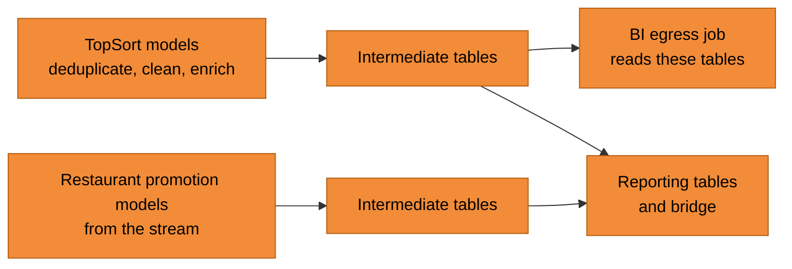

### Customer segment history (type 2 table)

**What it is.** One row per customer and restaurant for each period in which that customer had the same segment, with a start date and an end date. An open row (end date empty) is the current segment. Because history is kept, a purchase can be matched with the segment the customer had *on the day of the purchase*.

| customer | restaurant | segment | valid from | valid to |
|---|---|---|---|---|
| C1 | R1 | returning | 15 Jun | 20 Aug |
| C1 | R1 | winback | 21 Aug | *(open)* |

**How a daily run works.** There is no loop in the code. A generated list of days does the same job in one query, in four steps:

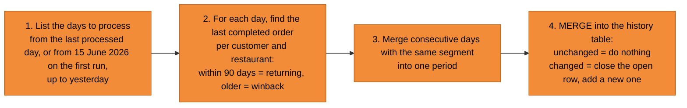

The decisions behind these four steps, and how each is implemented:
1. **For each day, find each customer's last completed order per restaurant.** Within 90 days is "returning", older is "winback".
2. **Merge consecutive days with the same segment into one period.** A customer is stored once per period, not once per day.
3. **Compare with the history table.** If the segment is unchanged, do nothing. If it changed, close the open row and insert a new one.
4. **If a run is missed, the next one catches up automatically**, because step 1 starts from the last processed day. A first run fills the whole history.

**Why a hand-written MERGE and not the dbt snapshot feature.** I had not used snapshots before, and I needed manual control of how the SQL runs.

**Better source data.** The legacy segment queries read a BI-owned staging table of orders, built by a daily finance staging job, and in practice it refreshed late (about 2 days), so recent orders were still not marked completed and customers were wrongly left out of segments. They also worked in local time. The history table reads the order table of the company's core data warehouse, which is the organization's single source of truth and is refreshed often, keeps only orders with status completed, and uses UTC dates, as TopSort and Skip systems do.

**Where it is used.** The dbt enrich layer replaces the segments provided by TopSort with this table, and the BI analysts' egress job later switched to it as its source, as a more trusted one (see [Decision 5](#decision-5)). A separate model keeps the Skip Plus membership periods, rebuilt in full on each run.

## A.4 Transformation in the legacy system

[↑ Back to the summary](#summary)

**What it does:** it shapes the data into the exact files that leave Skip, in both directions: campaign metrics for the restaurant portal, and customer segments and a restaurant-to-chain mapping for TopSort. These are SQL queries in the company's legacy query framework on BigQuery, which hands the results to the egress jobs (see [A.5](#a5-data-egress)).

**Ownership.** The BI analysts own and wrote almost all of it. My changes were small, to cover a gap: I rewired the queries from the *staging* tables to the *intermediate* tables, which was needed to use Skip's own customer segments and not the ones provided by TopSort. I advised the BI team on the rest. The history shows only one or two commits from my team per query set, against many from BI.

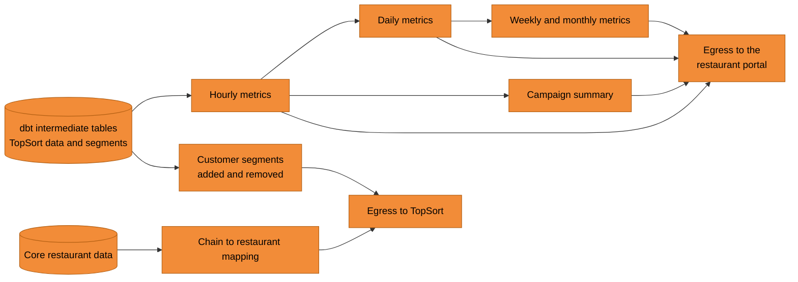

| Query set | Schedule (UTC) | What it does |
|---|---|---|
| Customer segments | daily, 08:00 | Sends only the *changes*: customers added to a segment and customers removed from it, since the last successful delivery. |
| Daily, hourly and campaign-summary metrics | daily, 08:15 | Aggregates the TopSort metrics and counts customers by segment (new, returning, winback, Skip Plus), for production only. |
| Weekly metrics | Mondays, 09:00 | Same, per week. |
| Monthly metrics | 1st of the month, 09:00 | Same, per month. |
| Chain mapping | on demand | Which restaurants belong to which chain, from the core restaurant data, for Canada and for online restaurants only. |

**Design points visible in the queries**
1. **Production only.** TopSort's data holds sandbox, staging and production records together. The BI team applied a filter that keeps only the production marketplace, at the request of the Restaurant Product team, so test data never reaches partners.
2. **Rebuilt in full each run.** The metrics tables are wiped and recreated each run over a moving window. A stored watermark moves forward only to *yesterday*, so incomplete days are never sent.
3. **Catch-up and duplicates.** If the data arrives late, a later run re-sends the missed days in one go. The restaurant team removes duplicates on their side.
4. **Warning when yesterday is missing.** A check after each run warns if there are no rows for yesterday.
5. **Segments sent as changes.** For each segment, the query compares today's list with the list at the last *successful* delivery (it reads the egress job's own delivery record), so a failed day is repaired automatically on the next run. The list itself comes from the segment history table (see A.3).

## A.5 Data egress

[↑ Back to the summary](#summary)

**What it does:** it delivers the prepared files out of BigQuery, in two directions:
- to the **restaurant portal**: campaign metrics (hourly, daily, weekly, monthly), and the chain names, as CSV files in an S3 bucket;
- to **TopSort**: customer segment changes (added and removed customers, per segment) and the restaurant-to-chain mapping, as CSV files on an SFTP server.

**Technology:** the company's egress service on Airflow. Its rule is that egress is a *transfer only*: every transformation must be done upstream, in the legacy query jobs (see [A.4](#a4-transformation-in-the-legacy-system)). Each table exported has its own job, so a failure can be recovered one table at a time. Each job waits for its source table through the company's orchestrator, which starts it only when the upstream table is ready.

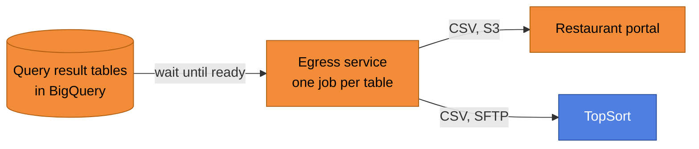

**Repository layout (conceptual).** One configuration file per target, one entry per exported table:

```text
egress config/
└── team/
    ├── s3/        restaurant portal: one entry per table, for dev, staging and production
    └── sftp/      TopSort: one entry per file
```

**Design points visible in the configuration**
1. **Separate environments.** The restaurant portal jobs have a dev, a staging and a production version, each with its own connection, bucket and source table, so a test never reaches production.
2. **One file per run, with a timestamp in its name.** Files are never overwritten, so the receiver can pick them up and de-duplicate safely.
3. **Triggered by data, not by a clock.** The jobs have no schedule of their own. They start when their source table is ready.

**My role.** The egress jobs are built and owned by the BI analysts. I advised the team on which sources were ready to use, which schedules the upstream jobs run on, and which window to use when filtering.

**Why egress is separate from ingestion.** The platform separates ingestion (into BigQuery) from egress (out of it), and egress belongs to the BI side. This is the rule behind the limit described in [Decision 1](#decision-1), option 2.

## A.6 Semantic layer prototype

[↑ Back to the summary](#summary)

**Status:** a prototype, published to a sandbox Cloud Run service. It is still work in progress because of infrastructure challenges.

**What it is for:** the metrics (revenue, orders, ad spend, impressions, clicks, click-through rate, conversion, cost per order, cost per click, return on ad spend, average order value, and customers by segment) are defined **once**, in a *semantic layer*, so that every report, analyst and AI assistant calculates them the same way and gets the same number.

**Intended users:** BI analysts and the product team, for self-service. Business users may follow later (not yet clear). AI agents access the semantic layer too.

**Technology:** Malloy, an open semantic modelling language, served by the Malloy Publisher. The Publisher runs as two Cloud Run services created with Terraform: a UI to browse the models, and an MCP server that lets AI agents query the data. Data is read from the reporting tables in BigQuery.

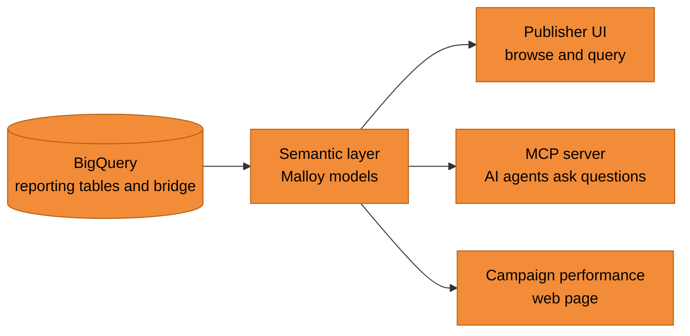

**How the models are organized.** Four layers, each with one job:

| Layer | What it holds |
|---|---|
| Raw views | The connection to the BigQuery tables. |
| Refinements | One model per table, with field descriptions, renamed keys and the measures. |
| Explores | One entry point built on the **bridge** and joined to every table through the `_key_` columns. |
| Analysis | Ready-made queries, such as the daily, weekly and monthly metrics that the restaurant portal receives. |

This is why the shared keys and the bridge ([Decision 6](#decision-6)) matter: the semantic layer joins every table through them, so users never write a join.

**Infrastructure challenges (from the deployment history).** Several steps were needed to deploy safely inside the company's cloud rules:
- the region had to be changed to match the network connector;
- permissions had to be reworked, for example BigQuery jobs were routed through a development project, and the failing cross-project permissions were removed;
- access to the UI went through several attempts: open to all traffic with IAM and a proxy, then back to internal-only because of an organization policy, then allowing an internal load balancer.

---

# Appendix B — Decision Log

Each decision follows the same pattern: context, options considered, choice, why, and the trade-off accepted.

### Decision 1

[↑ Back to the summary](#summary)
**Build the extraction from TopSort's Snowflake, and how**
- **Context:** I joined at the beginning of May 2026, after earlier decisions had been made. TopSort's reporting data was planned to arrive as files, but in April 2026 TopSort introduced Snowflake as its data warehouse and single source of truth, and recommended that clients migrate to it and extract their data themselves. The launch date stayed fixed. I had never worked with Snowflake before, so I researched it and found that the data can be exported to S3 and that the export can be scheduled with a Snowflake task, which needs SQL code.
- **The decision to extract from Snowflake was not mine:** it followed TopSort's recommended practice. The decision that was mine was *how* to build it. I tried three options in order of least work for Skip:

| # | Option | Who does the work | What happened |
|---|---|---|---|
| 1 | TopSort schedules the export itself: a Snowflake task writes the files straight to the S3 bucket where they are needed. I offered to help write the code. | TopSort | Creating the task needs admin rights in TopSort's Snowflake, which I did not have. TopSort's data team preferred that Skip handles the extraction. |
| 2 | Extract programmatically with the batch ingestion platform, writing to two places: Cloud Storage (in case the data is later needed in BigQuery; nobody knew yet, and the first priority was supporting the restaurant team) and S3 directly. | Skip data engineering | Needed a new connection to an S3 bucket. The platform's rule is that batch ingestion is for ingestion, while exporting to S3 is egress, which belongs to BI, so this was not possible. |
| 3 (chosen) | Batch ingestion extracts into Cloud Storage and BigQuery, and the existing egress job exports to S3. | Skip data engineering | Works inside the platform's rules. The BI analysts own the egress job and I advised them (see [A.5](#a5-data-egress)). |

- **Choice:** Option 3, with the pipeline described in [A.1](#a1-batch-ingestion): SQL extraction, a watermark with a lookback window, Cloud Storage as staging, BigQuery as the target.
- **Why:** The extraction from Snowflake followed TopSort's guidance. Options 1 and 2 would have meant less work for Skip, but were not available. Option 3 was the one that could be delivered inside the rules and before the launch.
- **Trade-off accepted:** Skip owns the extraction, the SQL and any change at the source, and the data takes two hops (Snowflake to BigQuery, then BigQuery to S3), where option 1 would have been a single export owned by TopSort.
- **What I learned:** About three months later the owners of the platform confirmed that batch ingestion can do this kind of export (rules for confidential data might still apply), but by then the design was fixed. Lesson: check how a platform rule is interpreted with the platform's owner early, before redesigning around it.

### Decision 2

[↑ Back to the summary](#summary)
**Send customer segments to TopSort through the egress job**
- **Context:** TopSort's engine needs to know which customers belong to which segment (returning, winback, Skip Plus) to target them. In February 2026, before I joined, it was decided that Skip would send this data to TopSort as incremental files through the egress job, without developing the integration in the customer application.
- **Options considered:** (1) incremental files through the egress job (chosen); (2) TopSort's documented Segments API, called from Skip's own application, so the company keeps the data and the exchange is a reliable API call. See [TopSort Segments API](https://docs.topsort.com/en/ad-server/additional-apis/segments-api) and [segments setup](https://docs.topsort.com/en/knowledge-base/ad-platform/campaign-targeting/segments/setup).
- **Choice:** Option 1.
- **Why:** Decided before I joined, reasons not known to me.
- **Trade-off accepted and what I would do differently:** The data team became responsible for sending customer data to a third party, without full control of the exchange. With hindsight, a stronger design is for the customer application to send the segments through TopSort's documented API, so that Skip keeps the data and the exchange is a reliable API call.

### Decision 3

[↑ Back to the summary](#summary)
**Reuse and extend the existing stream for the restaurant data**
- **Context:** The restaurant portal team needed several related tables in BigQuery. Researching how this had been done before, I found a change-data-capture stream that already carried restaurant promotion data. It was owned by the domain team responsible for restaurant promotion pipelines globally. I belong to a different team.
- **Options considered:** (1) build a similar stream and have my team own it; (2) add the tables to the existing stream through a small pull request and agree ownership with the owning team.
- **Choice:** Option 2. The owning team approved the pull request and kept ownership.
- **Why:** It was the simplest, fastest and most reliable path, and it avoids duplicating something that already exists (not reinventing the wheel).
- **Trade-off accepted:** My team depends on another team's stream, including its release process and priorities. In return there is no second pipeline to build, run and monitor, and the result arrived with almost no effort.

### Decision 4

[↑ Back to the summary](#summary)
**Who owns the join between purchases and hourly metrics**
- **Context:** Two TopSort tables were agreed for ingestion. The first lists purchases and the customer segment each purchase belongs to, for a specific restaurant (one row per purchase line). The second holds hourly metrics per partner: impressions, clicks and charged clicks. In late May 2026 the restaurant team asked for more: the number of customers and purchases, and the purchase amount, by customer segment, aggregated per day, week and month. That meant combining the hourly metrics with the segmented purchases.
- **Options considered:** (1) Skip's data engineers write the join themselves; (2) TopSort gives us the SQL for the join; (3) TopSort delivers the combined table in its Snowflake, and we only consume it.
- **Choice:** I pushed back to TopSort and asked for both: the SQL for the join, and the combined table delivered in Snowflake. TopSort delivered it as a new table (hourly behavior summary with segment purchases), which I added to the batch ingestion and then to the dbt models.
- **Why:** We are not experts in TopSort's platform, so we could not guarantee that the two tables are linked correctly. The correctness of the data had to be TopSort's responsibility.
- **Evidence the risk was real:** TopSort's own description of the join was revised once, in July 2026, so that segment categories apply to the partner that received the attribution. Before, a customer's returning segment for one partner could be counted on purchases of another.
- **Trade-off accepted:** Skip depends on TopSort to deliver and maintain the table, and on its timing, and has less control over the logic. In return the accountability is clear and Skip does not own a join it cannot verify.

### Decision 5

[↑ Back to the summary](#summary)
**Build our own customer segment history instead of using the segments from TopSort**
- **Context:** TopSort sends, with every purchase, the list of segment names the customer belonged to, and the partner is hidden inside the name text. I ported TopSort's own SQL into a dbt staging model and tested it: the results were identical to TopSort's. A few days before the launch it turned out that TopSort could not provide correct segments. The formula needed to read them out is complex, and joining the vendor table to improve it did not help much:

```sql
MAX(IF(
    TRIM(SPLIT(asf.user_segment_name, '-')[SAFE_OFFSET(0)]) = 'winback'
    AND (
        REGEXP_EXTRACT(
            asf.user_segment_name,
            r'[0-9a-f]{8}-[0-9a-f]{4}-[0-9a-f]{4}-[0-9a-f]{4}-[0-9a-f]{12}'
        ) = v.external_vendor_id
        OR asf.string_vendor_id = v.string_vendor_id
    ),
    1, 0
)) = 1
```

- **A gap in the legacy system:** the egress job built by the BI analysts kept only daily snapshots, which expire after 14 days, and no history of which segment a customer had at which restaurant on which day.
- **Options considered:** (1) keep patching the segments from TopSort; (2) calculate the segments from Skip's own orders and keep the history, using dbt's snapshot feature; (3) the same, but with a hand-written MERGE.
- **Choice:** Option 3, a type 2 history table (see A.3). This was pivotal for the whole team.
- **Why:** The segments had to be correct and under our control. I had not used snapshots and needed to control how the SQL runs. The table also fixed three weaknesses: a more frequently refreshed and organization-wide source for orders, only completed orders counted, and dates aligned to UTC.
- **Result:** The enrich layer uses the table in place of TopSort's segments. The BI analysts later pointed the egress job at it too.
- **Trade-off accepted:** Skip now owns the segment definitions and the logic, which is more work than depending on TopSort. In return the data is correct, controlled and has history. Compare Decision 4: there I returned the join to TopSort, because the correctness could not be checked. Here the fix had to be ours, because it was in Skip's data.

### Decision 6

[↑ Back to the summary](#summary)
**Design the reporting layer as one linked data product**
- **Context:** Data came from two very different systems: TopSort's reporting data (ad performance and purchases) and Skip's restaurant promotion data (campaigns, vendors, budgets). Analysts, the semantic layer and the Partners Portal needed to combine them without writing a custom query each time. Each system had its own identifiers.
- **Decisions and how:**
  1. **A shared key column on every table (the `_key_` columns).** This is what makes the Unified Star Schema possible and ensures reporting tools consume the data correctly. Each table has a key named the same way in every table that refers to it. I spent a lot of time adding them, so that *any two tables* can be joined on the same column, including TopSort's campaign id against Skip's campaign data. Primary keys are declared on every reporting table so tools can read them, but BigQuery does not enforce them.
  2. **A bridge view.** One central view holds one row per entity per table, with all the keys side by side. Joining through it avoids double-counting and gives one standard way to join, so all reports match.
  3. **An entity relationship diagram (ERD) in the documentation.** It gives visibility and serves as documentation: every table, its keys and every allowed join, including which joins apply only to corporate or only to individual campaigns, so anyone can see how to join correctly. One path is built but switched off until needed. The concept in one picture:

     ```mermaid
     flowchart LR
         B(("Bridge"))
         B --- C["Campaigns"]
         B --- V["Vendors"]
         B --- R["Restaurants"]
         B --- CR["Campaign restaurants"]
         B --- CP["Campaign promotions"]
         B --- M["Campaign metrics<br/>hourly"]
         B --- A["Scored attributions"]
         B --- BU["Sponsored ad budget"]
         B --- CL["Campaign changelog"]

         classDef skip fill:#F28C38,stroke:#B35F12,color:#000
         class B,C,V,R,CR,CP,M,A,BU,CL skip
     ```

     **What the bridge view looks like** (illustrative values and simplified table names, and only 4 of its 10 key columns). Each key column is named `_key_` + the **business entity** + the table name, so the same name appears in the table it points to.

     | source_table | _key_business_entity_campaigns | _key_business_entity_corp_vendor | _key_business_entity_campaign_metrics_hourly | _key_business_entity_scored_attributions |
     |---|---|---|---|---|
     | business_entity_campaigns | C1 | V1 | | |
     | business_entity_corp_vendor | | V1 | | |
     | business_entity_campaign_metrics_hourly | | V1 | H1 | |
     | business_entity_scored_attributions | | V1 | | A1 |

     Each row is one record from one table. It fills its own key and the keys that link it to its neighbours, and leaves the rest empty. Two tables are joined through a key they share, such as `V1`.

     **Why the business entity is in the name.** The business entity is the subject of one data mart in dbt, here the whole retail media data product. Every table of that mart carries the same prefix, so a mart is a set of tables that belong together, not one table. This links the keys directly to how the marts are built in dbt, and it opens the door for the semantic layer and for building further data marts as sets of tables that drive analytics.

  4. **A union for the campaigns table.** Skip has two kinds of campaigns in different source tables with different columns: corporate campaigns (many restaurants) and individual sponsored ads (one restaurant). I gave both models the same column set, as a contract, and combined them into one table with a campaign type column, so there is a single list of campaigns.
  5. **Full rebuild for the reporting tables, not incremental.** The models they read are views over the full change log. Filtering on the modified date could miss rows loaded late with old dates, and a full rebuild costs about the same at the current volume.
- **Options considered:** The tables follow dbt's recommended project structure (staging, intermediate, marts), with the marts as business entities. Instead of a classic fact and dimension split, the reporting layer uses the [Unified Star Schema](https://www.agilelab.it/blog/unified-star-schema-to-model-data-products). It avoids the problems that complex models create: join loops, and the *chasm trap* and *fan trap*, two ways in which joining several tables silently duplicates rows or loses them and so inflates or hides totals. Instead of isolated fact and dimension tables, one central bridge connects all tables, and any table can act as a fact or as a dimension.
- **Why:** To enable the Unified Star Schema and correct BI consumption, with the ERD for visibility and documentation, and to follow the dbt standard for naming and structure.
- **Trade-off accepted:** More upfront work to add keys, the bridge and the diagram, and a full rebuild every day. In return, joins are simple and safe, and new reports need no new join logic.

### Decision 7

[↑ Back to the summary](#summary)
**Choose Malloy for the semantic layer**
- **Context:** The same metrics were needed by BI analysts, the product team and, increasingly, AI agents. Without a shared definition, each report would calculate them differently.
- **Options considered:** a semantic layer built with Malloy; or reporting tables only, with each report defining its own metrics.
- **Choice:** Malloy.
- **Why:** It is open source and run on our own compute. Models, queries and dashboards are code, kept in Git and shipped through CI/CD. It supports an AI agent that works with the models, so agents can be given access to the data safely. I also know it well, as a contributor to its community, where my testimonial on the [Credible website](https://www.credibledata.com/) reads:

> "This is what analytics engineering should have been all along – succinct models, versioned in git, ready for AI."
> — Maksim Antipev, Senior Analytics Engineer, Just Eat Takeaway.com
- **Trade-off accepted:** A newer tool with a smaller community than established alternatives, and the infrastructure to host it. In return, models are short, versioned and ready for AI. The infrastructure challenges are the reason it is still a prototype (see above).

### Decision 8

[↑ Back to the summary](#summary)
**Keep UTC, and ask TopSort to support time zones in its budget distribution**
- **Context:** TopSort's internal budget allocation works in UTC. A campaign's daily budget is therefore reset at a fixed UTC time, which causes sudden drops in delivery at the exact time when the Skip platform in Canada has its highest volume of visitors. A discussion started on moving the reporting to Pacific time.
- **Options considered:** (1) change the time handling on Skip's side to Pacific time; (2) keep UTC, and ask TopSort to build support for different time zones in its budget distribution.
- **Choice:** I advised option 2, and TopSort agreed to implement it.
- **Why:** The cause is in TopSort's budget mechanism, not in Skip's data. Changing Skip's reporting would not remove the drops, and Skip's systems and TopSort's use UTC throughout. The fix belongs to the owner of the mechanism.
- **Trade-off accepted:** The drops stay until TopSort delivers the feature, and Skip depends on TopSort's timing.

### Decision 9

[↑ Back to the summary](#summary)

**Land money values as text, and convert them later**
- **Context:** At the start, TopSort and I agreed the columns and their types. One money column was to be an integer in cents, and I built the tables on that pattern. The first test in the sandbox ingested without errors, but the amounts did not match: TopSort was sending dollars with decimals, and the integer type cut the decimals. About two weeks remained before production.
- **Options considered:** (1) keep the integer type, which keeps the numbers wrong; (2) change the BigQuery type to a floating-point number; (3) extract the values as text and convert them to numbers after they have landed.
- **Choice:** Option 3. I rewrote the Snowflake SQL to send these values as text, ingested them as text, and converted them to numbers in cents in the dbt clean layer.
- **Why:** After the first mismatch the team no longer trusted the agreed types, and more surprises were possible. Text cannot lose or change a value, so it was the safest choice with two weeks to go. A floating-point type was considered and rejected for the same reason.
- **How I checked it:** The numbers were validated against specific restaurants launched in the sandbox, together with the product team.
- **Trade-off accepted:** One extra conversion step. The raw tables hold text, and the conversion happens in one place, in the clean layer.

### Decision 10

[↑ Back to the summary](#summary)

**Make dbt development repeatable, for people and agents**
- **Context:** In June 2026 a new domain with many models had to be built quickly, and Claude had just become available to the team.
- **Options considered:** (1) written documentation only; (2) automatic checks only, such as pre-commit and SQL linting; (3) conventions kept in files the agent reads, built iteratively, with automatic checks added on top.
- **Choice:** Option 3, my own idea. I built the first models, then the folder structure, then wrote the markdown files from what each iteration taught me. The pre-commit checks, SQL linting and naming conventions came later.
- **Why:** It sped up the properties files significantly, because tests and column descriptions became much easier and faster to write. It also captured best practices as they emerged.
- **Trade-off accepted:** Effort to write and maintain the rules, and the agent's output still needs a human check.

---

# Appendix C — Links and References

- [TopSort Data Room](https://docs.topsort.com/en/knowledge-base/ad-platform/reporting-and-analytics/data-room#data-room)
- [TopSort Segments API](https://docs.topsort.com/en/ad-server/additional-apis/segments-api)
- [TopSort segments setup](https://docs.topsort.com/en/knowledge-base/ad-platform/campaign-targeting/segments/setup)
- [Unified Star Schema for data products](https://www.agilelab.it/blog/unified-star-schema-to-model-data-products)
- [Credible, the company behind Malloy](https://www.credibledata.com/)
- [TopSort glossary](https://docs.topsort.com/en/overview/glossary)
- [dbt: how we structure our projects](https://docs.getdbt.com/best-practices/how-we-structure/1-guide-overview?version=2)
- [dbt: marts](https://docs.getdbt.com/best-practices/how-we-structure/4-marts?version=2)

