# Project 2: DSA Annual Transparency Reporting

## Summary

| | |
|---|---|
| **Situation** | The EU Digital Services Act obliges Just Eat Takeaway to publish an annual transparency report on content moderation, in a mandatory template, as machine-readable files, by a legal deadline. Everything the report needs sat in customer service tickets in Zendesk. Nothing turned those tickets into the template, and the person responsible for submitting the report works in the legal department and has no access to the data warehouse. [Details](#1-situation--context-and-facts) |
| **Task** | Build the data behind that report and put it in the hands of the Report Writer, who can then produce any reporting period without help, in the exact shape the regulation demands, and see where the numbers come from. [Details](#2-task--the-obstacleproblem) |
| **Action** | I designed and built the whole solution: the ticket filtering and a tag model driven by one reference table, all in BigQuery, a fact table per template section, a parameterised view per template tab acting as a semantic layer, and a Google Sheets tool with a two-way connection to the warehouse that writes the reporting period, reads back every tab and exports the files. I documented every assumption the numbers rest on. [Details](#3-action--what-i-did-and-why) |
| **Result** | The company's first DSA annual transparency report was published on the corporate website on 16 April 2025, the regulatory deadline. The legal department can produce a report without engineering help, the pipeline has run daily since, it survived a change in the official category list, and the gaps that cannot be reported are written down instead of being guessed. [Details](#4-result--outcome-and-learning) |

**My role.** Senior Analytics Engineer in the Global Customer Service team. I designed and built the whole reporting solution: the documentation, the data collection, the transformation, the fact and dimension layer, the parameterised views, and the reporting tool the legal department uses. I worked directly with the legal representative who submits the report, and with the software developer who implemented the DSA tags in Zendesk. See [who I worked with](#34-the-people-i-worked-with).

---

## 1. Situation — Context and Facts

**1.1 The regulation.** The Digital Services Act is an EU law on how online platforms handle illegal content and content that breaks their own terms. Just Eat Takeaway is such a platform. The law creates two separate reporting duties, and they are often confused:

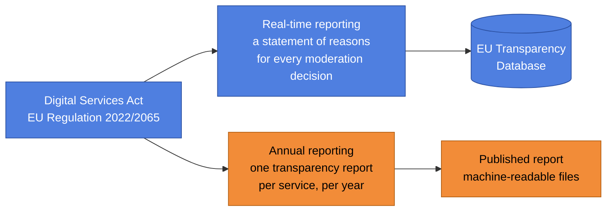

*Blue = the regulation and its real-time duty. Orange = the annual duty, which is this project.*

**1.2 What the annual report must contain.** The European Commission publishes the template, so the shape is not ours to choose. It is a workbook of tabs, one per reporting duty:

| Template tab | What it reports |
|---|---|
| Report identification | Who is reporting, for which service, and for which period |
| Category names | The official list of categories of illegal content, fixed by the Commission |
| Member State orders | Orders received from national judicial or administrative authorities |
| Notices | Notices received from users and trusted flaggers, and what was done about them |
| Own initiative, illegal content | Moderation the platform started itself |
| Own initiative, terms and conditions | The same, for breaches of our own terms |
| Appeals and recidivism | Internal complaints, out-of-court disputes, suspensions of repeat offenders |
| Automated means | How much moderation was done by machine, and how accurate it was |
| Human resources | The moderation team, including linguistic expertise |
| Average monthly recipients | Average monthly active users per Member State |
| Qualitative | Free text, written by the legal team rather than produced from data |

The instructions that come with the template are strict, and each rule has a direct consequence for how the data must be built:

| The rule | What it forces |
|---|---|
| Publish in a machine-readable file format, comma separated, UTF-8 | The output is files, not a dashboard |
| Counts are whole numbers, percentages are between 0 and 1, median times are in hours | Every measure has a defined type and unit |
| If a row does not apply, leave it blank. If it applies and the answer is zero, write 0 | A missing row and a zero row mean different things |
| Sub-category figures must add up to their high-level category | Totals cannot be calculated separately from the parts |
| Omit double counts | One ticket must not be counted twice |
| Publish within two months of the end of the period, and keep it public for five years | A hard deadline, and a document that stays public and citable long after the deadline |
| A corrected report must be published as a marked update, highlighting what changed, why, the method used to fix it, and the date of the change | A wrong figure cannot be quietly replaced. It becomes a public correction, so every number must be explainable from the start |

**The reporting cycles are not simply yearly.** The first cycle had a published deadline, the second was a shortened transitional cycle, and only then does the yearly rhythm settle. Each cycle also has its own template version. A model that works for one set of dates and one template version is of little use:

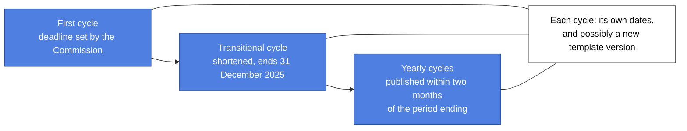

*Blue = set by the regulation.*

**1.3 What existed before.** In the summer of 2024 the company agreed that everything related to the Digital Services Act would live in Zendesk, the customer service ticketing system. Customer service agents work a ticket, and tags on the ticket record what kind of content it was, what was decided, and whether a decision was appealed. Tickets flowed nightly into BigQuery. That is where it stopped.

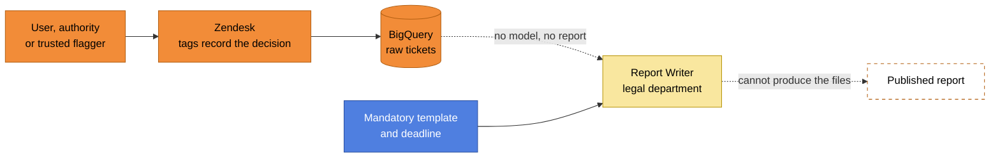

*Orange = our systems. Blue = the regulation. Yellow = a person. Dashed = did not exist. The dotted arrows are what was missing: a model that turns tickets into the template, and a way for the legal department to get the files.*

Three facts made this harder than a normal reporting job:

1. **The tags are owned by the business, not by engineering.** They are created in Zendesk. New tags appear without warning, and the report must keep working.
2. **The person responsible is not a data user.** The Report Writer is appointed by the legal department and is accountable for submitting the report, and does not use the warehouse.
3. **Some of what the template asks for does not exist anywhere.** Not every duty applies to us, and some data points were simply never captured.

**1.4 Why it mattered.** This is a legal obligation with a fixed deadline, and the result is a public document that stays public for five years. A wrong number is not a reporting inconvenience, it is a published error that has to be corrected in the open, with an explanation of what went wrong.

What was at stake if the report was late or insufficient, as the compliance group set it out to the working team:

| Risk | Consequence |
|---|---|
| Publicity | Publication is highly visible, and regulators were expected to check compliance |
| Regulator enforcement, first instance | An investigation into the company, requiring significant time and resource to answer |
| Regulator enforcement, worst case | Fines of up to 6 per cent of global turnover, plus daily penalties |

So the work had to be correct, repeatable, and explainable by someone who did not build it.

---

## 2. Task — The Obstacle/Problem

**2.1 The ask.** Provide the data for the annual transparency report, in the form the Report Writer needs, so that the report can be prepared and submitted without engineering help.

**2.2 What that really meant.** There were three gaps, not one.

**Gap 1: the collection was manual.** Before this, the figures for a report like this were gathered by hand. Someone asked each department for its part, the answers came back in messages and spreadsheets, and the legal representative assembled them. That is slow, it cannot be repeated, and two people asking the same question can get two different numbers. It also does not scale to a yearly legal deadline with ten sections to fill.

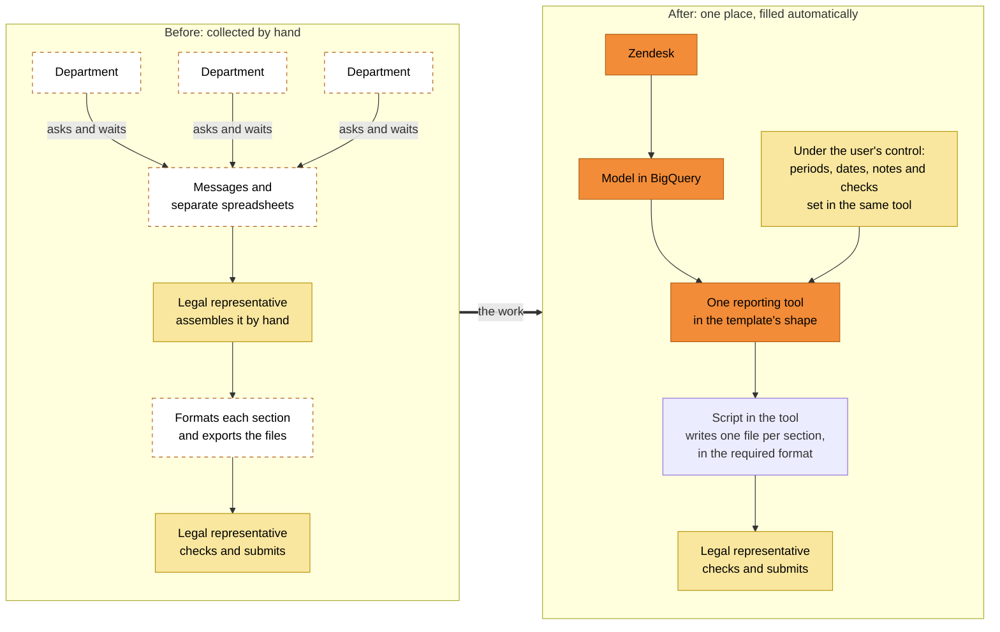

*Orange = systems. Yellow = under the user's control. Dashed = chased by hand, department by department. The point of the project is on the right: one place, filled from the source, in the shape the regulation wants, and steerable by the person using it.*

Two things on the right-hand side matter as much as the automation:

- **The user can steer it, not just read it.** A plain data feed would have given the legal team numbers they could not adjust, so any new period, any annotation and any question would have come back to me. Instead the tool is built for self-service: the reporting period and the publication dates are set in it, and notes, checks and review comments are written beside the figures they belong to. The automation supplies the numbers, and the user keeps the controls.
- **A script in the tool produces the files.** Once the tabs are filled and checked, a script writes one file per section in the format the regulator requires. That turns the last step, where ten sections would otherwise be copied out by hand, into one action.

**Gap 2: the format leaves no room for invention.** The report is eleven sections, each with its own fixed rows, its own wording and its own units, published by the Commission together with instructions on how to fill them. Nothing can be renamed, reordered or approximated, and a row that applies but has no cases must still show a zero. So the output shape was not a design choice. It was a specification to be met exactly.

**Gap 3: the data is shaped nothing like the report.**

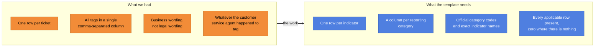

*Orange = the shape of our data. Blue = the shape the regulation requires.*

**And the person filling it does not use a data warehouse.** That turned one requirement into four, all of which had to be met by the same tool. A spreadsheet was the only thing in reach that could do all four at once:

| The tool had to be | Why |
|---|---|
| A data retriever, like a reporting tool | Pull each section from the warehouse on demand, already in the template's shape |
| A spreadsheet, as a working document | Hold notes, checks and comments beside the numbers while the report is being reviewed |
| A parameter form | Take the reporting period from the user, so any period can be produced: the one being submitted, the one submitted last time, or a trial run of a future one |
| A file producer | Turn the checked tabs into the files the regulator accepts, in one action, so the format cannot be got wrong at the last step |

**2.3 The objectives I set.**

1. The figures are collected in one place, automatically from the source, instead of department by department by hand.
2. The Report Writer can produce the report for any reporting period, without asking an engineer, including reproducing a period that was already submitted.
3. The output matches the template exactly: the right tabs, the right indicator names, the right types and units.
4. The arithmetic the regulation demands holds by construction, so sub-totals cannot disagree with totals.
5. The whole thing is usable by someone who does not use a data warehouse, in a tool they already know.
6. Every assumption behind a number is written down, so the report can be defended and corrected.
7. New tags, new categories and new reporting cycles do not require the model to be rebuilt.

**2.4 Constraints.**

- The ticketing system is the agreed system of record. Anything not captured there cannot be reported from here.
- The legal department has no access to the warehouse, and the tooling available to the team at the time was BigQuery, a scheduler of SQL jobs on Airflow, and Google Sheets.
- The first reporting cycle had a published deadline. The template, and later the official category list, could change between cycles, and did.
- Ticket data is customer service data, so the model works with internal keys rather than personal detail.

---

## 3. Action — What I Did and Why

### 3.1 Architecture at a glance

This is the design I drew for the solution. It is the original working drawing, kept here because the three-layer idea is the core of the project:


*The note in the top left states the idea: an abstraction layer that holds the translation between the business logic and the underlying data store. The yellow clouds mark the two places where a human puts something in. The green dots are the delivered pieces.*

The same design, as a readable diagram:

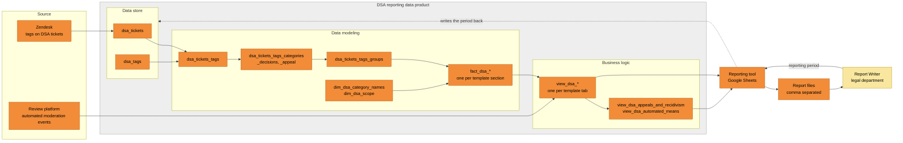

*Orange = systems and tables. Yellow = a person. The grey area is the data product. The dotted arrow is the loop that makes it self-service: the tool writes the chosen reporting period back into the warehouse, and reads the finished tabs out again.*

**The data product at a glance**

| | |
|---|---|
| **What it is** | The reporting data product for the Digital Services Act annual transparency report: what was moderated, why, on whose request, how fast, and by machine or by person. |
| **Layers** | A data store of filtered tickets and the tag reference list, a modeling layer of tag families and fact tables, and a business logic layer of parameterised views, one per template tab. |
| **Freshness** | Rebuilt daily, before the working day. |
| **Primary user** | The Report Writer in the legal department, through a Google Sheets tool. |
| **Other users** | Data analysts and the legal team, through the same views and the enriched ticket table. |
| **Scale** | 39 SQL scripts, one daily job of 37 tasks, 16 parameterised views, one fact table per template section. |

**What I did, and the decision behind each step**

| Stage | When | What exists at the end of it | Decisions |
|---|---|---|---|
| 1. Get to trustworthy DSA tickets | Sep to Dec 2024 | DSA tickets filtered out of all tickets, a tag reference list, tags turned into columns and back into labelled families, and one enriched ticket table that any DSA report can use. | Keep the ticketing system as the single system of record ([Decision 1](#decision-1))<br/>Drive the whole tag model from one reference table ([Decision 2](#decision-2))<br/>Build an enriched ticket table that other reporting can reuse ([Decision 3](#decision-3)) |
| 2. Shape the data like the template | Dec 2024 to Feb 2025 | A dimension holding the official category list, a fact table per template section, and a parameterised view per template tab that returns a finished tab for any period. | One fact table per template section ([Decision 4](#decision-4))<br/>Hold the official category list as versioned code ([Decision 5](#decision-5))<br/>Parameterised views instead of a reporting tool ([Decision 6](#decision-6))<br/>Let the engine compute the mandated subtotals ([Decision 7](#decision-7))<br/>Fill every applicable row, with zero where there is nothing ([Decision 8](#decision-8)) |
| 3. Put it in the hands of the legal department | Jan 2025 onward | A spreadsheet tool with a two-way connection to the warehouse, test mode, an audit log of every report produced, and a button that writes the report files. | A spreadsheet as the interface, with a two-way connection ([Decision 9](#decision-9))<br/>A report key as the parameter, and a log of every report ([Decision 10](#decision-10)) |
| 4. Make it honest and keep it alive | Mar 2025 onward | Documented assumptions, a tighter ticket filter, a correction route for the legal reviewers, and the model kept in step with the 2026 change to the official category list. | Write the assumptions down instead of hiding them ([Decision 11](#decision-11))<br/>Tighten the ticket filter beyond the form ([Decision 12](#decision-12))<br/>A manual override table for legal corrections ([Decision 13](#decision-13))<br/>Remap the categories after the 2026 change ([Decision 14](#decision-14)) |

The same architecture, stage by stage. Greyed-out boxes do not exist yet at that stage.

**Stage 1: trustworthy tickets and a tag model (Sep to Dec 2024).** See [Decision 2](#decision-2).

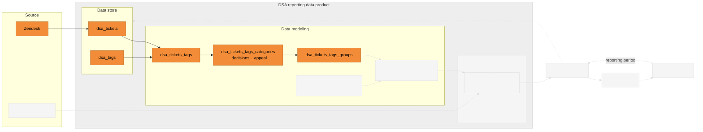

**Stage 2: the template shape (Dec 2024 to Feb 2025).** See [Decision 4](#decision-4), [Decision 5](#decision-5) and [Decision 6](#decision-6).

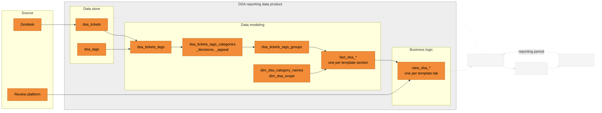

**Stage 3: self-service for the legal department (Jan 2025 onward).** See [Decision 9](#decision-9) and [Decision 10](#decision-10).

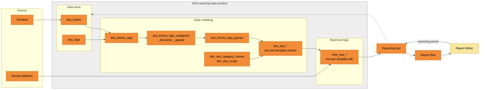

*Orange = systems and tables. Yellow = a person. Grey area = the data product.*

### 3.2 Key milestones and decisions

Each pivotal point changed the design and led to the next one:

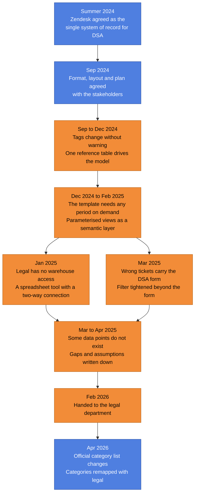

*Blue = set by the regulation or agreed before the build. Orange = my design decisions.*

| When | Pivotal point | What it changed | Detail |
|---|---|---|---|
| Summer 2024 | Zendesk is agreed as the single system of record for everything DSA | Fixes the source for the whole report, and fixes its limits too: anything not tagged there cannot be reported from here. | [Decision 1](#decision-1) |
| Sep 2024 | Format, layout and plan agreed with the stakeholders | Three questions settled before any code: in what form the data is needed, in what structure, and how it will be built. | [A.1](#a1-from-tickets-to-dsa-tickets) |
| Sep to Dec 2024 | Tags are created in Zendesk and change without warning | The whole tag model is generated from one reference table, so a new tag needs no code change. | [Decision 2](#decision-2), [A.2](#a2-the-tag-model) |
| Dec 2024 to Feb 2025 | The template must be producible for any reporting period, by a non-engineer | One parameterised view per template tab, carrying the business logic in the warehouse. | [Decision 6](#decision-6), [A.4](#a4-parameterised-views-as-a-semantic-layer) |
| Jan 2025 | The legal department has no warehouse access | A Google Sheets tool with a two-way connection, test mode and a file export. | [Decision 9](#decision-9), [A.5](#a5-the-reporting-tool) |
| Mar 2025 | Tickets that are not DSA cases carry the DSA form | The filter is tightened beyond the form, so only tickets with a real category and decision are counted. | [Decision 12](#decision-12) |
| Mar to Apr 2025 | A review of the template against our data shows real gaps | The gaps and the assumptions are documented per field, rather than filled with a guess. | [Decision 11](#decision-11), [A.7](#a7-gaps-assumptions-and-corrections) |
| Apr 2025 | Appeal reasons live in ticket custom fields, not tags, and differ per market | A separate path reads the custom fields across markets and reduces them to one row per ticket. | [A.3](#a3-facts-and-dimensions) |
| 16 Apr 2025 | **The first annual transparency report is published** on the corporate website, on the regulatory deadline | The data side was ready and validated in the final week, under heavy time pressure. | [4.1](#4-result--outcome-and-learning) |
| Feb 2026 | The tool and its folder are handed to the legal department, for the second reporting cycle | The legal team runs the reporting from its own copy. | [A.5](#a5-the-reporting-tool) |
| Apr 2026 | The official category list changes and deprecates codes, during the second cycle | Deprecated codes are remapped to current ones, agreed with legal and recorded in the code. The model is reused for the new cycle without being rebuilt. | [Decision 14](#decision-14) |
| 2026 | A later manual adjustment is added by another engineer | Records that existed outside the ticketing system had to be reported, so they were added by hand. This is the clearest example of the limit set in Summer 2024. | [A.7](#a7-gaps-assumptions-and-corrections) |

### 3.3 Components (each is a deep dive)

| Component | One-line summary | Deep dive |
|---|---|---|
| From tickets to DSA tickets | Filter the DSA cases out of all customer service tickets, and keep only the ones that really are DSA cases | [A.1](#a1-from-tickets-to-dsa-tickets) |
| The tag model | Turn one comma-separated tag column into labelled reporting families, generated from a single reference table | [A.2](#a2-the-tag-model) |
| Facts and dimensions | One fact table per template section, plus the official category list and the country scope | [A.3](#a3-facts-and-dimensions) |
| Parameterised views | One view per template tab that takes the report key and returns a finished tab, acting as a semantic layer | [A.4](#a4-parameterised-views-as-a-semantic-layer) |
| The reporting tool | A Google Sheet with a two-way connection to BigQuery, test mode and a file export | [A.5](#a5-the-reporting-tool) |
| Orchestration | One daily job of 37 tasks with declared dependencies | [A.6](#a6-orchestration) |
| Gaps, assumptions and corrections | What cannot be reported, what is assumed, and how the legal reviewers correct a record | [A.7](#a7-gaps-assumptions-and-corrections) |
| Advanced SQL | Every advanced technique the solution uses, and the plain reason each one is there | [A.8](#a8-advanced-sql-every-technique-and-why-it-was-used) |

### 3.4 The people I worked with

A reporting model like this cannot be built alone, because almost every number depends on a decision somebody else made. Three working relationships mattered:

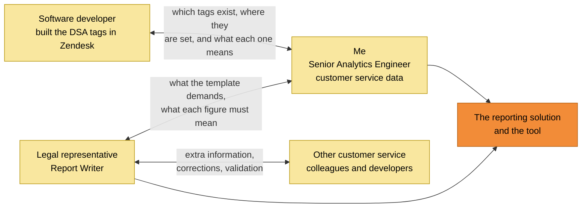

*Yellow = people. Orange = what we built.*

| Who | What the collaboration was for |
|---|---|
| The software developer who implemented the DSA tags in Zendesk | The most important technical relationship. He knew which tags had been created, where in the ticket flow each one is set, and what each one is supposed to mean. Without that, the tag families would have been guesswork, and a model built on guessed meanings would have produced numbers nobody could defend. |
| The legal representative who submits the report | My direct counterpart throughout. We worked through what each template field demands, what the available data can honestly answer, and what the tool had to let the legal team do for itself. The design of the tool came out of that conversation, not out of a specification handed to me. |
| Other customer service colleagues and developers | Reached through the legal representative, who collected the extra information the report needed and brought back corrections when a figure did not look right. That is how the numbers were validated, and how the assumptions in [A.7](#a7-gaps-assumptions-and-corrections) were agreed rather than assumed. |

**What I take from that.** The hardest part of this project was not the SQL. It was establishing, field by field, what a number is allowed to mean, with the person who signs it off and the person who created the data. The engineering was downstream of that.

---

## 4. Result — Outcome and Learning

**4.1 Outcome.** The legal department can produce the annual transparency report itself. The Report Writer sets a reporting period in a spreadsheet, checks each tab against the official template, and presses a button to get the files. No engineer is involved in producing a report.

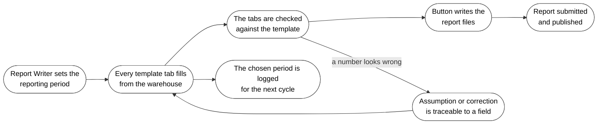

**What is verified from the code and the documents:**

| | |
|---|---|
| The reporting runs daily | One scheduled job of 37 tasks, rebuilding the whole model each morning |
| It serves the template, not a dashboard | 16 parameterised views, one per template tab, returning the exact indicator rows |
| It is reusable across cycles | The reporting period is a parameter. The second cycle reused the same model, with no rebuild |
| It survived a regulatory change | When the official category list changed in 2026, the remapping was agreed with legal and applied in the model |
| It met the deadline | The first annual report was published on the corporate website on 16 April 2025, the regulatory deadline |
| It was handed over | In February 2026 the tool and its folder were copied to the legal department, which runs the reporting from there |
| The assumptions are written down | Every number that rests on an assumption carries that assumption in the code and in the process document |

**The report was published on the deadline.** The company's first DSA annual transparency report went live on the corporate website on 16 April 2025, the regulatory deadline. The final week ran under heavy time pressure, with a data validation call and outstanding input requests closing on the last day. The message that confirmed it to the working group read:

> "I'm pleased to confirm JET's first DSA annual transparency report went live on the corporate website yesterday, meeting the regulatory deadline. This was a significant achievement, and it wouldn't have been possible without your hard work."

The same message singled out my contribution over more than a year of work on it.

Exact figures from the report are confidential and are not reproduced here.

**4.2 Were the objectives met?**

| Objective | Result |
|---|---|
| The figures are collected in one place, automatically from the source | ✅ every section is filled from the model, instead of being chased department by department |
| The Report Writer can produce any period without an engineer, including one already submitted | ✅ the period is a parameter set in the tool, and every report produced is logged against its key |
| The output matches the template exactly | ✅ one view per tab, with the template's own indicator names, types and units |
| The regulation's arithmetic holds by construction | ✅ subtotals and totals are computed together, so they cannot disagree |
| Usable by someone who does not use a data warehouse | ✅ a Google Sheet in the template's shape, with the period, the notes and the export in it |
| Every assumption is written down | ✅ documented per field, in the code and in the process document |
| New tags and categories do not require a rebuild | ✅ the tag model is generated from one reference table; the category list is one file |

**4.3 What I learned.**

*Project execution*

1. **Settle the format and the layout before building anything.** The first session with the stakeholders asked only three questions: in what form do you need the data, in what structure, and how shall we build it. Agreeing the output shape first meant the model was built once.
2. **Work from the regulator's own template, not from a summary of it.** The template and its instructions are the specification. Reading them closely turned vague duties into column types, units and rounding rules.
3. **Give the accountable person the controls.** The person who signs off the report is not a data person. Putting the period and the export in the hands of that person removed the engineer from the critical path of a legal deadline.
4. **Show the gaps early and in writing.** A review of the template against our data produced a list of what we do not capture. Naming those gaps in front of the stakeholders was more useful than filling them with an estimate.
5. **Document the assumptions where the logic lives.** The assumptions sit in the code next to the field they affect, and in the process document. Anyone can see why a number is what it is, and challenge it.

*Technical*

1. **Generate the model from a reference table when the business owns the vocabulary.** Tags are created by the business. Reading them from a reference table and generating the query means a new tag never breaks the report ([Decision 2](#decision-2)).
2. **Put the business logic in the warehouse when the output shape is fixed.** A parameterised view can deliver a finished template tab. That is what a reporting tool would normally do, but the output had to be files in an exact shape ([Decision 6](#decision-6)).
3. **Let the engine compute the totals.** Where the regulation says the parts must add up to the whole, computing both in one pass removes a whole class of error ([Decision 7](#decision-7)).
4. **A blank and a zero are not the same thing.** Joining to the full category list and filling with zero is the difference between a compliant report and a wrong one ([Decision 8](#decision-8)).
5. **Leave a correction route that does not touch the pipeline.** A small override table lets a reviewer fix a record, with the raw layer untouched and the correction visible ([Decision 13](#decision-13)).
6. **One system of record is a decision with consequences.** It makes the model simple and it also decides what can never be reported. The later manual adjustment by another engineer is the proof.

**4.4 Where I have used this learning since.** The pattern of putting the business logic in a parameterised, versioned layer, instead of inside a reporting tool, is the same idea I returned to later with a semantic layer, built in Malloy, on the Skip Retail Media project (Project 1). I keep the habit of writing assumptions next to the logic, and of agreeing the output shape with the person accountable for it before building.

**4.5 My own reflection.** This project had been offered quietly to several data engineers before it reached me, and none of them wanted it. Regulatory reporting is not the work engineers queue up for. It is audit, formality and process, with none of the appeal of a new product. I was given it explicitly, and my first reaction was the same as everyone else's: this is not interesting work.

What I did with that is the part I am most pleased about. I decided to make it interesting on purpose, by treating it as the chance to learn things I would not otherwise have touched:

| What I used it to learn | Where it shows |
|---|---|
| Data modelling against a specification I did not control | One fact table per template section, and the official category list held as code ([Decision 4](#decision-4), [Decision 5](#decision-5)) |
| Building a whole system end to end, rather than one piece of someone else's | Collection, modelling, presentation, consumption and the tool, all of it ([3.1](#31-architecture-at-a-glance)) |
| SQL far beyond what I had written before: dynamic SQL, table functions, scripting | [A.8](#a8-advanced-sql-every-technique-and-why-it-was-used), 35 techniques |
| Working directly with a legal specialist instead of through a ticket | [3.4](#34-the-people-i-worked-with) |

And the impact turned out to be bigger than anything I had worked on before. The risk of not publishing a sufficient report on time was an investigation at best and fines of up to 6 per cent of global turnover at worst, on top of the public damage. The report was published on the deadline, and that exposure went away.

The lesson I keep from it: the value of a project is not always visible in its subject. The work nobody wanted turned out to be the work with the clearest impact, and the place where I learned the most.

---

# Appendix A — Deep Dives

Each deep dive follows the same pattern: **what it does → how it works → the design decisions → the trade-off.**

## A.1 From tickets to DSA tickets

[↑ Back to the summary](#summary)

**What it does:** it selects, out of all customer service tickets, the ones that are DSA cases, and keeps only those that can be reported.

**How it works.** Tickets arrive in BigQuery nightly from Zendesk. A DSA case is raised on a dedicated ticket form, so `dsa_tickets` filters on that form, from the date the DSA process started. On its own that proved too generous, because a ticket can carry the form without being a reportable case. In March 2025, after a review with the group, a second filter was added further down the model, in `dsa_tickets_tags_groups_view`, keeping only tickets that have both a real content category and a real decision.

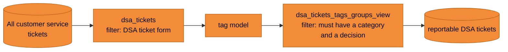

**Design decisions**

1. **Filter in two places, not one.** The form filter is cheap and runs first, on the whole ticket table. The stricter filter runs after the tags are modelled, because it needs them. Running the strict filter first would have been impossible, and running only the cheap one over-counted.
2. **Put the strict filter in the model, not in the ticketing system.** Correcting the tickets themselves was not possible at the scale needed, and a filter in the model is reversible, visible in one place and dated in the code.

**Trade-off accepted:** the stricter filter removes tickets that a reader of the raw data would count. That is a deliberate choice in favour of the regulation's definition of a reportable case, and it is written down so the difference can be explained.

## A.2 The tag model

[↑ Back to the summary](#summary)

**What it does:** it turns one comma-separated column of tags into reporting families, so a ticket can be counted as a notice, an order, an own-initiative action or an appeal, with a category and a decision attached.

**The problem.** The tags are created in Zendesk by the business. There are over a hundred of them, grouped into families: what kind of content, what was decided, why an appeal was raised, what the appeal outcome was. New tags appear when the process changes. Hard-coding them in SQL would mean a code change for every new tag, and a broken report in the meantime.

**How it works.** One reference table, `dsa_tags`, lists every tag and, for each tag, which family it belongs to. Everything else is generated from it:

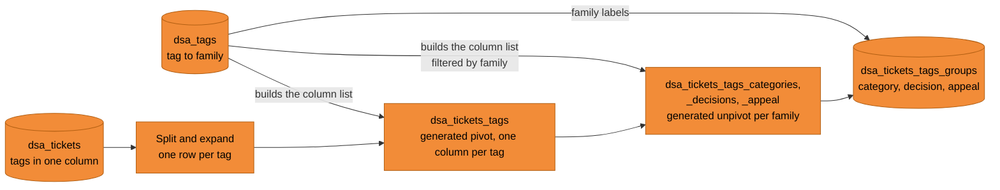

**The families in the reference table.** Each tag is assigned to one or more of these, and that assignment is the only configuration the model has:

| Family | What it answers | Example of use in the report |
|---|---|---|
| Group | What kind of DSA case is this | Notice, Member State order, own initiative, appeal |
| Category | What kind of content was it | The official category of illegal content |
| Decision | What was decided | Content removed, account suspended, provision terminated |
| Appeal outcome | What happened to the appeal | Original decision upheld or reversed |
| Appeal reason | Why it was appealed | Procedural grounds, interpretation of illegality |
| Suspension of repeat offenders | Derived from the decision family | Whether the decision counts as a suspension |

Step by step:

1. The tags of a ticket are split on the comma and expanded, so there is one row per ticket and tag.
2. A small function reads the reference table and returns the tag names as a single text value.
3. That text is used to build a pivot statement, which is then run. Every tag becomes a column, counting the ticket once.
4. For each family, the same trick runs in reverse. The column list is built from the reference table filtered to that family, and an unpivot turns those columns back into rows, keeping only the tags a ticket actually has.
5. The result is joined back to `dsa_tags` to attach the family label, and the families are combined into one enriched ticket table, `dsa_tickets_tags_groups`, published as `dsa_tickets_tags_groups_view`.

That view is deliberately useful on its own, not only to the annual report. Analysts and the legal team query it during the year, so a figure in an ad-hoc question comes from the same definitions as the published report.

**Advanced SQL: generating the statement.** This step uses dynamic SQL. The tag list is data, so the statement that uses it is built as text and then executed. Names here are simplified:

```sql
-- 1. read the vocabulary out of the reference table
SET tag_list = (
  SELECT STRING_AGG("'" || dsa_tags || "'" ORDER BY row_num) FROM dsa_tags
);

-- 2. build the statement around it
SET statement = '''
  CREATE OR REPLACE TABLE dsa_tickets_tags AS
  SELECT * FROM (
    SELECT ticket_key, ticket_count, tag
    FROM dsa_tickets, UNNEST(SPLIT(ticket_tags, ",")) AS tag
  )
  PIVOT (COUNT(DISTINCT ticket_count) FOR tag IN (''' || tag_list || '''))
''';

-- 3. run it
EXECUTE IMMEDIATE statement;
```

The reverse step is the same idea, with the list filtered to one family, so only that family's tags are turned back into rows:

```sql
SET column_list = (
  SELECT STRING_AGG('`' || dsa_tags || '`')
  FROM dsa_tags
  WHERE dsa_tags_categories <> 'not assigned'
);
-- ... UNPIVOT (metric FOR tag IN (<column_list>)) WHERE metric > 0
```

**Why generate the SQL rather than write it.** The pivot and unpivot statements both need an explicit list of columns. That list is data, and it lives in the reference table. Generating the statement from the data means the list is never out of date, and the same technique serves four families with one piece of logic.

**Design decisions**

1. **One reference table is the only place a tag is named.** Adding a tag to the report is adding a row, not editing SQL. This is the single most useful property of the model.
2. **Pivot, then unpivot.** Pivoting first gives one row per ticket with a column per tag, which is what the counting needs. Unpivoting per family then gives the labels the report needs. The round trip looks indirect, but it keeps both shapes available and both generated from the same source.
3. **Only tags belonging to a family are unpivoted.** The reference table marks tags that are not assigned to a family, and those are excluded, so an unrelated tag cannot leak into a reporting category.
4. **Keep a row count check in the output.** Each family table carries a row number per ticket, so a ticket that somehow lands twice is visible rather than silently doubling a count.

**Trade-off accepted:** generated SQL is harder to read than a written query, and an error in the reference table becomes an error in the generated statement. In return the model follows the business vocabulary automatically, which was the difference between a report that keeps working and one that breaks on the next process change.

**Repository layout (conceptual)**

```text
cs_dsa_reporting/
├── dsa_tags.sql                          the tag list and the family of each tag
├── dsa_tickets.sql                       the DSA ticket filter
├── dsa_tickets_tags.sql                  generated pivot: one column per tag
├── dsa_tickets_tags_categories.sql       generated unpivot, per family
├── dsa_tickets_tags_decisions.sql
├── dsa_tickets_tags_appeal.sql
├── dsa_tickets_tags_appeal_fields.sql    appeal values from ticket custom fields
├── dsa_tickets_tags_groups.sql           the combined, enriched ticket table
├── dim_dsa_category_names.sql            the official category list
├── dim_dsa_scope.sql                     the country scope
├── fact_dsa_notices.sql                  one fact per template section
├── fact_dsa_notices_manual_overrides.sql corrections from the legal reviewers
├── fact_dsa_state_orders.sql
├── fact_dsa_own_initiatives.sql
├── fact_dsa_internal_complaints.sql
├── fact_dsa_outofcourt_disputes.sql
├── fact_dsa_suspension_offenders.sql
├── fact_dsa_appeals.sql
├── fact_dsa_human_resources.sql
├── fact_dsa_monthly_recipients.sql
├── fact_dsa_report_identification.sql    the report log and the live input
├── view_dsa_notices.sql                  one parameterised view per template tab
├── view_dsa_states_orders.sql
├── view_dsa_own_initiatives.sql
├── view_dsa_appeals_fields.sql
├── view_dsa_appeals_and_recidivism.sql   composed from three views
├── view_dsa_automated_means.sql          composed, with a scope breakdown
├── view_dsa_bad_words_automation.sql     from the review platform, not Zendesk
├── view_dsa_fake_reviews_automation.sql
├── view_dsa_human_resources.sql
├── view_dsa_monthly_recipients.sql
├── view_dsa_report_identification.sql
└── config.json                           the task list and its dependencies
```

## A.3 Facts and dimensions

[↑ Back to the summary](#summary)

**What it does:** it turns the enriched ticket table into one fact table per section of the template, and holds the two dimensions the report needs.

**How it works.** The template's sections are the model. There is `fact_dsa_notices`, `fact_dsa_state_orders`, `fact_dsa_own_initiatives`, `fact_dsa_internal_complaints`, `fact_dsa_outofcourt_disputes`, `fact_dsa_suspension_offenders`, `fact_dsa_appeals`, `fact_dsa_human_resources`, `fact_dsa_monthly_recipients`, and `fact_dsa_report_identification`, which records the report itself. Each fact table already carries the indicator names the template uses, so the view on top has little left to do.

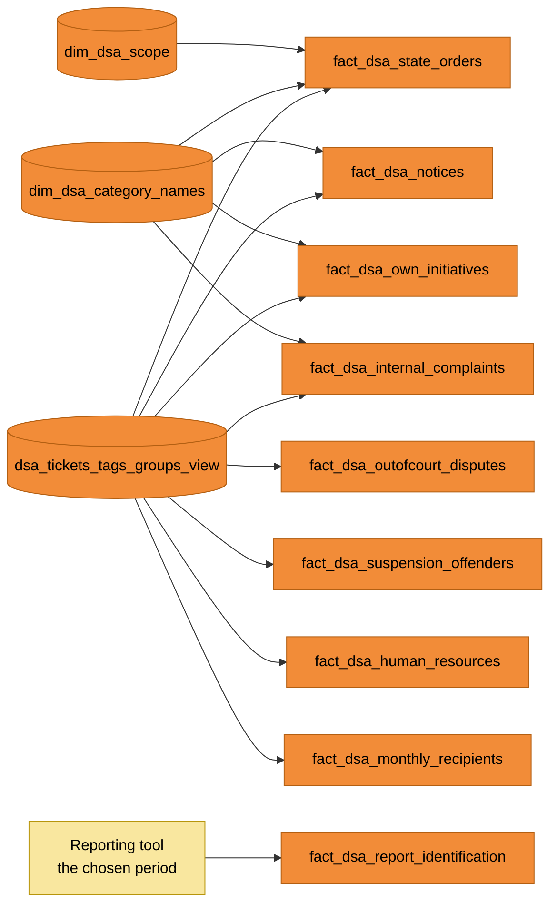

*One fact table per template section. The report identification fact is the exception: it does not come from the tickets at all, it records the period the Report Writer chose (see [A.5](#a5-the-reporting-tool)).*

**The two dimensions.**

- **`dim_dsa_category_names`** carries the Commission's own list of categories and sub-categories of illegal content, written as code in the repository: an array of records, one per category, with the official code, the label, the description and the group it belongs to. The sort order used by every view is derived from the label, so the tabs always come out in the template's order.
- **`dim_dsa_scope`** is the list of countries in which DSA tickets were raised, with a total row, used to break figures down per Member State.

**A harder path: appeal reasons.** Appeal reasons and outcomes are not tags. They are custom fields on the ticket, and each market runs its own ticketing instance with its own field identifiers and its own tables. The model therefore reads the custom fields per market, joins each to that market's own field definitions, unions the markets together, and joins back to the DSA tickets. The result, `dsa_tickets_tags_appeal_fields`, is then reduced by `fact_dsa_appeals` to one row per ticket with a set of yes or no flags: which kind of decision was appealed, what the outcome was, and on what grounds.

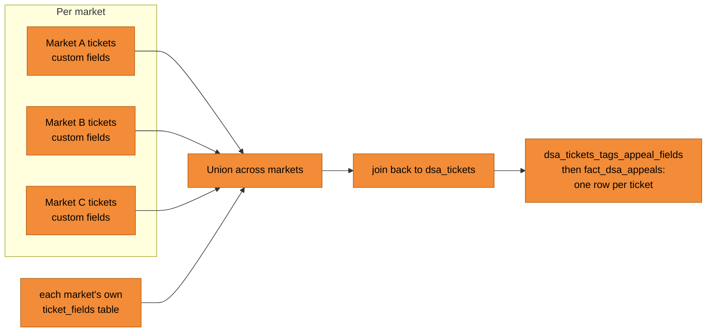

**Design decisions**

1. **One fact table per template section.** The template is the contract, so the model mirrors it. A reader can hold the template and the model side by side. It also means a change to one section cannot disturb another.
2. **Name the columns after the template's indicators.** The fact tables use the template's own long indicator names. It is verbose, and it removes a translation step where mistakes happen.
3. **Hold the official category list in the repository, not in a spreadsheet.** It is published by the Commission, it changes, and the report must match it exactly. As code it is versioned, reviewable, and the same list feeds every tab.
4. **Reduce many field values to flags per ticket.** One ticket has many custom field values. Collapsing them into one row with a flag per decision type keeps the counting simple and prevents double counting.

**Trade-off accepted:** one fact table per section duplicates some columns across tables. The alternative, one wide table for everything, would have been shorter but would have coupled the sections together, and a change for one tab would have risked all of them.

## A.4 Parameterised views as a semantic layer

[↑ Back to the summary](#summary)

**What it does:** for one reporting period, each view returns one finished tab of the template, with the right rows, the right names, the right units, and the arithmetic the regulation demands.

**The problem.** A plain view cannot take an argument. The reporting period is chosen by the Report Writer, not by an engineer, and it changes with every cycle. Hard-coding dates would mean editing SQL for every report, which puts an engineer in the path of a legal deadline.

**How it works.** Each view is a table function: a view that takes a parameter. The parameter is the report key. Given that key, the view looks up the reporting period that was recorded against it, applies it to the facts, and returns the tab:

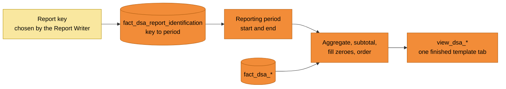

*Yellow = chosen by a person. Orange = the warehouse.*

**Advanced SQL: the shape of a view.** One statement combines a parameterised table function, a key-value lookup, a rolling subtotal and a zero-filling join. Names here are simplified:

```sql
CREATE OR REPLACE TABLE FUNCTION view_dsa_notices(X STRING) AS

WITH reporting_period AS (
  -- the period is not passed in; it is looked up from the key
  SELECT
    MAX(IF(indicator = 'starting_date_of_reporting_period', value, NULL)) AS period_start,
    MAX(IF(indicator = 'ending_date_of_reporting_period',   value, NULL)) AS period_end
  FROM view_dsa_report_identification(X)
),

aggregation AS (
  SELECT service, reporting_period, category, SUM(notices) AS notices, ...
  FROM fact_dsa_notices CROSS JOIN reporting_period
  WHERE created_date BETWEEN period_start AND period_end
  GROUP BY ROLLUP (service, reporting_period, category)   -- subtotals and total in one pass
  HAVING reporting_period IS NOT NULL
)

-- every applicable category appears, with zero where there is nothing
SELECT ... FROM aggregation FULL OUTER JOIN dim_dsa_category_names USING (category)
ORDER BY IF(category = 'TOTAL', 0, 1), sort_order
```

**Why this is a semantic layer.** The hard work of these views is pivoting: turning wide fact tables into the long list of named indicator rows the template wants, with mandated subtotals and no empty cells. That is normally the job of a reporting tool. Here it sits in the warehouse, versioned in the repository, because the output had to be files in an exact shape, retrievable for a chosen period, by someone without a reporting tool. One definition of each indicator serves the spreadsheet, an analyst's query and any future tool. Table functions were a relatively new BigQuery feature at the time, and they are what makes this reusable rather than a query per report.

**What each view does to meet the instructions.**

| The instruction | How the view meets it |
|---|---|
| Report for a given period | The period is read from the report key, then applied to the facts |
| One row per named indicator | The wide aggregate is unpivoted, so each measure becomes a row carrying the template's own indicator name |
| Sub-categories must add up to their category, and a total row is required | The aggregation groups with a rolling subtotal, so the parts and the whole are computed in one pass |
| An applicable row with no data must read 0, not blank | The full category list is joined to the aggregate, and missing measures are filled with zero |
| Rows in the template's order | A sort order derived from the category label, with the total row first |
| Median times in hours | The median is taken from the distribution of resolution times, already converted to hours in the fact table |
| The fixed applicability wording | Each view carries the template's own applicability text as a column |

**One key, every tab.** The same key drives all of them, so one choice produces a whole report. Thirteen of the sixteen views resolve their reporting period through the same view, `view_dsa_report_identification`, which reads the key the Report Writer typed into the Sheet (see [A.5](#a5-the-reporting-tool)). The diagram shows the views that return a template tab; the remaining ones feed the two composed tabs:

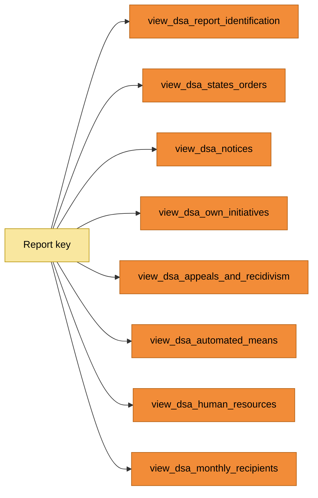

| Template tab | Fact table behind it | View that returns the tab |
|---|---|---|
| Report identification | `fact_dsa_report_identification`, plus the live input | `view_dsa_report_identification`, unpivoted into indicator and value |
| Category names | `dim_dsa_category_names` | Read directly from the dimension |
| Member State orders | `fact_dsa_state_orders` | `view_dsa_states_orders` |
| Notices | `fact_dsa_notices`, with `fact_dsa_notices_manual_overrides` applied | `view_dsa_notices`, with zero filling across every category |
| Own initiative | `fact_dsa_own_initiatives` | `view_dsa_own_initiatives` |
| Appeals and recidivism | `fact_dsa_appeals`, `fact_dsa_outofcourt_disputes`, `fact_dsa_suspension_offenders` | `view_dsa_appeals_fields`, `view_dsa_outofcourt_disputes` and `view_dsa_suspension_offenders`, combined by `view_dsa_appeals_and_recidivism` |
| Automated means | `fact_dsa_internal_complaints`, `fact_dsa_own_initiatives`, plus the review platform events | `view_dsa_automated_means_internal_complaints` and `view_dsa_automated_means_own_initiatives`, combined by `view_dsa_automated_means`, with `view_dsa_automated_means_scope` |
| Human resources | `fact_dsa_human_resources` | `view_dsa_human_resources` |
| Average monthly recipients | `fact_dsa_monthly_recipients` | `view_dsa_monthly_recipients` |
| Qualitative | none | none: the tab is free text, written by the legal team |

**Composed tabs.** Some tabs need more than one source. The appeals and recidivism tab needs internal complaints, out-of-court disputes and suspensions of repeat offenders together, and every row of that tab is a fixed pair of an indicator and a scope, where some cells must stay blank and others must read zero. Each source view is first reduced to a single row of named measures, and then the tab is assembled as an explicit list of rows in the template's order:

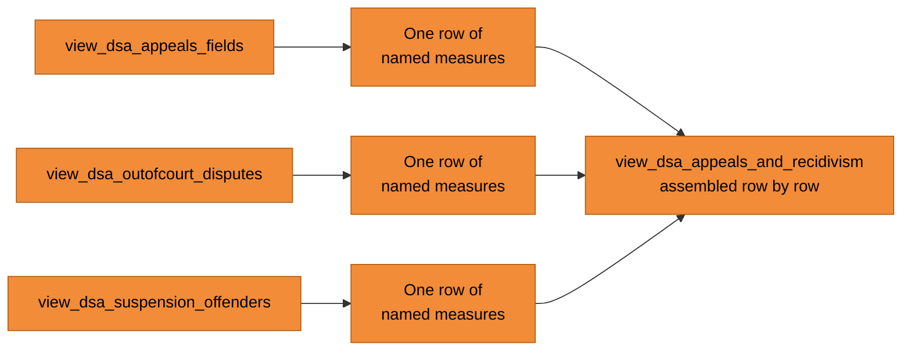

Writing that tab as an explicit list of rows is deliberate. It is long, and each row maps one to one to a published row of the template, so anyone can check the document against the code, and any adjustment stays visible instead of hidden inside an aggregation.

**A different source for one tab.** The automated means tab asks how much moderation was done by machine. None of that is in the ticketing system, because automated moderation happens in the review platform and never creates a ticket. Those views keep the same parameter and the same shape, and count from the review platform's own event tables instead.

**Design decisions**

1. **The parameter is a report key, not a pair of dates.** A key identifies a report, and the dates hang off it. That makes the choice auditable and lets the same key be reused to reproduce a report exactly.
2. **One view per template tab.** The view is the unit the user consumes, so it matches the tab being filled. No view returns two tabs.
3. **Composed views sit on top of simple ones.** Each source stays independently queryable and testable, and the composition is a separate, readable layer.
4. **The template's wording lives in the view.** Applicability text, indicator names and scope labels are carried as data, so the spreadsheet does not have to re-type anything.

**Trade-off accepted:** the business logic is spread across 16 views, and the composed ones are long and repetitive. A reporting tool would have been shorter to build. In return the output is exactly the required shape, reproducible for any period, and reviewable in version control, with no dependency on a tool the legal department does not have.

## A.5 The reporting tool

[↑ Back to the summary](#summary)

**What it does:** it is the interface for the Report Writer. It takes the reporting period, fills every template tab from the warehouse, and writes the report files.

**It plays four roles at once**, which is why a spreadsheet was the right choice rather than a reporting tool:

| Role | What it provides |
|---|---|
| Data retriever | Each tab is a live query against the matching parameterised view, so the numbers come from the warehouse and not from a copy |
| Working document | Notes, checks and review comments can be written beside the numbers while the report is being prepared, which a reporting tool does not allow |
| Parameter form | The period is typed into the input tab, so any period can be produced: the one being submitted, a period already submitted, or a trial of a future one |
| File producer | A script writes one file per section in the format the regulator requires, so the final hand-off is one action rather than ten manual exports |

**How it works.** The tool is a Google Sheet built to the same structure as the official template. Its connection to BigQuery goes both ways:

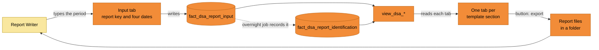

*Yellow = the person. Orange = the tool and the warehouse. The loop on the left is what makes it self-service: the spreadsheet writes the period into the warehouse, and the views read it straight back.*

**The two directions matter.**

- **Writing.** The input tab has a small set of cells: a key for the report, the publication date, the previous publication date, and the start and end of the reporting period. Those cells are written into `fact_dsa_report_input`, where the views can see them immediately.
- **Reading.** Every other tab is a query against the matching parameterised view, using that key. Refreshing a tab, or all of them, fills the template.

**How the live link works.** The Sheet is not loaded into BigQuery on a schedule. The input tab is exposed to BigQuery as a linked table, `fact_dsa_report_input`, so a cell edited in the Sheet is visible to a query straight away. `fact_dsa_report_identification` then combines two sources with a `UNION ALL`: a single hard-coded default row, and everything coming live from the Sheet. One row per key is kept, and the live row wins:

```mermaid
flowchart LR
    SH["Input tab in the Sheet<br/>key and four dates"]
    LT[("fact_dsa_report_input<br/>linked table, read live")]
    DEF["Hard-coded default row<br/>the TEST key"]
    RI[("fact_dsa_report_identification<br/>UNION ALL, one row per key")]
    V["view_dsa_report_identification(X)"]
    OUT["13 of the 16 views<br/>resolve their period here"]
    SH -->|"edited in the Sheet"| LT
    LT --> RI
    DEF --> RI
    RI --> V --> OUT

    classDef jet fill:#F28C38,stroke:#B35F12,color:#000
    classDef human fill:#F9E79F,stroke:#B7950B,color:#000
    class LT,DEF,RI,V,OUT jet
    class SH human
```

*Yellow = typed by a person. Orange = the warehouse.*

Two things follow from that small piece of SQL. First, a change in the Sheet takes effect at once, with no load step and nothing to wait for, which is what makes checking a period practical. Second, the default row means the chain can never return nothing: even if the Sheet is empty or unreachable, there is always one valid key to report on, so no tab breaks. The overnight job then writes the chosen period into the permanent log.

**Reproducing an earlier report.** Because every report is recorded against its key, an earlier submission can be produced again by entering its key. That matters for a document that stays public for five years: if a published figure is questioned, the exact period behind it can be re-run and compared.

**Test mode.** A reserved key runs the report in test mode. The Report Writer can try a period, look at every tab, change the dates and try again, with nothing recorded. Once the result is right, the key is replaced with the real identifier of the report to be submitted. The overnight job then folds that choice into `fact_dsa_report_identification`, so there is a log of every report produced and the exact period it covered.

**Producing the files: a script on top of the Sheet.** The last step is the one most likely to go wrong by hand: turning ten checked tabs into ten files in the exact format the regulator accepts. A button in the Sheet runs a script that walks every tab, converts each one to a comma separated file in the required format, and saves them to a folder. The files are overwritten on the next run, so they are moved out before submission.

This is the fourth role the tool plays, and it exists to remove human error at the end of the chain:

| Without the script | With the script |
|---|---|
| Ten sections copied out by hand, one at a time | One button, all sections at once |
| Format set by whoever does the export | The required format every time, by construction |
| Easy to export a stale tab, or to miss one | Every tab exported from the same refreshed state |
| No repeatable step to hand to someone else | The same action for anyone running the next cycle |

**The process, as the legal department runs it:**

```mermaid
flowchart LR
    S1["1. Enter the report key<br/>and the four dates"] --> S2["2. Refresh and check<br/>every tab"]
    S2 --> S3["3. Overnight job records<br/>the report in the log"]
    S3 --> S4["4. Press the button<br/>to write the files"]
    S4 --> S5["5. Move the files out<br/>and submit"]
    S2 -.->|"not right yet"| S1

    classDef jet fill:#F28C38,stroke:#B35F12,color:#000
    class S1,S2,S3,S4,S5 jet
```

**Design decisions**

1. **Google Sheets, because it is where the user already works.** The legal department has no warehouse access and no reporting tool. A Sheet that looks like the official template needs no training.
2. **One tool for all four jobs.** A reporting tool could retrieve the data but not hold the reviewers' notes, could not easily be given a period to work from, and would not produce the regulator's file format. A plain spreadsheet could hold notes but retrieve nothing. Connecting a spreadsheet to the warehouse, and adding a script to it, was the only option that did all four.
3. **The Sheet writes the parameter, rather than an engineer setting it.** This is the single change that took engineering out of the critical path.
4. **Test mode before recording.** A legal deadline is a bad place to discover that a period was wrong. Trying a period without recording it makes checking safe.
5. **Every produced report is logged.** The log is the audit trail: which report covered which period, and when it was chosen.
6. **The export is a button, not a manual copy.** The regulation demands a specific machine-readable file format. A script produces it the same way every time.

**Trade-off accepted:** a spreadsheet is a fragile interface. It can be edited by anyone, the export folder has to be managed by hand, and the files are overwritten on the next run. In return the accountable person can produce the report herself, which was the objective. The alternative, a reporting tool nobody in the legal department had, would have left the engineer in the loop for every cycle.

## A.6 Orchestration

[↑ Back to the summary](#summary)

**What it does:** it rebuilds the whole model once a day, in the right order, before the working day starts.

**How it works.** One scheduled job holds 37 tasks, each with its dependencies declared, which forms the layers of the model:

```mermaid
flowchart LR
    L1["dsa_tags, dsa_tickets"] --> L2["dsa_tickets_tags"]
    L2 --> L3["dsa_tickets_tags_categories,<br/>_decisions, _appeal"]
    L3 --> L4["dsa_tickets_tags_groups"]
    L4 --> L5["dim_dsa_*, fact_dsa_*"]
    L5 --> L6["view_dsa_*"]
    L6 --> L7["view_dsa_appeals_and_recidivism,<br/>view_dsa_automated_means"]

    classDef jet fill:#F28C38,stroke:#B35F12,color:#000
    class L1,L2,L3,L4,L5,L6,L7 jet
```

Two properties matter for a report that has to be right:

1. **Nothing is built on half-updated inputs.** A fact table cannot run before the tag families it reads, and a view cannot run before its fact table. The dependencies are declared, not implied by ordering.
2. **The overnight run is also what records the report log.** The report the user chose during the day is folded into the log by the same run, which is why the log is a day behind the live input and the live input is what the views read in the meantime.

**Design decisions**

1. **Rebuild fully each day rather than incrementally.** The volumes are small, the model is a reporting model, and a full rebuild means the output always reflects the current tag reference list and category mapping. An incremental model would have needed its own backfill logic for every tag change.
2. **One job for the whole product.** The report is one deliverable, so it is one job. A failure anywhere is one alert, and the state after a failure is simply yesterday's model.

**Trade-off accepted:** a full daily rebuild costs more compute than an incremental one and makes the run time grow with history. At this volume that is cheap, and it removes a class of problems that would be expensive in a legal report.

## A.7 Gaps, assumptions and corrections

[↑ Back to the summary](#summary)

**What it does:** it records, in the model itself, what we cannot report, what we assume, and how a reviewer corrects an individual record.

**Why this section exists.** The regulation allows a published report to be corrected, but only in the open: a corrected version must be marked as an update, say what changed and why, describe the method used to fix it, and carry the date of the change. That turns every unexplained number into a liability, because a correction cannot be made quietly. It is the reason the assumptions below are written down rather than carried in someone's head.

**The three kinds of honesty the report needs.**

```mermaid
flowchart TB
    subgraph G["Gap"]
        G1["The data does not exist"]
        G2["Report zero, or leave the row<br/>blank where it does not apply"]
    end
    subgraph A["Assumption"]
        A1["The data exists but does not<br/>answer the question exactly"]
        A2["State the assumption next to<br/>the field it affects"]
    end
    subgraph C["Correction"]
        C1["A single record is wrong"]
        C2["Override it, keep the raw layer,<br/>record who verified it"]
    end
    G1 --> G2
    A1 --> A2
    C1 --> C2

    classDef jet fill:#F28C38,stroke:#B35F12,color:#000
    classDef missing fill:#FFF,stroke:#B35F12,stroke-dasharray: 5 5,color:#000
    class A1,A2,C1,C2 jet
    class G1,G2 missing
```

*Dashed = where the data does not exist.*

**The assumptions, and why each one is a decision.** Each is written in the code beside the field it affects:

| Assumption | Why it is needed | What it means for the number |
|---|---|---|
| One ticket counts as one item of information | A notice can reference many items, but the data holds a ticket, not a count of items | The item count equals the notice count, which is a floor, not a true count |
| Each customer service agent who worked a DSA ticket counts as one moderation resource, internal or external by the outsourcing flag | The template asks about the moderation team, and there is no separate team record to read | The figure reflects the customer service agents who touched DSA tickets, not a staffing record from the personnel system |
| Linguistic expertise is reported as zero | The data does not record the languages a moderator works in | A true zero, not an unknown, and flagged as a gap |
| Only one category group is treated as a terms-and-conditions case, the rest as law | The template splits actions taken under the law from actions taken under our terms, and the tags do not split that way | The split follows the category, which is a mapping agreed with the stakeholders |
| Average monthly recipients cannot be produced | The field the model would need is empty | Reported as zero, with the gap documented |
| Out-of-court disputes and suspensions of repeat offenders have no tags | No tag was ever created for them | The tables exist and return nothing, so the tab reports zero rather than omitting the row |

**Corrections by the legal reviewers.** When a reviewer finds a notice in the wrong category, or an action wrongly marked as taken, the correction goes into `fact_dsa_notices_manual_overrides`: the record, the corrected category, the corrected action flag and who verified it. The raw layer, `fact_dsa_notices_raw`, is left untouched, and `fact_dsa_notices` is built on top of it. So the published figure is the corrected one, the original is still visible, and the correction is attributable.

```mermaid
flowchart LR
    R[("fact_dsa_notices_raw")]
    O[("fact_dsa_notices_manual_overrides")]
    F[("fact_dsa_notices")]
    R --> F
    O -->|"overrides where present"| F

    classDef jet fill:#F28C38,stroke:#B35F12,color:#000
    class R,O,F jet
```

**The limit of the system of record.** In 2026 another engineer added a fixed number of own-initiative appeals directly into `view_dsa_appeals_and_recidivism`, after I had finished the documentation. Those cases had to be reported but had never existed as tickets, so there was no other way to get them in. It is the clearest illustration of the decision taken in summer 2024: choosing one system of record makes the model simple and it also decides what can never be reported from it. A record created outside that system has to be added by hand, which is exactly what the override route was built to avoid.

**Design decisions**

1. **Report a zero where the duty applies, and leave the row out where it does not.** The instructions treat these differently, so the model does too.
2. **Keep an empty fact table rather than deleting it.** A table that returns nothing still produces the required zero row. Removing it would silently drop a row the template expects.
3. **Corrections live in data, not in the pipeline.** A reviewer's correction should not require a code change to the logic, and should never overwrite the raw layer.
4. **Write the assumption where the number is made.** A reader who questions a figure finds the reason in the same place as the calculation.

**Trade-off accepted:** documenting assumptions in the open invites challenge, and some of them understate reality, such as counting one item per notice. That is the right direction for a published legal document: a figure that can be explained and defended, rather than an estimate that cannot.

## A.8 Advanced SQL: every technique, and why it was used

[↑ Back to the summary](#summary)

The solution is written almost entirely in advanced SQL, because the output is a fixed legal format rather than a chart, and because the person producing it is not an engineer. This is the full list of techniques, grouped by the job they do, with the plain reason each one is there.

**Generating SQL, so the model follows the business vocabulary**

| Technique | Where | Why it was used |
|---|---|---|
| Scripting variables, `DECLARE` and `SET` | the four generated scripts | Hold the tag list and the statement as values, so a query can be assembled before it is run |
| `CREATE TEMPORARY FUNCTION` | `dsa_tickets_tags` | Read the tag list out of the reference table in one reusable call, inside the same script |
| `STRING_AGG` to build a column list | 5 scripts | Turn rows of tag names into the single piece of text that a pivot statement needs |
| `EXECUTE IMMEDIATE` | 5 scripts | Run the statement that was just assembled, so the column list always matches the reference table and a new tag never needs a code change |
| `SPLIT` with `UNNEST` | `dsa_tickets_tags` | Break the single comma-separated tag column into one row per tag |
| `PIVOT` with `COUNT(DISTINCT …)` | `dsa_tickets_tags` | Give every tag its own column and count a ticket once, so tickets can be counted per tag |
| `UNPIVOT … WHERE metric > 0` | 14 files | Turn those columns back into rows, keeping only the tags a ticket actually has |

**Delivering the template's shape**

| Technique | Where | Why it was used |
|---|---|---|
| `CREATE TABLE FUNCTION` with a parameter | all 16 `view_dsa_*` | Let a view take the report key, so any reporting period can be produced without editing SQL |
| `MAX(IF(indicator = …))` over key-value rows | most views | Read the start and end date out of the report record, which is stored as indicator and value pairs |
| `CROSS JOIN` to a single-row period | 12 files | Attach the chosen period to every fact row, so one filter serves the whole tab |
| `UNPIVOT` of measures into indicator rows | most views | Turn a wide aggregate into the long list of named indicator rows the template expects |
| Row-by-row assembly with `UNION ALL` | `view_dsa_appeals_and_recidivism` | Write each published row explicitly, so every row maps one to one to the template and a cell that must stay blank does |
| `SELECT * EXCEPT(…)` | 6 files | Replace one column in a wide select without listing every other column again |
| Conditional `ORDER BY` | `view_dsa_notices` and others | Put the total row first and the rest in the template's own order |

**Meeting the arithmetic the regulation demands**

| Technique | Where | Why it was used |
|---|---|---|
| `GROUP BY ROLLUP` | 9 files | Compute the detail rows, the subtotals and the total in one pass, so the parts can never disagree with the whole |
| `HAVING` after a rollup | 8 files | Drop the rollup levels the template does not ask for |
| `FULL OUTER JOIN` to the category dimension | `view_dsa_notices` | Make every applicable category appear, including one with no cases at all |
| `IFNULL` to zero | 19 files | Print 0 where a row applies but there is nothing to count, which the instructions require |
| `UNION ALL` with explicit zero rows | `fact_dsa_monthly_recipients` | Produce the required row even where the data does not exist anywhere |
| `UNION ALL` of a default row with the live input | `fact_dsa_report_identification` | Guarantee that a valid reporting key always exists, so no tab breaks when the Sheet is empty, while the live input still takes effect immediately |
| `APPROX_QUANTILES(…)[OFFSET(50)]` | 4 views | Report a median in hours, as the instructions demand, without sorting the whole history |

**Reading awkward source data**

| Technique | Where | Why it was used |
|---|---|---|
| A spreadsheet exposed as a linked table | `fact_dsa_report_input` | Read the Report Writer's cells live from BigQuery, so a typed date is visible to a query at once with no load step |
| A script on top of the spreadsheet | the reporting tool | Export every checked tab to one file per section in the regulator's format, so the last step is one action instead of ten manual exports |
| `UNNEST(custom_fields)` | `dsa_tickets_tags_appeal_fields` | Read appeal reasons and outcomes, which are custom fields on the ticket rather than tags |
| Wildcard tables with `_TABLE_SUFFIX` | 2 files | Read many dated tables as one, and limit the scan to the years that matter |
| `UNION ALL` across markets | `dsa_tickets_tags_appeal_fields` | Bring each market's own ticketing instance into one shape |
| `CASE` inside a `JOIN … ON` | `dsa_tickets_tags_appeal_fields` | Match a ticket to the right market's rows, where the join key depends on the market |
| `GROUP BY ALL` | 7 files | Collapse duplicates created by expanding the fields, without listing every column |
| `MIN(…) OVER ()` | 3 views | Carry the earliest available date next to every row, as a guard when counting from event tables |
| Flag aggregation with `MAX(IF(… , 1, 0))` | `fact_dsa_appeals` | Reduce many field values to one row per ticket, with a yes or no per decision type and outcome |

**Keeping the numbers correct and correctable**

| Technique | Where | Why it was used |
|---|---|---|
| `QUALIFY ROW_NUMBER() = 1` | 4 files | Keep exactly one row per key, so nothing is double counted, which the instructions forbid |
| `ROW_NUMBER()` kept as a column | 11 files | Leave a visible duplicate check in the output instead of trusting the join |
| `COALESCE` over an override table | `fact_dsa_notices` | Let a reviewer's correction win over the raw value, without touching the raw layer |
| `CASE` remapping of retired codes | `fact_dsa_notices` | Map category codes the regulator withdrew onto current ones, as agreed with legal |
| `ENDS_WITH`, `CONTAINS_SUBSTR`, `SPLIT(…)[OFFSET(1)]` | 2 files | Reduce a compound category code to its leaf keyword, while keeping the 'other' codes attached to their parent category |
| Array of `STRUCT`s with `UNNEST` | `dim_dsa_category_names` | Hold the regulator's official list in version control and expand it into a table |
| `REGEXP_EXTRACT` with `SAFE_CAST` | `dim_dsa_category_names` | Derive a numeric sort order from labels such as "Category 2f", so every tab comes out in the template's order |
| `IFNULL` to a named default | 19 files | Make an unassigned tag explicit, instead of leaving a null that would silently drop out of a count |

**Why these and not a reporting tool.** Every technique above exists for one of two reasons: the output is a fixed legal format that must be produced exactly, or the business owns the vocabulary and the model has to follow it without a code change. A reporting tool would have held this logic in a place the legal department cannot reach and version control cannot see.

---

# Appendix B — Decision Log

Each decision follows the same pattern: context, options considered, choice, why, and the trade-off accepted.

### Decision 1

[↑ Back to the summary](#summary)

**Keep Zendesk as the single system of record for DSA data**
- **Context:** In the summer of 2024 the company agreed that everything related to the Digital Services Act would be recorded in Zendesk, the customer service ticketing system. This was settled before the reporting work began, and I built on it.
- **Options considered:** (1) one system of record, Zendesk; (2) collect each reporting duty from whichever system holds it, and reconcile them later.
- **Choice:** Option 1, as agreed.
- **Why:** Moderation decisions are already made in tickets, so the tags sit where the work happens. One source means one model, one definition of a case, and no reconciliation between systems.
- **Trade-off accepted:** anything that is not recorded there cannot be reported from the model. That limit showed up twice: automated moderation, which happens in the review platform and needed its own path, and a set of appeal records in 2026 that existed nowhere as tickets and had to be added by hand.

### Decision 2

[↑ Back to the summary](#summary)

**Drive the whole tag model from one reference table, and generate the SQL**
- **Context:** The DSA tags are created in Zendesk by the business, there are over a hundred of them in several families, and new ones appear when the process changes. The pivot and unpivot statements that the model needs both require an explicit list of columns.
- **Options considered:** (1) write the tag lists into the SQL and maintain them by hand; (2) keep the tags in a reference table and generate the statements from it; (3) avoid pivoting and write one query per reporting family, filtering on tag names.
- **Choice:** Option 2. One reference table names every tag and its family, and the pivot and unpivot statements are built from it at run time.
- **Why:** Adding a tag to the report becomes adding a row. The business can change its vocabulary without an engineer, and the report cannot silently miss a new tag. The same technique serves four families from one piece of logic.
- **Trade-off accepted:** generated SQL is harder to read and harder to debug than a written query, and a mistake in the reference table propagates into the generated statement. I accepted that in exchange for a model that follows the business vocabulary by itself.

### Decision 3

[↑ Back to the summary](#summary)

**Publish an enriched ticket table for any DSA reporting, not only the annual report**
- **Context:** The annual report is one consumer of this data. Analysts and the legal team also ask DSA questions during the year.
- **Options considered:** (1) build only what the annual report needs; (2) publish the enriched ticket table, with tags, categories, decisions and appeal outcomes attached, as a reusable view.
- **Choice:** Option 2.
- **Why:** The cost was almost nothing, because the annual report needed that table anyway. The benefit is that an ad-hoc answer and the published report come from the same definitions.
- **Trade-off accepted:** a published table gains users, which makes it harder to change later. The alternative, everyone writing their own tag logic, would have produced numbers that disagree with the report.

### Decision 4

[↑ Back to the summary](#summary)

**One fact table per template section**
- **Context:** The template is a fixed set of sections with fixed indicators. The model had to produce them exactly, and survive the template changing between cycles.
- **Options considered:** (1) one wide table holding every indicator; (2) one fact table per template section; (3) no fact layer at all, with the views reading the enriched ticket table directly.
- **Choice:** Option 2.
- **Why:** The template is the contract, so the model mirrors it and can be checked against it side by side. A change to one section cannot disturb another. Option 3 would have put heavy logic in every view and repeated it.
- **Trade-off accepted:** columns are duplicated across fact tables, and a change that affects all sections has to be made in several places. That is the price of keeping the sections independent, which matters when the regulator changes one of them.

### Decision 5

[↑ Back to the summary](#summary)

**Hold the official category list as versioned code**
- **Context:** The Commission publishes the list of categories and sub-categories of illegal content. The report must use those exact codes, in that order, and the list changes.
- **Options considered:** (1) a spreadsheet the business maintains; (2) a table loaded from a file; (3) the list written as code in the repository.
- **Choice:** Option 3, as an array of records with the code, label, description and group, expanded into a table, with the sort order derived from the label.
- **Why:** It is versioned, reviewable, and changes arrive through the normal code review. One list feeds every tab, so the order and the labels cannot drift between tabs.
- **Trade-off accepted:** a change needs an engineer rather than a business user editing a sheet. For a list published by a regulator, that is the right way round.

### Decision 6

[↑ Back to the summary](#summary)

**Parameterised views in the warehouse, instead of a reporting tool**
- **Context:** Each template tab needs heavy pivoting: wide facts turned into a long list of named indicator rows, with mandated subtotals and no empty cells. The reporting period is chosen by the Report Writer and changes every cycle. A plain view cannot take an argument.
- **Options considered:** (1) a reporting tool, which is where pivoting like this normally lives; (2) a hand-written query per report, edited each cycle; (3) BigQuery table functions, taking the report key as a parameter.
- **Choice:** Option 3. Sixteen views, one per template tab, each taking the report key, resolving the period and returning a finished tab.
- **Why:** The output had to be files in an exact shape, retrievable for a chosen period, by someone with no reporting tool. Putting the logic in the warehouse makes it a semantic layer: one definition of each indicator, versioned in the repository, serving the spreadsheet, an analyst and any future tool. Option 1 would have needed a tool the legal department does not have and would have hidden the logic inside it. Option 2 would have put an engineer in the path of a legal deadline, every cycle.
- **Trade-off accepted:** the logic is spread over sixteen views, some of them long, and table functions were a relatively new BigQuery feature at the time, so there was little precedent to copy. In return the shape is exact, reproducible, and reviewable.

### Decision 7

[↑ Back to the summary](#summary)

**Let the engine compute the mandated subtotals**
- **Context:** The instructions require that sub-category figures add up to their high-level category, and that a total row is present. A published report where the parts disagree with the whole is an error that has to be corrected in public.
- **Options considered:** (1) compute the detail rows and the totals as separate queries and union them; (2) compute detail and subtotals in one aggregation with a rolling subtotal.
- **Choice:** Option 2.
- **Why:** When the total is derived from the same single pass as the parts, it cannot disagree with them. Two separate queries can drift apart whenever one is edited.
- **Trade-off accepted:** the rolling aggregation needs care, because it produces rows at every level and the unwanted ones have to be filtered out, which is less obvious to read than two plain queries.

### Decision 8

[↑ Back to the summary](#summary)

**Fill every applicable row, with zero where there is nothing**
- **Context:** The instructions are explicit: if a row does not apply to the provider, leave it blank; if it applies and the result is zero, write 0. A category with no cases must still appear.
- **Options considered:** (1) report only the categories that have data; (2) join the aggregate to the full category list and fill the missing measures with zero.
- **Choice:** Option 2, with the full list joined to the reporting period, so every applicable category appears for that period, in the template's order, with the total first.
- **Why:** A blank and a zero mean different things to the regulator. Reporting only what has data would have produced a report that is quietly incomplete.
- **Trade-off accepted:** the tabs are longer, and a row of zeroes can look like missing data to someone who has not read the instructions. The process document explains it.

### Decision 9

[↑ Back to the summary](#summary)

**Google Sheets as the interface, with a two-way connection to BigQuery**
- **Context:** The Report Writer is accountable for submitting the report, works in the legal department, and has no access to the warehouse or to a reporting tool.
- **Options considered:** (1) the engineer runs the views each cycle and sends files; (2) give the legal department BigQuery access and training; (3) a Google Sheet built to the template's structure, connected to BigQuery in both directions.
- **Choice:** Option 3. The Sheet writes the chosen period into a BigQuery table, and reads every tab back from the parameterised views.
- **Why:** It puts the controls with the person who is accountable, in a tool that person already uses, in a layout that matches the template being filled. Option 1 leaves engineering in the path of a legal deadline. Option 2 asks a legal team to learn a warehouse to do their own job.
- **Trade-off accepted:** a Google Sheet is fragile. Anyone can edit it, the export folder is managed by hand, and the files are overwritten on the next run. The process document covers that, and the gain in independence was worth it.

### Decision 10

[↑ Back to the summary](#summary)

**Use a report key as the parameter, and log every report produced**
- **Context:** The parameter has to come from a non-technical user, take effect immediately so the result can be checked, and still leave a record of what was reported for which period.
- **Options considered:** (1) the user types dates directly into each query; (2) a report key that identifies a report, with the dates typed into the Sheet and read live by BigQuery through a linked table, a reserved key for test runs, and an overnight job that records the choice permanently.
- **Choice:** Option 2.
- **Why:** A key makes a report a thing that can be referred to and reproduced, not a set of dates typed twice. Reading the Sheet as a linked table means a typed date takes effect immediately, so checking a period is a matter of seconds rather than waiting for a load. Combining that live input with one hard-coded default row, and keeping a single row per key, means the chain always has a valid key and cannot return nothing. Test mode makes checking safe before a deadline. The log answers, later, which period a published report actually covered.
- **Trade-off accepted:** the live input and the permanent log are not the same table, so for part of a day the views read the live input while the log catches up overnight. That is explained in the process document, and it is the price of immediate feedback.

### Decision 11

[↑ Back to the summary](#summary)

**Write the assumptions down instead of hiding them**
- **Context:** A review of the template against our data, in March 2025, showed that several fields could not be answered exactly. A notice can reference many items but the data holds a ticket. The template asks about the moderation team but there is no team record to read. Some duties have no data at all.
- **Options considered:** (1) fill the fields with the nearest plausible estimate and move on; (2) leave them empty; (3) state the assumption next to the field it affects, in the code and in the process document, and report a zero where the duty applies but there is nothing to count.
- **Choice:** Option 3.
- **Why:** The regulation itself settles this. A provider that needs to correct a published report must republish it as a marked update, highlighting what changed, explaining why, describing the method used to rectify the error, and dating the change. A wrong figure therefore cannot be quietly replaced, it becomes a public correction with a public explanation. The only way to be ready for that is to know, for every number, what it rests on. A figure that can be explained is worth more than one that looks complete, and writing the assumption beside the calculation means anyone can challenge it and a correction has a clear starting point.
- **Trade-off accepted:** some figures understate reality, notably counting one item per notice. An honest floor with a stated reason is a better position than a defensible-looking estimate nobody can reconstruct.

### Decision 12

[↑ Back to the summary](#summary)

**Tighten the ticket filter beyond the ticket form**
- **Context:** A DSA case is raised on a dedicated ticket form, so the first version of the model filtered on the form. In March 2025 a review with the group found that tickets could carry the form without being reportable cases, which inflated the counts.
- **Options considered:** (1) keep the form filter and accept the over-count; (2) correct the affected tickets in the ticketing system; (3) add a second filter in the model, keeping only tickets that have both a real content category and a real decision.
- **Choice:** Option 3, applied after the tag model, because it needs the modelled tags.
- **Why:** The ticketing data cannot be retrospectively cleaned at the scale needed, and the report had a deadline. A filter in the model is reversible, visible in one place, and dated in the code.
- **Trade-off accepted:** the model now reports fewer cases than a naive count of the DSA form would suggest, so the two numbers differ. That difference is deliberate and documented.

### Decision 13

[↑ Back to the summary](#summary)

**A manual override table for the legal reviewers' corrections**
- **Context:** Legal reviewers check records before submission and find individual notices in the wrong category, or wrongly marked as actioned. The correction must reach the published figure, must not require a change to the pipeline logic, and must be attributable.
- **Options considered:** (1) fix the tags in the ticketing system and wait for the next run; (2) edit the logic for each case; (3) a small override table of record, corrected values and verifier, applied over an untouched raw layer.
- **Choice:** Option 3.
- **Why:** The raw layer stays faithful to the source, the published figure is the corrected one, and the correction is a row that shows who verified it. Option 1 is right in principle but too slow before a deadline, and it rewrites history in the operational system. Option 2 buries one-off corrections inside logic.
- **Trade-off accepted:** overrides are maintained by hand in the repository, and left unreviewed they can accumulate. They are deliberately visible so they can be pruned.

### Decision 14

[↑ Back to the summary](#summary)

**Remap the categories after the 2026 change to the official list**
- **Context:** In 2026 the Commission's category list changed. Some codes our tags still produce were deprecated, and others no longer had a matching category. The report must use the current list.
- **Options considered:** (1) rename the tags in the ticketing system; (2) report the deprecated codes as unspecified; (3) map each deprecated code to its current equivalent, agreed with the legal stakeholders, and fall back to unspecified only where no equivalent exists.
- **Choice:** Option 3, with every mapping written in the code and marked as confirmed with legal in April 2026.
- **Why:** The mapping is a legal judgement, not a technical one, so it had to be agreed with the people accountable for the report and then recorded where the numbers are made. Renaming tags would have broken the history of the earlier cycles.
- **Trade-off accepted:** the model now carries a mapping layer that has to be revisited whenever the official list changes. The alternative, losing those cases into an unspecified category, would have under-reported real moderation.

---

# Appendix C — Links and References

- [Digital Services Act, Regulation (EU) 2022/2065](https://eur-lex.europa.eu/eli/reg/2022/2065/oj)
- [European Commission: transparency report templates and detailed rules](https://ec.europa.eu/info/law/better-regulation/have-your-say/initiatives/14027-Digital-Services-Act-transparency-reports-detailed-rules-and-templates-_en)
- [EU DSA Transparency Database, for the real-time statements of reasons](https://transparency.dsa.ec.europa.eu/)
- [BigQuery table functions](https://cloud.google.com/bigquery/docs/table-functions)
- [RFC 4180, the comma separated values format](https://www.rfc-editor.org/rfc/rfc4180)
