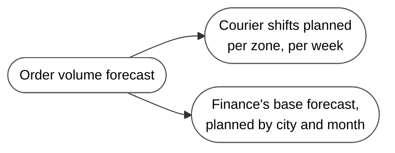
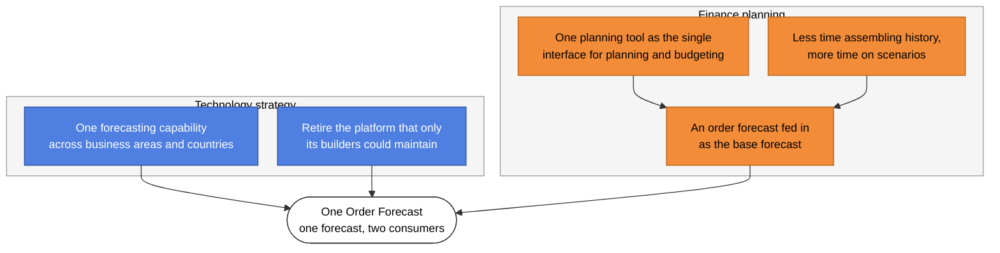
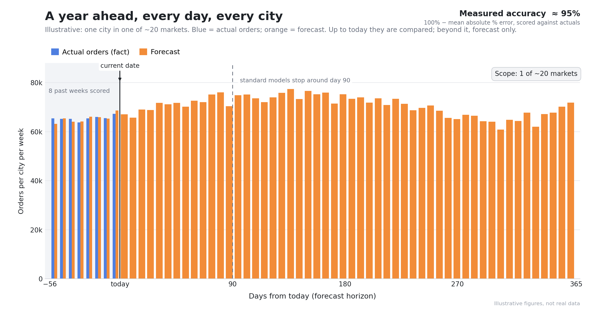
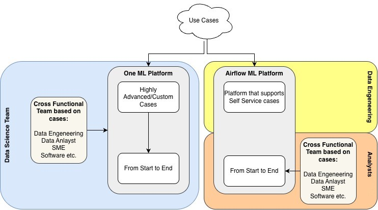
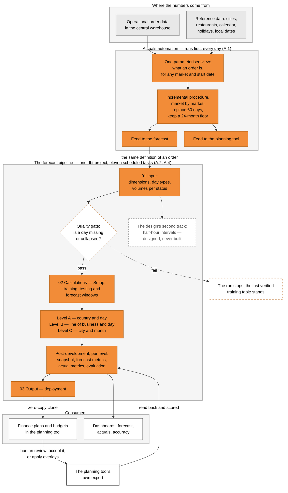
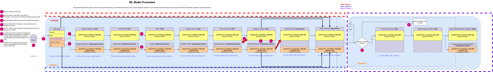
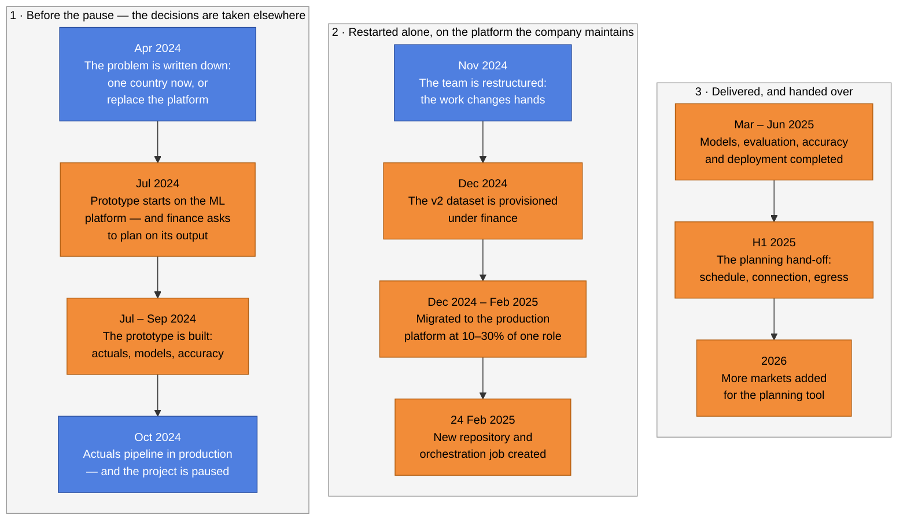

# Project 3: One Order Forecast — Order Volume Forecasting for Finance Planning

## Summary

| | |
|---|---|
| **Situation** | A global food-delivery marketplace wanted one forecast of order volume to plan against. Order volume drives courier schedules and the financial base forecast, but the forecasts were produced in different places, on a platform near the end of its life, and finance's planning team wanted to plan against an order forecast fed straight into their planning tool. Nobody owned the future solution and no team was dedicated to it. [Details](#1-situation--context-and-facts) |
| **Task** | Make the forecast real for that planning use case: a full year of order volume, city by city, produced automatically every day, measured for accuracy, and delivered both to a monitoring dashboard and into the planning tool — fast enough to prove the concept before the old platform was gone. [Details](#2-task--the-obstacleproblem) |
| **Action** | I wrote the actuals pipeline (one parameterised view shared by both consumers, an incremental procedure, two feeds) and designed and built the forecast as a dbt project: three stages, 50 models, written as hand-written warehouse SQL rather than plain SELECTs — pipe syntax in one statement, models created dynamically per market and per order status, zero-copy clones to publish, and the forecast trained and scored inside the warehouse. The year is produced by a chain of models that differ by granularity and horizon (country and day → line of business and day → city and month) rather than by one model, with holidays and spikes handled explicitly and accuracy measured in the pipeline. When the team was restructured I moved it to the production platform and shipped it alone, without the old ML platform or infrastructure support. [Details](#3-action--what-i-did-and-why) |
| **Result** | The forecast runs in production for multiple European markets and two markets outside Europe. Finance's planning tool is fed from the same pipeline, measured accuracy against actuals sits in the mid-90s% range depending on the market, accuracy is monitored in two dashboards, and adoption into long-term planning is still in progress. [Details](#4-result--outcome-and-learning) |

**My role.** **Senior Analytics Engineer**, working across:

- business analysis
- analytics engineering
- data science

I initiated the project, designed the solution and built it end to end: the actuals pipeline, the forecast models, the accuracy reporting and the hand-off to finance planning. Data engineers built the platform infrastructure while the team existed; at the end I delivered alone. The change management that makes long-term planning adopt the forecast is still open.

---

## 1. Situation — Context and Facts

**1.1 The business.** The company is a food delivery marketplace operating in many countries and many cities. An order forecast is an operating input there, not a report: operations plan courier shifts with it, and finance uses it as the base of its plan.



*One forecast, two consumers with different needs: operations needs the near term in detail, finance needs a full year by city.*

**1.2 What existed, and what was wrong with it.** The company already had a large automated forecasting platform, built and run by the group data science team. It ran end to end for the DELCO delivery zones (AU, CA, IE, NZ, UK), covered several brands and several forecasting use cases, and produced over 1.3 million courier shifts for more than 165,000 couriers every week. It worked.

It was also near the end of its life. The components that processed the data could only be maintained by ML engineers, which put the product at risk after launch, and a data scientist needed three to six months to learn the platform well enough to implement and validate a solution on it. The company's stated direction was to replace it with something simpler and unified: one forecasting capability across business areas and countries, which analysts and data engineers could understand and maintain themselves.

**1.3 Two initiatives met in the middle.** The forecast work was re-established in 2024 with a vision and a mission rather than a plan: *"a reliable central forecast solution that is compliant and trustworthy"*, delivered by *simplified and unified forecasting across the business*. Finance was moving towards the same place for its own reasons — connected planning, with the planning tool as the single interface for budgeting and planning, so that analysts stop assembling history and spend that time on scenarios. For that, finance needed a base order forecast at a granularity it could plan on, arriving on a schedule it could trust.



*Blue = the technology strategy. Orange = the finance planning ambition. The overlap is the project.*

**1.4 The requirement a standard model cannot meet.** Once the two agendas were put together, the requirement was unusually hard:

| What was needed | Why it is hard |
|---|---|
| **A full year ahead, by date** | A standard forecasting model returns about **90 days** and stops. That is the limit of the method, not a tuning problem. |
| **At city level**, not country level | City granularity multiplies the number of series, and each city series is noisier than the country total. |
| **For every order status and business dimension** the business reports on | Every combination is a separate series, so the number of series, not the number of rows, is the problem. |
| **Measured, not assumed** | Finance cannot plan on a forecast nobody has scored. Accuracy had to be produced by the same pipeline, next to the forecast. |

The scope was not one country: the forecast had to cover every city the business reports on, across around **20 markets**. The picture below shows one city in one of them.



*Illustrative, not real figures: one city in one of around 20 markets, weekly order volume. Up to today, actual volume (blue) and the forecast made for those same weeks (orange) sit side by side — that comparison is what produces the accuracy figure. Beyond today the forecast runs alone, for the 365 days ahead. Accuracy is measured against actuals by the same pipeline and sits in the mid-90s% range.*

**1.5 Nobody owned it, and there was no approved concept.** The most important fact in the situation is organisational. The initiative had a name, sponsors, a vision and a mission — and at the same time:

- **no approved technical concept** for the future platform, and no agreement between the teams about how the old and the new would coexist;
- **no dedicated data science or engineering team** on it;
- **two goals pulling against each other:** get one country forecasting now, on whatever exists, or replace the platform entirely. The short fix buys time; the long one needs resources that were never allocated;
- **fragmented work:** a proof of concept here, a prototype there, and a decision to build on the existing model that was not carried through.

The documents from that period are blunt about it, listing human constraints next to technical ones.

**1.6 How the work was staffed, and why it was fragile.** A forecasting use case was routed to one of two platforms: highly advanced or custom cases to **One ML Platform**, run by the data science team; self-service cases to the **Airflow ML Platform**, run by data engineering. Either way the case was given a **cross-functional team** assembled for it — data engineering, data analyst, SME, software — and delivered from start to end: from the data science side on the custom route, from the **analyst** team on the self-service route.



One Order Forecast was classified as a custom case: built on the ML platform, start to end, by a team assembled for it. That is why it could start at all — a year-ahead, city-level forecast needs data engineering, analysis and subject-matter knowledge in one room. It is also why it was fragile:

- the team existed **for the case**, so it dissolved when the case was re-routed (November 2024, 2.3);
- the platform had **no successor owner**: the vision to replace it existed, but nobody had been given the future solution (1.5);
- so the work was **portable and the platform was not** — and portability is what saved it later.

---

## 2. Task — The Obstacle/Problem

**2.1 The ask.** Make One Order Forecast real for the finance planning use case, and prove it fast. Four things at once:

1. **Get the actuals right and shared.** The forecast and the planning tool must be fed the same order history by the same definition, or the two sides of the business will disagree about what has happened.
2. **Produce a forecast finance can plan on** — a full year ahead, per city, per order status, automatically, every day.
3. **Make the quality visible.** Accuracy had to be a number the business could look at, in a dashboard, next to the actuals.
4. **Deliver it into the planning tool**, in the shape and granularity the planning process expects.

**2.2 The obstacle.** Four obstacles, and only the first one was technical:

- **The requirement was beyond a standard model:** a year ahead at city level, for every order status and business dimension the business reports on.
- **No approved technical concept and no dedicated team:** the vision existed; the agreement on how the old and the new platform would coexist did not.
- **Two competing goals:** get one market forecasting now, on whatever exists, or replace the old platform entirely. The short fix buys time; the long one needs resources that were never allocated.
- **Fragmented work:** a proof of concept here, a prototype there, and a decision to build on the existing model that was not carried through.

The forecast still had to reach production, be measured, and be fed into planning.

**2.3 How the scope moved.** The shape of the task changed three times, and each change was forced from outside:

| Stage | The task, as it then stood | What ended it |
|---|---|---|
| **1. Prove it** (mid 2024) | Build a working prototype quickly: fetch the actuals, produce a forecast, show accuracy, feed both consumers. | It worked well enough to be given a real platform. |
| **2. Build it properly** (late 2024) | Rebuild the forecast as a proper dbt project inside the ML platform: ingestion, preparation, models, evaluation, deployment. | The project was paused, then the team was restructured and the work changed hands. |
| **3. Ship it alone** (end 2024 → mid 2025) | Move the pipeline to the production analytics platform, finish it, and get it into production — without the platform team, at a fraction of one person's time. | Delivered. What is left is adoption, not engineering. |

**2.4 The constraints I had to design inside.**

- **Time was a fraction of a role.** The migration and the finishing work received roughly 10–30% of one person's time alongside another project. The two-to-three-month calendar span was not effort; a design that needed sustained full-time attention would have failed.
- **No safety net.** The ML platform and the infrastructure support were gone with the restructuring, so anything that needed another team's move was a real risk rather than a formality.
- **Cost mattered.** The actuals pipeline runs over years of history for many markets; a design that rebuilt everything every day would be expensive every day.
- **Finance's calendar, not mine.** The forecast has to be complete, at the right granularity, before the planning process needs it. A missed day is a planning problem, not a pipeline error.

---

## 3. Action — What I Did and Why

### 3.1 Architecture at a glance

Two pipelines, deliberately separate, sharing one definition of an order. The actuals pipeline runs first and produces the order history that both the forecast and the planning tool read. The forecast pipeline is a dbt project in three stages. Everything in the picture is what is running, except the one box marked as never built.



*Grey = what already existed. Orange = what I built. White = the consumers. Dashed = the quality gate, and the one part of the design that was never built.*

Three things in that picture are decisions rather than plumbing:

- **The year is produced in a fixed order.** Level A (country and day) → level B (line of business and day) → level C (city and month). A year at city level is only reachable by adding detail to something coarser, and a wrong country total cannot be repaired lower down.
- **The quality gate sits in front of the models**, and everything the run produces is scored afterwards — the forecast against the actuals, and the forecast as the planning tool received it.
- **The forecast goes out and comes back.** The planning tool's own export is read into the pipeline and scored, so the hand-off is measured rather than assumed.

The half-hour track that the design drew was never built, because nothing in finance's dimension set has a time of day in it ([A.2](#a2-the-forecast-architecture)).

**The design the rebuild implements.** The process was documented before it was rebuilt, in one picture: a pipeline that produces the forecast, a second pipeline in which a person reviews and adjusts it, the checks the pipeline has to satisfy, and two tracks — daily, and half-hour intervals reconciled to the same totals.



Read left to right, each track runs: prepare and unpivot → create the model → predict → smooth and pivot → clean and business logic → snapshot the forecast → format → assess accuracy → egress. The upper track is the daily forecast, the lower one the interval track, and the two are synchronised to identical totals. Pipeline 2 is the review: the base forecast goes to a person, changes are made in the forecast, the result is formatted for the application, the snapshot is ingested, and the adjusted snapshot returns to pipeline 1 at the format step — so what is assessed is what the consumer received. The numbered notes are the checks the design required: determine "bad data"; keep it out of training and fall back to the previous model; still let prediction run when bad data is found; synchronise the two forecasts; say something when the forecast changes significantly; and put a human in the loop. One note concerns ownership rather than code: the ETL that reads the order facts is rebuilt, and responsibility for data accuracy moves to the core team that owns those facts.

**How the dbt project is organised.** Fifty models in one project, grouped by stage and by step. This is the repository as it stands:

```text
one-order-forecast/                  # one dbt project; no schedule lives in it
├── dbt_project.yml                  # project name, model paths, per-folder settings
├── packages.yml / package-lock.yml  # external package dependencies
├── profiles.yml                     # which warehouse project each environment pays for
├── envs/env_file                    # the environment values
├── .github/workflows/build.yml      # release: version, tag, publish docs
└── dbt/
    ├── macros/one_order_forecast/   # dataset, market list, dimensions, the raw_sql
    │                                # materialisation, ref_dataset_model
    └── models/one_order_forecast_v2/
        ├── 01_input/
        │   ├── step_0_data_acquisition/  0_ing0_calendar · 0_ing1_holidays ·
        │   │                             0_ing2_special_dates · 0_ing3_orders
        │   └── step_1_data_preparation/  1_stg0_orders · 1_stg1_time_dimension ·
        │                                 1_stg2_orders_finance · 1_stg3_metrics_finance
        ├── 02_calculations/
        │   ├── data_quality/             2_ml2_data_quality_check
        │   ├── step_2_ml_development/
        │   │   ├── 1_Setup/              2_ml1_date_parametrs · 2_ml2_metrics_finance ·
        │   │   │                         2_ml3_selection_finance
        │   │   ├── 2_Model_One_Level_A/  agg · training · ml · prediction ·
        │   │   │                         smoothing · forecast
        │   │   ├── 3_Model_One_Level_B/  the same six steps at level B
        │   │   └── 4_Model_One_Level_C/  the same six steps at level C
        │   └── step_3_ml_post_development/
        │       ├── 1_Model_One_Level_A/  snapshot · metric forecast · metric actual ·
        │       │                         metric combined · model evaluation
        │       ├── 2_Model_One_Level_B/  the same five at level B
        │       └── 3_Model_One_Level_C/  the same five at level C
        └── 03_output/
            └── step_4_ml_deployment/     4_dp1_forecast_to_planning_tool ·
                                          4_dp2_actual_forecast_reporting ·
                                          4_dp3_accuracy_reporting ·
                                          4_dp4_accuracy_reporting_from_planning_tool ·
                                          4_dp5_table_labels
```

*Every folder carries its own README. The numbering is not decoration: `01_input`, `02_calculations` and `03_output` are the three stages, and each `step_*` folder is one task in the daily schedule ([A.4](#a4-orchestration-and-infrastructure)).*

- **One file per step, one set of tables per market.** A model loops over the market list held in a macro, so adding a market changes a code rather than 50 files.
- **Files are numbered inside each folder** and run in that order.
- **Table names are resolved by a macro** (`ref_dataset_model`), which appends the market suffix and points at the right dataset, so the same file works in development and in production.
- **Fifty models become eleven tasks**, because a task is a folder, not a model.

### 3.2 Key milestones and decisions

Every date below comes from the project itself: the documents written at the time, the commit history of the repositories, and the infrastructure definitions. Nothing here is remembered.



*Blue = driven by events outside my control. Orange = work I did. Read the three phases in order: a start decided elsewhere, a restart with no team and no platform, and the delivery that carried finance's plan.*

| When | Pivotal point | What it changed | Detail |
|---|---|---|---|
| April 2024 | The situation is written down: a country needs a forecast now, the platform that could provide it is near the end of its life, and both goals compete for the same people | Fixes what the project is for, and admits the organisational problem before any code is written | [1](#1-situation--context-and-facts) |
| July 2024 | The prototype starts, and finance proposes to plan against the forecast it produces | Turns a forecasting experiment into a business process with a deadline on somebody else's calendar | [1](#1-situation--context-and-facts) |
| October 2024 | The actuals pipeline goes to production, and the project is paused | The shared actuals outlive the pause, which is what made the restart possible | [A.1](#a1-the-actuals-pipeline) |
| November 2024 | The team is restructured and the work changes hands | Removes the platform and the infrastructure support; from here the work is solo | [4](#4-result--outcome-and-learning) |
| December 2024 | The v2 dataset is provisioned under finance, with finance as billing owner | Confirms that cost ownership follows the value: the pipeline serves the planning tool | [A.5](#a5-the-finance-hand-off) |
| 24 Feb 2025 | The new dbt repository and its orchestration job are created | The work restarts in its final home, on the platform the company maintains | [A.4](#a4-orchestration-and-infrastructure) |
| Mar – Jun 2025 | Seventy tagged releases in under four months | Models, evaluation, accuracy reporting and deployment are completed and iterated in production | [A.2](#a2-the-forecast-architecture) |
| H1 2025 | The planning hand-off is built: schedule, connection and the egress finance reads | The forecast becomes an input to the planning process rather than a report | [A.5](#a5-the-finance-hand-off) |
| 2026 | More markets are added for the planning tool | The pipeline keeps being extended after the project period, by the team that now owns it | [A.5](#a5-the-finance-hand-off) |

### 3.3 Components

Each component is a deep dive, and the craft they share is collected in 3.4.

| Component | In one line | Deep dive |
|---|---|---|
| The actuals pipeline | One parameterised view defines what an order is, one incremental procedure keeps it cheap, and two feeds move it out | [A.1](#a1-the-actuals-pipeline) |
| The forecast architecture | A chain of models that differ by granularity and horizon, because one model cannot reach a year at city level | [A.2](#a2-the-forecast-architecture) |
| Accuracy | The forecast is scored inside the pipeline: how far it was off, in which direction, and how it compares with what the planning tool received | [A.3](#a3-accuracy-scoring-the-forecast) |
| Orchestration and infrastructure | Daily dependency-ordered execution, one task per model group, the dataset provisioned as code | [A.4](#a4-orchestration-and-infrastructure) |
| The finance hand-off | The same actuals definition and the forecast itself delivered to finance planning, with ownership moved to the team that consumes it | [A.5](#a5-the-finance-hand-off) |

### 3.4 The craft: advanced SQL, not library calls

The forecast is not a script that imports a model. Every step is warehouse SQL, and the work usually hidden inside a Python service is done in SQL instead: models are created dynamically, data is promoted with a zero-copy clone that only happens when the quality check passed, and the check itself is a query that is allowed to stop the pipeline.

| Technique | Where it is used | Why it was needed |
|---|---|---|
| **Pipe syntax** (`\|>`) — one statement, stages in reading order | The accuracy model that scores the forecast the planning tool received | Three transformations stacked on each other — aggregate to city and day, score, aggregate to country and day — then a join. Nested, that is unreadable. |
| **Warehouse scripting** — variables, loops, dynamic DDL (`EXECUTE IMMEDIATE`), `IF/THEN/ELSE` | Building the models per market and per order status; the quality gate | The number of models is not known when the file is written: it depends on which order statuses a market has. |
| **Zero-copy promotion** (`CREATE TABLE … CLONE`) | The metrics table the models train on, the training snapshot, and the hand-off table the planning tool reads | This is how the gate is enforced, not only how a table is published: checked data is promoted into the table the next step reads only if the check passed. Metadata-only, so promotion is atomic and copies nothing. |
| **Window functions and `QUALIFY`** | Deduplication, daily volume levels, anomaly detection in the gate | Ranking and per-dimension totals without self-joins. |
| **`GROUP BY ALL`, `SAFE_DIVIDE`, `NULLIF`, `COALESCE`** | Throughout the project | Division by zero, missing dimension members, and drift between what is selected and what is grouped — in a forecast one bad row propagates into the year. |
| **In-warehouse ML** — `ARIMA_PLUS_XREG`, `ARIMA_PLUS` with time-series and hierarchical series options, `ML.FORECAST`, `ML.ARIMA_EVALUATE`, `ML.HOLIDAY_INFO` | The three levels and model selection | The model trains where the data already sits: no separate ML platform, no serving layer, no export step. |
| **Templating plus one custom dbt materialisation** | All fifty models | One file per step generates every market, and the materialisation lets dbt run hand-written DDL while still resolving the dependency order, because every reference goes through a macro. |

The pipe-syntax model is worth seeing whole, because it is where the forecast is audited against what finance actually received. Abridged, with names generalised:

```sql
-- Score the forecast that the planning tool actually received, against the same actuals
FROM  (SELECT * FROM planning_tool_export)      -- orders, forecast versions and actuals together
|> WHERE    time >= '2025-01-01'

|> AGGREGATE                                     -- step 1 · to city and day
       SUM(CASE WHEN orders_type = 'Forecast'
                 AND version LIKE '%1OF%'  THEN orders ELSE 0 END) AS ov_forecast,
       SUM(CASE WHEN orders_type = 'Actuals' THEN orders ELSE 0 END) AS ov_actual,
   GROUP BY country AS country, city AS final_city, time AS date

|> EXTEND                                        -- step 2 · error per city and day
       ABS(ov_actual - ov_forecast) / NULLIF(ABS(ov_actual), 0) AS ape

|> AGGREGATE                                     -- step 3 · to country and day, weighted
       SUM(ov_actual) AS ov_actual,
       SUM(ov_forecast) - SUM(ov_actual) AS bias,
       ROUND(SAFE_DIVIDE(SUM(ov_forecast) - SUM(ov_actual), SUM(ov_actual)) * 100, 2)
                                                                    AS percent_bias,
       ROUND((1 - SUM(ov_actual * ape) / SUM(ov_actual)) * 100, 2)  AS baseline_accuracy
   GROUP BY country, date

|> AS planning_tool                                    -- name the intermediate table, then join it
|> LEFT JOIN own_accuracy_report AS one
       ON planning_tool.country = one.country AND planning_tool.date = one.date

|> SELECT planning_tool.*, one.ov_actual AS ov_actual_check, one.ov_forecast AS ov_forecast_check
|> ORDER BY country, date
```

The real model keeps three forecast versions side by side — the previous week's rolling forecast, the rolling forecast, and the 1OF forecast — each split into base and base-plus-overlay, so the versions finance used to plan on are scored the same way as the new one ([A.3](#a3-accuracy-scoring-the-forecast)).

What this bought is survivability rather than elegance. The daily run is one command per stage; per-market and per-status behaviour is data in a macro instead of branching code; publishing is a metadata operation; and the whole thing fits in one head, which is what made finishing it at 10–30% of one person's time possible (2.4).

---

## 4. Result — Outcome and Learning

**4.1 The outcome.**

> **The forecast runs in production for multiple European markets and two markets outside Europe. Finance's planning tool is fed from the same pipeline, measured accuracy against actuals sits in the mid-90s% range depending on the market, accuracy is monitored in two dashboards, and adoption into long-term planning is still in progress.**

| Objective from [2](#2-task--the-obstacleproblem) | Where it stands |
|---|---|
| Get the actuals right and shared | Done and running daily. One definition of an order serves both the forecast and the planning tool, so the two sides cannot drift apart. |
| A forecast finance can plan on: a year ahead, city level, daily | Done and in production. The year is reached by a chain of models rather than by one over-stretched model. |
| Make quality visible | Done, and produced by the pipeline itself: accuracy and bias are read in two dashboards — the forecast against actuals, and what the planning tool actually received. Measured accuracy settled in the **mid-90s% range depending on the market**, and that is the number that turned the forecast from a prototype into something finance would plan on. |
| Deliver into the planning tool | Delivered, and the ownership of the data moved with it: the team that plans against the numbers now pays for the pipeline. |
| Prove the concept fast | Done, and it outlived the proof: the pipeline was paused, restructured, migrated and finished, and the actuals side never stopped running. |

What is **not** finished is adoption. The pipeline can deliver a forecast that planning uses, but making the company's long-term planning work against it is change management, and that takes longer than shipping the code.

**4.2 What went wrong, and what I would do differently.**

- **The project was picked up and put down.** It was paused mid-build and then restructured, so a design that assumed stability would have died. The migration was done at 10–30% of one person's time, which is a real constraint on architecture: fewer moving parts per release, everything written down, nothing dependent on someone else's board.
- **Delivery after the restructuring was solo.** The ML platform and the infrastructure support disappeared with the team. I finished and shipped it on the platform the company maintains, which is why it is still running.
- **The hardest technical part was proving the year-ahead, city-level forecast was possible** — not tuning a model, but establishing that the requirement could be met at all, and then making the output measurable so that "possible" could become "trusted".
- **The hardest non-technical part was making the numbers agree end to end**, from the warehouse to the planning tool, because every step in that chain had its own definition of the same order until somebody made them one.
- **What I would do differently:** treat the change management as part of the deliverable from the beginning. The engineering finished while adoption was still starting, and those two should have run on the same timeline.

---

# Appendix A — Deep Dives

Each deep dive explains how a component works, what it had to satisfy, and what it cost.

## A.1 The actuals pipeline

The forecast is scored against the actuals and finance plans against them, so both consumers depend on one number per market, per city, per day, per order status. That number comes from a pipeline of its own that runs before everything else — the part of the project that survived the pause and was already in production in October 2024 ([3.2](#32-key-milestones-and-decisions)).

It is three artefacts, each answering a different question:

| Artefact | What it decides | What it replaced |
|---|---|---|
| A **BigQuery table function** | What an order is — for any market, from any start date | A plain view, or a copy of the same definition inside every consumer |
| An **incremental procedure**, looping market by market | How much history is recalculated on any given day | A full rebuild of the whole history every night |
| **Two egress paths** from that one view | What each consumer receives: its own grain and its own shape | One export that each consumer adapted to itself |

Those artefacts are three files in the shared queries repository — the view, the procedure, and one feed per consumer — plus the orchestration configuration that runs them and the two dashboards that read the result.

### The view is a function, so the definition has one home

`actuals_view(start_date, market)` takes exactly two inputs: the date to start from, and the market. Every consumer calls it with its own two values instead of re-implementing the filter, the joins and the status logic. The order statuses are labelled blocks inside one file — successful, cancelled, on-demand, white-label and the delivery-as-a-service status — and that file is where "one order" means one thing.

A table function rather than a view, because consumers need it *from a start date they choose*: the forecast needs the window it is about to score, the planning feed needs the months it is refreshing. Parameterising it was the decision that made the rest possible.

### The procedure recalculates sixty days, not two years

The daily procedure walks the markets one at a time and rebuilds the recent window instead of the whole history:

- **The cut-off is sixty days**, because the central warehouse itself replaces roughly that much history; anything older has not moved, so recalculating it would pay twice for the same numbers.
- **The floor is twenty-four months**, so every market always carries two full years — enough to train on a year and test on months, and a defensible history for accuracy reporting.
- The window is assembled in a **staging table that expires after twelve hours**, so the storage used while the work happens costs a rounding error and leaves no debris.
- The last sixty days are **deleted from the target and re-added**, which makes the operation idempotent: run it twice and the second run produces the same table instead of duplicating a day.
- If the incremental path cannot be used — a schema change in the source, for instance — the procedure catches the error and **falls back to a full rebuild for that market** rather than leaving the table half-refreshed. A pipeline that stops is expensive; a pipeline that silently keeps yesterday's numbers is worse.

Looping over markets instead of writing one query for all of them is deliberate for the same reason: a failure stays inside one market, the statements stay small, and a rerun costs one market's window rather than the whole estate.

### Two feeds, two shapes

- **The feed to the forecast** is built per market, enriched with the city grouping the planning tool uses, and stripped of the dimensions a market does not have — so a market that never had a certain partner category does not arrive with a column of nulls.
- **The feed to the planning tool** is aggregated to the granularity that tool expects, because planning happens at a coarser grain than the forecast is scored at.

Only three of the five order statuses the view defines are promoted to the egress. The two left behind are statuses nobody plans on, and carrying them would inflate the totals both consumers compare against.

### What it cost, and what is honest about it

The cost control is structural rather than a matter of tuning: the expiring staging table, the twenty-four-month floor and the sixty-day window *are* the design, and the per-market loop keeps a rerun cheap. The price is that only the recent window is guaranteed fresh — an older day corrected upstream waits for the next full rebuild. I would make that trade again, because both consumers care about the recent past.

Two wrinkles worth stating rather than leaving to be discovered:

- The loop covers the European markets plus two markets outside Europe **added later for the planning tool**, and one further market that is not in the planning egress.
- The definition of an order is **narrowest inside the forecast**: these feeds carry three statuses, while the forecast's own preparation step keeps two ([A.2](#a2-the-forecast-architecture)). That exclusion is deliberate, not an oversight: the third status is not one anybody plans on, and a model built on it would forecast orders nobody acts on.

### Who owns it, and why that is the point

I wrote the pipeline end to end: the table function, the incremental procedure, the orchestration configuration and both egress paths. The ownership did not stay with me — the repository is managed by the central finance analytics team, and billing and operational ownership moved there as the planning integration started in the first half of 2025, because by then the pipeline served their planning tool as much as it served the forecast. That is the outcome I wanted: the work stopped being a project and became somebody's production asset.

## A.2 The forecast architecture

The requirement was a year ahead, at city level, for every order status and business dimension the company reports on (1.4). No single model does that: a standard time-series model returns roughly ninety days and stops, and every extra dimension multiplies the number of series to fit. The architecture is the answer, and it has three parts — the levels, the horizons, and the gate in front of both.

### The design, and what the rebuild did with it

The process was written down before the rebuild: the picture, the steps, the table each step produces, and the checks the pipeline had to satisfy. That picture is reproduced in [3.1](#31-architecture-at-a-glance). The rebuild is a faithful implementation of it — one file per step, one set of tables per market — with four differences that mattered:

| The design said | The rebuild does | Why |
|---|---|---|
| Prepare → model → predict → smooth → business logic → snapshot → assess → egress | The same eight steps, one file per step, one set of tables per market | The process was right; what was missing was that only its author could maintain it. |
| A second track: the daily forecast distributed across the half-hour interval | Not built for this consumer | The interval dimension belongs to the operational planning use case. Finance's dimension set has no half-hour in it, and shipping an interval nothing consumes is cost with no reader ([Decision 5](#decision-5--no-half-hour-track-for-this-consumer)). |
| Two levels: country and day | Three: country and day, line of business and day, city and month | City is where finance plans, and in the design's model levels city does not exist at all. |
| One forecast horizon | Two horizons: days for the near term, months for the year | The near term has to be daily to be usable, and a year cannot be reached at daily granularity. |

### The guarantees, and how the pipeline meets them

The design listed the guarantees the pipeline had to give. They are the requirements that usually stay implicit, and they are most of what makes a forecast trustworthy:

| Guarantee written into the design | How the rebuilt pipeline meets it |
|---|---|
| **Detect bad data** | Every day is compared with the average of the same market, weekday and day type, so a collapsed or missing day stands out. The tolerance is set per market, because a normal day is not the same shape everywhere: one market has a known Christmas collapse, another a different weekend pattern, and the rest a default. |
| **Keep bad data out of training** | The gate withholds rather than warns. Every day of the training window is compared with that market's own average for the same weekday and day type; when a day falls below the tolerance, the verified metrics are **not cloned** into the table the models read — that table keeps the last verified content — and the check table is written with a column named `failure` where the next step selects `success`, so the run stops on a SQL error instead of training on a broken week. |
| **Still let prediction run when bad data is found** | The gate blocks only when the bad day is in the training data. A gap in the recent days that are about to be scored does not stop the forecast — the difference between a pipeline that is safe and one that is never available. |
| **Keep the levels synchronised to identical totals** | Each level is reconciled to the level above: the business-unit level is joined to the country totals, and the city level is built from the business-unit level, so the same total appears at every level and finance's plan inherits one number. |
| **Notify about significant changes** | Every run's forecast is snapshotted with its ingestion time, so a change between runs is visible rather than silent, and the accuracy report states the direction of the error — bias and percentage bias per country and day — not only its size. |
| **Use the correct data when a change is made** | The window definitions — training, testing and the two forecast windows — are computed per market at the start of every run, so a re-run uses the same definitions as the previous run instead of whatever today's date happens to be. |
| **Be able to re-run after a model change** | Models are created from one file per level and step, so a model change is a re-run of one stage, and the stages above rebuild on the new output instead of being re-edited by hand. |
| **Allow the user to make manual changes** | Manual changes live in the planning tool, not in the pipeline: finance adjusts the forecast there, and the pipeline scores what it actually received, so an adjustment is recorded and measured rather than colliding with the next run. |

### The three levels

| Level | Grain | What is fitted | Trained on | Horizon | Why this level exists |
|---|---|---|---|---|---|
| **A** | Country and day | One model per order status, with external regressors | Daily history, up to the start of the current week | Days, to the end of the month roughly two months out | The total, and the shape of the near term. A wrong country total cannot be repaired lower down. |
| **B** | Line of business and day, with every other reporting dimension attached | One hierarchical model per market, over all of that market's series | The same daily history | Days | The mix: which business line, partner type and chain carry the volume. It is reconciled to level A's country totals. |
| **C** | City and month | One hierarchical model per market | Monthly history whose window ends where the daily forecast ends | Twelve months | The level finance plans on, and the only level that reaches a year. |

The order matters. Level B is built on top of level A, and level C on top of level B, because the year at city level is only reachable by adding detail to something coarser: fitting the city series directly produces ninety days and noise, while adding city detail to a forecast whose totals are already anchored to the country produces the same forecast with a bottom.

### The horizons and the windows

Five windows are computed per market in every run, and they are what turn "a year ahead" into something the models can be pointed at:

| Window | What it covers | Measured in |
|---|---|---|
| `training 1` | From the first day in the calendar to the start of the current week | days |
| `testing 1` | The current, incomplete week, up to today | days |
| `forecasting 1` | From tomorrow to the end of the month about two months out | days |
| `training 2` | From the first day in the calendar to the end of `forecasting 1`, so it contains the daily forecast's own output | months |
| `forecasting 2` | The twelve months after that | months |

Two things follow from this, both deliberate. The near-term track ends on a month boundary, so the daily and monthly forecasts join on a clean line instead of in the middle of a month. And the monthly model's history includes the daily model's forecast, so the twelve-month track starts from a level that already agrees with the near term rather than restarting from the last day with actuals — which is how a chain of models with a ninety-day reach covers a year.

### How the models are configured

- **External regressors at level A, hierarchy at levels B and C** — the regressor model does better on a series that must not be wrong, and the hierarchical model is the one that fits many series at once and respects the relationships between them. The trade-off is stated in the files rather than hidden ([Decision 4](#decision-4--hierarchy-at-the-granular-levels-external-regressors-at-the-coarse-one)).
- **One model per order status at level A**, because the statuses have different histories, different shapes and different noise.
- **Spikes and dips are cleaned, step changes adjusted, seasonality left automatic**, and holidays are declared explicitly: public holidays per market, local special dates, and the dates the business treats as events.
- **The number of models is not known when the file is written** — it depends on which statuses a market has — so the file generates them in the database instead of listing them ([3.4](#34-the-craft-advanced-sql-not-library-calls)).
- **Model selection is inspectable:** candidate models are trained and evaluated, and the winner is written to a table with its information criteria and log-likelihood.
- **The training length per series was tuned deliberately**, and the arithmetic of the alternatives sits in the model file's comments next to the value chosen.

Every run retrains and republishes a forecast for every level, market and dimension combination. That is the price of a current forecast rather than a historical one, and it is bounded by two decisions: how long the training window is, and what genuinely has to be a model rather than a calculation.

## A.3 Accuracy: scoring the forecast

A forecast nobody has scored is an opinion. Two things are measured, in two layers: the forecast against the actuals, inside the pipeline, on every run; and the forecast as the planning tool received it, after finance planned on it or adjusted it. The second layer is why the pipeline does not simply trust its own output.

### Layer 1 — the forecast against the actuals

The measurement runs from the bottom up, so that the verdict and the diagnosis both survive:

1. **Error per city and day** — the absolute percentage error, `|actual − forecast| / |actual|`, with the division protected so a zero-actual day cannot turn into infinity.
2. **Aggregated to country and day**, and deliberately **weighted by volume** rather than averaged: an unweighted mean of city errors lets a village with five orders count as much as a capital. The published number is `1 − Σ(actual × error) / Σ(actual)`.
3. **Bias alongside it** — the absolute error (`Σ forecast − Σ actual`) and the same difference as a percentage. A forecast can be 95% accurate and still systematically 4% high, and finance cares which of the two it is.
4. **Rounded and dated** — per country and per day, ready to be charted and compared week over week.

| What is published | In words | What it answers |
|---|---|---|
| Absolute error | Sum of forecast minus sum of actual, in orders | Are we planning too high or too low? |
| Percentage bias | That difference divided by the actual total | Is the error material at the size of this market? |
| Baseline accuracy | One minus the volume-weighted average city error | How close is the forecast, allowing for the mix of cities? |
| Error per city and day | The same error before weighting | Which city is dragging the accuracy down — the diagnosis rather than the verdict. |

All of it is computed for **three forecast versions at once** — the previous week's rolling forecast, the rolling forecast, and the 1OF forecast — each split into base and base-plus-overlay. So "is the new forecast better than what finance planned on last week" is answered by the same numbers, over the same days, rather than by memory.

### Layer 2 — what the planning tool actually received

The last model of the pipeline reads the planning tool's own export — the orders, the forecast versions and the actuals as that tool holds them — and repeats the measurement on it ([3.4](#34-the-craft-advanced-sql-not-library-calls) shows the query). It then joins the pipeline's own accuracy report alongside it, country by country and day by day, so the two can be read together.

This layer exists because a forecast can be right in the warehouse and wrong by the time planning opens it: imported at the wrong grain, missing a dimension value the planning model expects, or published as a version the planners do not use. Measuring what arrived is the only way to catch that class of failure, and it is what turns the hand-off from something hoped for into something verifiable.

### What the numbers say

Accuracy settled in the **mid-90s% range depending on the market**, measured by the volume-weighted definition above, on every run. The range rather than a single figure is the honest form: markets differ in how stable their own volumes are, and one figure across all of them would hide exactly what a planner needs to know. That is why the per-city error and the per-day bias stay in the report next to the country-level accuracy — so the reason a market sits where it does can be read instead of argued about.

### One thing that is deliberately absent

The operational forecaster scores itself at half-hour and delivery-zone level. This forecast has no half-hour dimension, but it does carry partner and business-unit dimensions, so the same definition of accuracy is applied at city and day. Keeping the definitions aligned was deliberate: two forecasts of the same orders that disagree about what "accurate" means will always disagree about the answer.

## A.4 Orchestration and infrastructure

The dbt repository contains no schedule and no coordinator: models, macros, configuration, and the CI that releases them — and nothing that could run any of it. Execution belongs to the company's shared orchestration service (Airflow, run through the internal platform), and the tasks are declared in a *second* repository, in a folder that mirrors this project ([3.1](#31-architecture-at-a-glance) shows the model tree it selects from). That separation looked like overhead when I started; it is the reason the pipeline later needed no platform team of its own, because "the run" is a configuration entry in a shared service rather than a service to keep alive.

The entire schedule is one file:

```yaml
kind: dbt                        # dbt | airflow-bigquery
schedule: 0 12 * * *             # crontab — once a day
owner: customer-services-analytics
dbt:
  repo: data-platforms-users/one-order-forecast
  airflow_integration: model     # project | model level integration
  profile: profiles.yaml
tasks: …                         # eleven tasks, below
notifications: notifications.yaml
```

Eleven tasks, one per folder of models, with the dependencies written out:

| # | Task (the folder it selects) | Waits for | What it produces |
|---|---|---|---|
| 1 | `01_input · step_0_data_acquisition` | — | Calendar, holidays, special dates, orders |
| 2 | `01_input · step_1_data_preparation` | 1 | Finance dimensions, day labels and day types, daily volumes per status |
| 3 | `02_calculations · 1_Setup` | 2 | The window parameters per market, **the quality gate**, and the metrics table the models train on |
| 4 | `02_calculations · data_quality` | 3 | A task that fails when the gate found a broken training day |
| 5 | `02_calculations · 2_Model_One_Level_A` | 2, 3 | The country-and-day forecast |
| 6 | `02_calculations · 3_Model_One_Level_B` | 5 | The business-unit-and-day forecast |
| 7 | `02_calculations · 4_Model_One_Level_C` | 6 | The city-and-month forecast, the level finance plans on |
| 8 | `02_calculations · post-development A` | 5 | Snapshot, forecast metrics, actual metrics, combined view, evaluation |
| 9 | `… post-development B` | 8, 6 | The same, for level B |
| 10 | `… post-development C` | 8, 9, 7 | The same, for level C |
| 11 | `03_output · step_4_ml_deployment` | 8, 9, 10 | The planning-tool hand-off, the accuracy reports, the table labels |

Three things in that table are decisions rather than mechanics:

- **The tasks are folders, not models.** Integration is at *model-group* level: one Airflow task per folder, one `dbt run --select` per task. Fifty models therefore become eleven tasks that can be watched, retried and reasoned about. The folder naming convention exists for exactly this: the README inside the input step says the folders are numbered "to help with the Airflow DAGs set-up: to choose which folders to be grouped or separated for execution".
- **Evaluation follows the level it evaluates.** The post-development steps chain A → B → C rather than running in parallel, because each level's evaluation reads the level above it as well as its own output ([A.3](#a3-accuracy-scoring-the-forecast)). The last task waits for all three evaluations, so the hand-off to finance is published only after every level has been scored.
- **The safety mechanism is not the dependency graph.** The quality-gate task is a *sibling* of the model tasks, not their parent. It exists to make a bad day loud in the run history; what actually keeps unverified data out of training is the SQL in task 3 — the gate promotes the verified table into the table the models read only when the check passed, and writes a differently-named column when it did not, so the next model fails on a SQL error ([3.4](#34-the-craft-advanced-sql-not-library-calls)). A dependency cannot express "this data is trustworthy".

### Releasing it: a tag, a manifest, a generated DAG

Nothing is deployed by hand. A merge to the dbt repository starts a chain of reusable CI workflows that the platform team owns:

1. **Generate a version** and **create a tag** — the release is a tag produced by CI, so "which code is running in production right now" always has an exact answer.
2. **Trigger the manifest** in the tasks repository — the tagging workflow's completion is what fires it, so there is no moment where models and DAG can disagree about which version they belong to.
3. **Generate the DAGs** from the dbt manifest plus the task declaration, and **apply them to dev**, then publish documentation, then repeat for production. A **rollback workflow** exists alongside the deploy chain, so going back is a supported operation rather than a rescue.

The DAG is generated, not drawn: the dependencies come from the `ref()` calls in the SQL, the task boundaries come from `dag.yaml`, and the generator package is pulled from the internal artefact repository. That is the pay-off of the custom materialisation ([3.4](#34-the-craft-advanced-sql-not-library-calls)): because every model resolves its inputs through a macro, dbt can still see the lineage of hand-written DDL, and the generated graph is the real graph.

### The environment is two answers, in two files

- **Which dataset a table lives in** is one macro; **the market list** is one line of Jinja — seventeen market codes, over which every model in the project loops. Adding a market is adding a code, not writing a model, which is why coverage could grow for a new consumer without new SQL ([A.1](#a1-the-actuals-pipeline)).
- **Which project pays for the query** is the profile, and that is what separates the environments: dev executes in the finance dev project, production in the finance production project (the execution project is deliberately not the warehouse project, so storage and compute can be attributed without mixing them). Production is chosen by an environment variable, not a code change.
- **What a dependency is called** is `ref_dataset_model()`, which resolves the model, appends the market suffix the looping SQL uses, and pins the warehouse project — so the same file works in every environment.
- **Dimensions have macros of their own** — the finance dimension, the date dimension, and two variants for the planning-tool egress — so "business unit" or "city" is written once and cannot drift between the forecast and the hand-off.

Two conventions do the rest of the operational work: every folder carries `data_product: one_order_forecast` as a label, so the cost of one product can be read from the warehouse, and `persist_docs` is on, so the documentation written next to the SQL ends up on the table itself. A failed run notifies the owning team alias, the finance analytics alias and the engineers on the project — the ownership of a failure sits in the same file as the schedule.

### What it takes to keep this alive

- **The run is configuration.** Eleven tasks, one cron, one notification list — no bespoke service, no servers, nothing to patch.
- **The release is a tag** and the graph is generated, so a change cannot land in the code without landing in the schedule.
- **A rerun is a task**, and a bad market is isolated to its own step ([A.1](#a1-the-actuals-pipeline)).

The costs of the same design, stated plainly: the schedule lives in a second repository, so changing the shape of the run is a pull request somewhere else; the market list is code rather than reference data, so a new market needs a change and a release rather than a row; and a market that fails late in a run is recovered by rerunning the task rather than by resuming from the failure point. I would pay all three again — each is a small, known price for a pipeline one person can hold in their head.

## A.5 The finance hand-off

A forecast nobody plans on has no effect, so the last job of the pipeline is not "compute a forecast" but "deliver one". The delivery is a table in the warehouse that finance's planning tool reads, and everything about it is shaped by the receiving end.

### What finance receives, and why it looks the way it does

The hand-off table is built from **level C** — the monthly, city-level forecast — because that is the grain planning works at. It is not the table the models produced; it is a deliberately flattened interface to the tool's own model:

| What the tool receives | Where it comes from | Why it is shaped that way |
|---|---|---|
| `orderdatetime` | the level C date, formatted as day-month-year | The tool's import expects that format rather than a warehouse date |
| `cityid`, `businessunit`, `chaintype` | the comma-separated hierarchy codes, **first element only** | The pipeline's dimensions are hierarchical; the tool's model keys on a single flat code per hierarchy |
| `nr_of_orders` | the level C forecast, summed | The tool's grain, not the pipeline's |
| `partner_category`, `partner_type`, `chainid`, `restaurant_segment`, `order_status` | level C | The dimensions planning consolidates by |
| `inserted_ts` | the ingestion timestamp, as text | Freshness is visible at the receiving end, not only in our logs |

Two details of that interface are what a hand-off really is. The hierarchical codes are **truncated to their first element on the way out**, so the pipeline carries the full hierarchy and the tool receives the flat key it can join on. And the table is **cloned** into the shared dataset rather than rebuilt in it — a metadata operation, so publishing costs nothing, is atomic, and cannot half-succeed. Because the last task waits for all three levels and all three evaluations ([A.4](#a4-orchestration-and-infrastructure)), finance never reads a partially published forecast.

The actuals arrive in the tool by the same route from the other pipeline ([A.1](#a1-the-actuals-pipeline)), aggregated to the same grain. Forecast and actuals therefore meet inside the planning tool in the shape the tool wants, from two feeds cut from one definition of an order.

Nothing finer than that grain reaches the planning tool. Levels A and B are the pipeline's own working levels — daily, and finer than any planning decision — read inside the pipeline, where each level is scored against the one below it; level C is the monthly roll-up that planning opens.

### The loop closes: measuring what the tool received

The hand-off is not one-way. The last model of the pipeline reads the planning tool's own export and measures the forecast **as the tool has it** ([3.4](#34-the-craft-advanced-sql-not-library-calls), [A.3](#a3-accuracy-scoring-the-forecast)).

That model scores two things at once. It separates **forecast versions** — the previous week's rolling forecast and the 1OF forecast, each split into base and base-plus-overlay — so the number finance planned on last week is scored against the same actuals as this week's, on the same days, weighted the same way. And it separates **base from overlays**, because a forecast that was accurate before finance applied their own judgement and inaccurate after it is a different conversation from the reverse; without that split, the pipeline and the planners would be arguing about a number neither of them owns alone.

Then it joins the pipeline's own accuracy report beside that result, country by country and day by day. Nothing downstream of the pipeline can quietly break the hand-off unnoticed: a wrong grain, a missing dimension value, or a version the planners do not use shows up as a divergence between the two halves of that report.

This is the part of the project I would defend hardest. A forecast measured only where it is produced will always look better than the forecast finance actually receives, and the difference between those two is exactly where hand-offs fail.

### One dataset, two owners

The dataset this hand-off lives in was created under the central finance analytics team, and the integration work — schedule, connection and the tool's egress — ran through the first half of 2025. The tool's own egress service account holds read access to the forecast dataset, which is the machine-level evidence that the hand-off is live rather than planned: nobody has to copy anything for finance to get the forecast.

That is also why the ownership moved: the pipeline now serves finance's planning process as much as it serves the forecast, so the cost belongs where the value is. I kept the authorship and gave away the bill, which is the arrangement I would choose again ([A.1](#a1-the-actuals-pipeline)).

---

# Appendix B — Decision Log

Each decision follows the same pattern: context, options, choice, why, and the trade-off accepted.

### Decision 1 — Three models by grain and horizon, not one model

- **Context.** The near term has to exist per day and per line of business to be usable, and the year has to exist per city and per month for finance to plan on it. One model cannot serve both on this data.
- **Options.** (a) One model at the finest grain, projected a year ahead. (b) One model at the coarsest grain, with detail added by calculation. (c) Three models — country and day, line of business and day, city and month — chained so each adds detail to the level above.
- **Choice.** (c). Level B is built on top of level A, level C on top of level B, and each level's combined output is assembled from the level above it as well as from itself.
- **Why.** Fitting city series directly produces ninety days and a lot of noise; adding city detail to a forecast whose country totals are anchored produces the same forecast with a bottom ([A.2](#a2-the-forecast-architecture)). A wrong country total cannot be repaired lower down, so the coarse level is settled first.
- **Trade-off accepted.** Three models to train, run and reconcile every day instead of one. Accepted because the alternative cannot reach a year at the grain finance plans at.

### Decision 2 — The monthly level's history includes the daily forecast

- **Context.** The monthly model's horizon is twelve months. Its history would normally end at the last day with actuals, so the year would start by contradicting the daily forecast over the weeks the two overlap.
- **Options.** (a) Monthly history from actuals only. (b) Monthly history from actuals plus the daily forecast. (c) Fit both tracks independently and reconcile the totals afterwards.
- **Choice.** (b). The daily forecast is aggregated to the month, and the monthly history takes the actual where a day is an actual and the forecast where it is not — one table, read from the level above.
- **Why.** Two tracks that overlap by a month will disagree inside that month unless one is defined in terms of the other. This way the twelve-month track starts from a level that already agrees with the near term, joining on a month boundary rather than mid-month.
- **Trade-off accepted.** Part of the monthly model's history is a forecast, so an error in the daily forecast is inherited by the year. Accepted because the alternative is a year that contradicts the near term; the borrowed stretch is at most the daily horizon, and the daily forecast is republished every day.

### Decision 3 — One model per order status at level A

- **Context.** The order statuses are not variations of one series: different histories, different shapes, different noise — and a market does not necessarily have all of them.
- **Options.** (a) One model with the status as a dimension. (b) One model per status, per market. (c) One model for the dominant traffic and one for the rest. (d) A hand-maintained list of models.
- **Choice.** (b). The file declares no model list: it loops over the statuses present in that market's training data and generates one model per status through dynamically built DDL.
- **Why.** A shared model has to compromise between shapes that do not resemble each other, and a hand-written list is wrong in a market that has a status the author never saw. Deriving the list from the data makes the number of models a property of the market, not of the file ([3.4](#34-the-craft-advanced-sql-not-library-calls)).
- **Trade-off accepted.** The number of models multiplied by markets and statuses is where the compute goes, and the model inventory differs per market, so "which models exist" is a query rather than a reading of the code. Accepted because the cost is bounded by the training window, and the alternative averages unlike things together.

### Decision 4 — Hierarchy at the granular levels, external regressors at the coarse one

- **Context.** Two warehouse ML options for the same data: a model that takes external regressors, or a model that fits many series in one query and enforces the relationships between them. The published comparisons — cited in the model files — put the regressor variant ahead on the measured error metrics.
- **Options.** (a) Regressors everywhere. (b) The hierarchical model everywhere. (c) Regressors at the coarse level, hierarchy at the granular ones.
- **Choice.** (c). Level A is one regressor model per order status; levels B and C are one hierarchical model per market, over all of that market's series.
- **Why.** At level A the extra signals are pure gain on a series that must not be wrong. At the granular levels the number of series is what matters, and fitting them independently throws away the relationship between a city and its country — the reason those levels exist ([A.2](#a2-the-forecast-architecture)).
- **Trade-off accepted.** A measured accuracy advantage is knowingly given up at levels B and C. The files state it: the regressor variant scores better, and the hierarchical one was chosen because it supports series identifiers, which is what fitting and forecasting a whole market in one query requires. Consistency between a city and its country is worth more to a planner than the last increment on an isolated series.

### Decision 5 — No half-hour track for this consumer

- **Context.** The operational forecaster scores itself at half-hour and delivery-zone level, and the design picture for this project drew it as a second track. Copying that shape was possible.
- **Options.** (a) Add a half-hour dimension and mirror the operational forecaster. (b) Keep the three reporting levels and no time-of-day dimension. (c) Deliver half-hour data for the near term only.
- **Choice.** (b). The forecast carries country, line of business, partner type, chain and city — not time of day.
- **Why.** Nobody in this chain plans at that grain: the questions are how many orders in a city in a month, and how the near term is shaping. The accuracy model notes the difference explicitly — the operational forecaster works at hour and zone level, "but 1OF does not have 1 hr, but has different dimensions like partners, business unit etc." A half-hour dimension would multiply the series and the training cost for a dimension nobody consumes.
- **Trade-off accepted.** The daily forecast cannot answer a question about a time of day, and that gap is stated rather than left to be discovered ([A.3](#a3-accuracy-scoring-the-forecast)). The operational forecaster already answers it, and where the two meet — city and day — they are measured with the same definition of accuracy.

### Decision 6 — Measure what the consumer actually received

- **Context.** A forecast can be correct in the warehouse and wrong by the time finance plans on it: imported at the wrong grain, missing a dimension value the planning model expects, or published as a version the planners do not use.
- **Options.** (a) Measure inside the pipeline only. (b) Measure inside the pipeline and wait for finance to report problems. (c) Read the planning tool's own export back and score the forecast as the tool holds it.
- **Choice.** (c). The last model of the pipeline reads the tool's export, scores the forecast versions it contains against the actuals, separates base from overlays, and joins the pipeline's own accuracy report beside the result.
- **Why.** The only meaningful definition of a working hand-off is the number the planner opens, and it settles attribution, because the base and the overlays finance applied are measured separately ([A.3](#a3-accuracy-scoring-the-forecast), [A.5](#a5-the-finance-hand-off)).
- **Trade-off accepted.** The pipeline depends on an export from a system it does not own, and it identifies forecast versions by a naming convention there, so a renamed version would be measured as something else. Accepted because the alternative measures only where the pipeline has control; the mitigation is in the design — the two reports sit side by side, so a divergence between what the pipeline produced and what the tool holds is visible on one row rather than invisible on two.

---

# Appendix C — Links and References

External references are sources **anyone can look up**: vendor product documentation, published articles, the dbt documentation. Internal locations are described by what they are rather than by name, so this document can be read outside the company. Nothing below requires company access — which is the point of keeping it, because a reason that can be re-checked is worth more than one that has to be remembered.

### External references (publicly available sources)

| Reference | Where it was used | Why it matters |
|---|---|---|
| Warehouse ML: `CREATE MODEL … ARIMA_PLUS` time-series syntax | Every model file | The model type, the timestamp and value columns, the series identifier and the hierarchical series options — the whole fitting contract |
| Warehouse ML: multivariate time-series syntax (`ARIMA_PLUS_XREG`) | The level A model files | How external regressors are declared alongside the series — the coarse level's model type |
| Multi-series and hierarchical forecasting with warehouse ML (vendor blog) | The hierarchical models at levels B and C | The reason the lower levels fit every series in one model and enforce the relationships between them |
| Comparison of `ARIMA_PLUS` and `ARIMA_PLUS_XREG` (two independent write-ups) | The headers of the model files | The measured advantage of the regressor variant, which the lower levels knowingly give up ([Decision 4](#decision-4--hierarchy-at-the-granular-levels-external-regressors-at-the-coarse-one)) |
| Dynamic SQL in the warehouse (technique write-up) | The level A model file | How a model name is assembled at runtime and executed — the technique behind "one model per status, derived from the data" |
| Interpreting ARIMA model output | The model-evaluation models | Reading the information criteria and log-likelihood that the model-selection table keeps |
| Smoothing raw data (statistics tool documentation) | The smoothing step of every level | Why spikes and dips are cleaned before training and step changes are adjusted rather than smoothed away |
| Country reference for payroll and calendar frequency | The calendar and day-type preparation | A market-specific fact (how a market's payroll cycle shapes its order pattern) that belongs to the date dimension rather than to the model |
| dbt documentation — models, documentation as code, tests | The whole project | Materialisation, lineage, and the documentation published alongside the tables |

### Pictures kept with this document

The two screenshots come from the project's own design documents and sit in this folder beside this file, so the links above work when the document is read on its own; the third picture is an illustrative chart drawn for this document, not a screenshot. The diagrams themselves are deliberately not exported as pictures: as Mermaid source they stay editable, and no second copy of them can drift away from the text.

| File | What it shows | Used in |
|---|---|---|
| `One_order_Forecast.jpg` | The routing rule: One ML Platform for highly advanced and custom cases, the Airflow ML Platform for self-service cases, and the cross-functional team assembled for the case | 1.6 |
| `ML_Model_Processes_V1.png` | The design of the forecast process: the steps that transform the data, the table each step produces, the checks around them, and the second pipeline in which a human reviews the forecast | [3.1](#31-architecture-at-a-glance) |
| `Forecast_Horizon.png` | An illustrative chart of the requirement: weekly order volume for one city in one of around 20 markets, actual against forecast up to today and forecast only for the next year, with measured accuracy | 1.4 |

### Internal locations, described generically

- **The dbt repository** — models, macros, environment profiles, package dependencies and the release workflow. It contains no schedule.
- **The orchestration repository** — the single task declaration that describes the daily graph, the failure-notification list, and the release workflows that generate and apply the DAG.
- **The shared orchestration service** — the scheduler that runs the eleven tasks, visible in both a development and a production instance.
- **Two warehouse datasets** — the pipeline's own, where every level, snapshot, accuracy table and model lives; and the one the planning tool reads, written by a zero-copy clone of the hand-off table.
- **The actuals pipeline's repository** — the table function, the incremental procedure and the two feeds ([A.1](#a1-the-actuals-pipeline)).
- **The planning tool and its export** — the system finance plans in, and the export of it that the last model reads to measure what the consumer received.
- **Two dashboards** — the forecast against actuals, and the accuracy of what the planning tool received.
- **The team aliases** — the distribution lists a failed run notifies: the owning team, finance analytics, and the engineers on the project.
