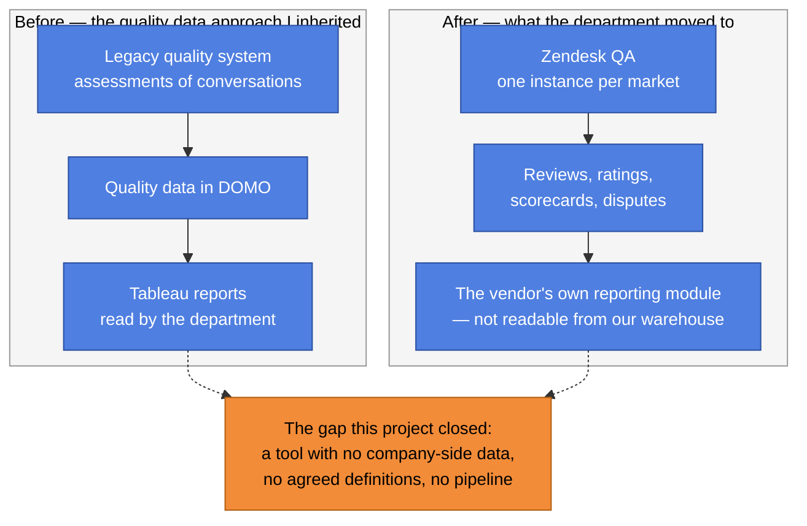
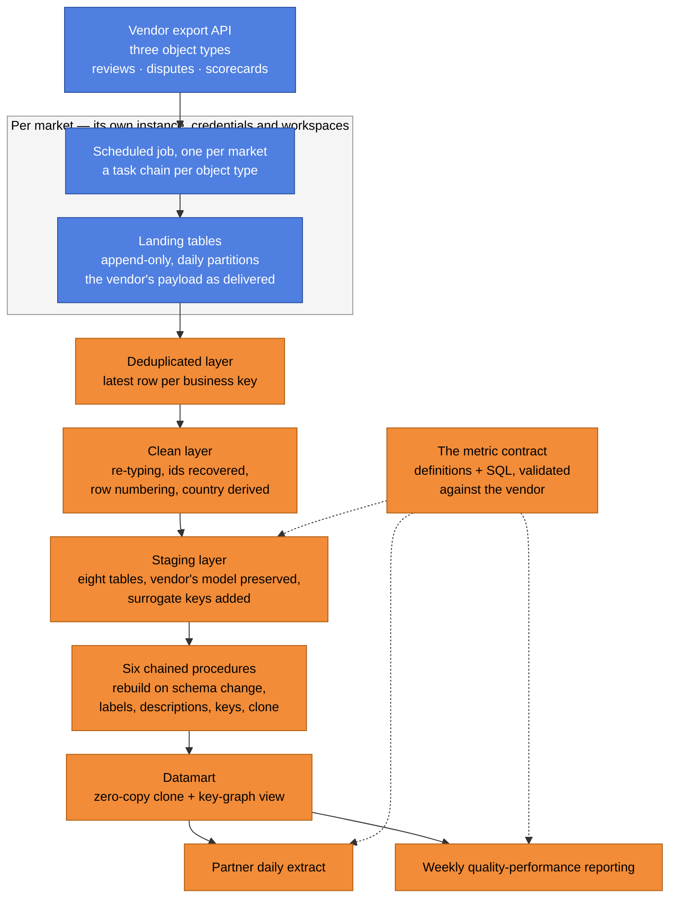
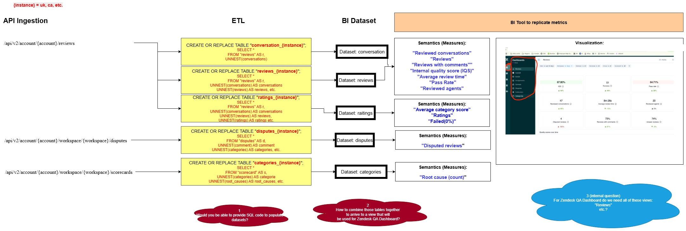
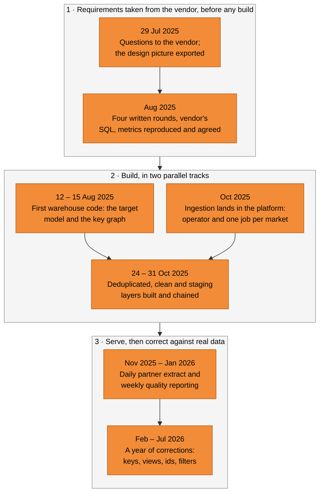

# Project 4: Zendesk QA — Quality Data for Customer Services

## Summary

| | |
|---|---|
| **Situation** | Customer Services moved its conversation reviews out of its legacy quality system and into **Zendesk QA**, a tool the company had just adopted. The old quality data lived in **DOMO** and was read through **Tableau** reports built on it. The new tool keeps its reviews inside its own instances, one per market, and its reporting module cannot be read from the company warehouse — so the department was about to run its quality process on data nobody here could join, schedule or reproduce. |
| **Task** | Make that data usable: establish which metrics the department needs, define them, extract the data from the vendor reliably, model it so those definitions can be calculated, and serve the two consumers — with no specification, no vendor data model, and nobody here who had used the tool. [Details](#2-task--the-obstacle-and-the-problem) |
| **Action** | I started from the metrics, not from the pipeline. Four written rounds of questions to the vendor's team became one spreadsheet holding the definitions, the SQL behind each metric (the vendor's beside ours), the diagrams and the target design — the project's contract while the build ran. Then the build: the vendor's three export endpoints read per market by a config-driven job with pagination and retry, landed append-only and partitioned; three warehouse layers — deduplicated, clean and staging — reproducing the vendor's model in eight tables and adding the keys it lacks; six chained procedures refreshing them, with a rebuild path when the vendor's schema moves and a zero-copy clone at the end; and a key-graph view so any of the eight tables can be joined to any other. Every metric was reproduced against the vendor's own rows before it was trusted. [Details](#3-action--what-i-did-and-why) |
| **Result** | The data is in the warehouse and in use: the daily partner extract and the weekly quality-performance reporting read modelled tables instead of manual exports, the definitions agree with the tool because they were validated against it, and ingestion runs daily for every configured market. What is **not** finished is the last mile — the metrics exist as validated definitions rather than as a finished reporting product — and the legacy history (years of assessments, read today through DOMO and Tableau) still has no decision. [Details](#4-result--outcome-and-learning) |

**My role.** Senior Analytics Engineer. I owned the requirements and the metric logic, learned the vendor's API and proved the data model with my own SQL against the vendor's sandbox, and built the warehouse side: the deduplication, the clean layer, the eight staging tables, the key graph and the six procedures. The platform side — storage, datasets and scheduling — belongs to the platform team, and the shared repositories carry other engineers' names beside mine; 3.7 sets out who did what.

**How to read this document.**

| Section | What is in it |
|---|---|
| [1 Situation](#1-situation--context-and-facts) | The platform change, the vendor's data, and what existed before |
| [2 Task](#2-task--the-obstacle-and-the-problem) | What was asked of me, the obstacle, the constraints |
| [3 Action](#3-action--what-i-did-and-why) | The approach, the timeline, the components, the craft, the aftermath |
| [4 Result](#4-result--outcome-and-learning) | Where the project stands, what went wrong, what I would do differently |
| [Appendix A](#appendix-a--deep-dives) | Deep dives: requirements, ingestion, the model, the metrics, access and ownership |
| [Appendix B](#appendix-b--decision-log) | The decision log: context, options, choice, why, trade-off |
| [Appendix C](#appendix-c--references-pictures-and-generic-locations) | References, the design picture, generic locations, glossary |

**The change that started it.** The project begins with a business decision: the department leaves one platform for another, and nothing on the company side can be reused.



*Blue = the situation I inherited. Orange = what the project existed to produce.*

---

## 1. Situation — Context and Facts

**1.1 The trigger was a platform change, and it was not mine to make.** Customer Services was told to move its conversation assessments from the legacy quality system into Zendesk QA. The decision came from the business; the consequence landed on the data side, because the two platforms have nothing in common:

- the old quality data sat in **DOMO** and was consumed through **Tableau** reports built on it;
- the new tool keeps its evaluations inside itself, in one instance per market, and neither its storage nor its reporting module can be read from the company warehouse;
- so the day the department changed tools, the quality data it had been reading became unavailable in the form it had been reading it.

Nothing about the new tool's data model was written down for us either: no specification to build against, no vendor table definitions to copy.

**1.2 What the tool holds, and why that made this a modelling problem.** Zendesk QA scores customer-service conversations across channels — voice, chat, e-mail, web form and messaging. Reviewers score against a **scorecard**: groups holding categories, each category carrying a scale, a weight and a root-cause list. The scoring lands as **reviews**, each review carrying **ratings** — one per category, with the score, the weight and the cause the reviewer chose. A disagreement between reviewer and agent becomes a **dispute**, with its own status, resolution time, comment and thread.

That is a normalised model, and the reason the project needed a model rather than only a pipeline: a metric like "root causes per category for one reviewer in one week" has to join the scorecard, the review, the rating and the root-cause list, and the export delivers each of those as a separate nested payload.

**1.3 One instance per market, and only an export API to read.** Each market runs its own Zendesk QA instance with its own credentials, account and workspaces — not one global database to query. The project's records of the vendor conversations are clear on two points: the data cannot be queried directly, and the vendor's own SQL cannot simply be handed over to run in our warehouse. What the vendor exposes is an export API over three object types — reviews, disputes and scorecards. That is the only door, so the reporting layer had to be reconstructed from those three payloads.

**1.4 Why the metrics were a problem in their own right.** The metrics and KPIs are calculated inside the vendor's reporting module, which users can see and our warehouse cannot read. So a number about the quality process in the company's own reporting has to be reimplemented — and the only safe way to reimplement it is to understand how the vendor calculates it and reproduce the same number from the same rows.

**1.5 What existed before.** Nothing reusable: no tables for the new tool, no agreed definitions, no schedule. Whatever the department needed was read inside the vendor's module or pulled by hand. Nor was there history to carry forward — the legacy assessments stay in the outgoing stack (the old quality system's data in DOMO, the reports people read built in Tableau), and what eventually happens to them — kept read-only, migrated or dropped — is an open business decision rather than a technical one.

**1.6 Who needed the result.** Two consumers, from the start.

| Consumer | What they need | Why it cannot stay manual |
|---|---|---|
| The **outsourced partner** | A daily file of their own reviewers' assessments: score, comment, review time, who reviewed whom | It arrives as a file, so it has to be produced by a schedule rather than by a person |
| **Quality-performance reporting** | Scores per reviewer over the week, so quality is followed through how reviewers perform | It has to be repeatable and defined by a metric, not by somebody re-running an export |

The department wanted the tool's numbers **in company reporting**, not only in the tool: before this project only the vendor could see the data, and afterwards the company could join it, schedule it and audit it.

---

## 2. Task — The Obstacle and the Problem

**2.1 What I was asked for.** Four things, in the order they had to happen:

1. **Find out what the department actually needs.** The tool was new to everyone here, so the metric list had to be collected before it could be implemented.
2. **Define the metrics so they cannot drift.** The number in the tool and the number in company reporting have to be the same number, or nobody will trust either.
3. **Get the data out of the vendor, reliably and repeatedly** — every market, every day, without a person running it.
4. **Model it so those definitions can be calculated**, and serve the two consumers who need it.

**2.2 The obstacle: no specification, no model, and no way to borrow either.**

| Obstacle | Why it blocked the obvious route |
|---|---|
| The vendor's data model is not published | Nothing to copy, so the model had to be inferred from the payloads themselves |
| The vendor's SQL does not transfer | It is written against a schema we cannot query, so the work is a reimplementation rather than a port |
| The reporting module cannot be read from our systems | The metric definitions had to come from the vendor's team in writing, not from the tool's database |
| One instance per market, each with its own credentials and workspaces | A single global pipeline was impossible; ingestion had to be per market from the start |
| Sensitive data throughout, including the people being reviewed | Every layer had to respect the company's data-protection position, from bucket to report |
| Nobody here had used the tool | No internal expert could say which metrics mattered, which is why the requirements phase is part of the technical story and not a preamble to it |

**2.3 The constraints I had to design inside.** Storage, datasets and the orchestration platform came from the platform team. Beyond that: no writing into the vendor; the three export object types as the only interface; per-market credentials held as platform connections rather than in code; the data classified and access-restricted; and a department that would judge the result by whether its numbers matched the tool.

**2.4 How the shape of the work changed.** The work did not arrive as a pipeline request. It started as a question — *what will people need from this tool?* — and became a build only once that question was answered, written down and agreed. Four phases followed, each with its own evidence in the repositories:

| Phase | What it was | When |
|---|---|---|
| 1. Requirements and definitions | Questions to the vendor, answers in writing, one spreadsheet as the contract | Late July – August 2025 |
| 2. Model proof and design | The design picture and the metric SQL written against the vendor's sandbox, reviewed with the vendor | Late July – August 2025 |
| 3. Build | Ingestion per market, the three warehouse layers, the procedures, the key graph | August – November 2025 |
| 4. Serve, and keep serving | The consumers' models, then a year of corrections driven by real data | November 2025 – July 2026 |

---

## 3. Action — What I Did and Why

**3.1 Architecture at a glance.** One flow, four warehouse layers and two consumers. Each layer answers a question the next one cannot:



*Blue = the vendor's side and the landing zone. Orange = what the project built and serves.*

The project's own design picture, drawn while the work was being planned, shows the same flow — including the vendor's dashboard the reporting side had to reproduce:



The same architecture, written as the shape of the repositories rather than as paths:

```
platform repository
└── the ingestion job for this tool
    ├── the vendor-specific operator ....... URL per object type, JSON to NDJSON,
    │                                       pagination, retry on rate limit
    ├── one scheduled DAG per market ....... a task chain per object type
    └── config per market .................. tenant, account, workspaces,
                                            object list, credentials reference

warehouse repository
├── deduplicated layer ..................... reviews · disputes · scorecard
│                                            (one row per business key)
├── clean layer ............................ the same three, re-typed and keyed
├── staging layer .......................... eight models + six procedures
│                                            (the model every consumer reads)
└── datamart ............................... the clone and the key-graph view
```

**3.2 The approach: work backwards from the end.** The first thing I did was not technical. Customer Services had never worked with the tool, so they could not name the metrics they would need — they knew the work they did, not the list of numbers. I started instead from the end the business cares about: the numbers that appear in company reporting.

**The requirements conversation.** Four rounds of questions went to the vendor's team in writing across late July and August 2025. They were the questions that decide what a metric can be: how the tool models a review and a rating; how the export behaves (which objects, which window, what a paging key looks like); what the tool's own definitions of the standard metrics are; and how its numbers are meant to be aggregated. The answers came back in writing, carrying the vendor's own SQL for the metrics and a worked example — which is why the definitions here could be reproduced rather than guessed.

**One spreadsheet as the contract.** The answers went into a single spreadsheet that became the project's working document and its specification: the definitions, the calculation behind each of the twelve metrics, the vendor's SQL, the same SQL rewritten against the tables we would have, the diagrams and the vision of the system. Shared with the vendor, corrected as the rounds went on. Two things made it the right artefact:

- **it answered "what will we need?" before anything was built**, which is how a pipeline producing data nobody asked for is avoided;
- **it was a contract, not a report**: every metric carried the vendor's SQL beside our version, so the two could be compared and the vendor could confirm the reimplementation was faithful.

**The proof.** Each metric was reproduced against real rows in the vendor's own environment — including the metric that counts root causes, which needed its own answer because the vendor's way of counting and the natural reading of the model disagree. Only a definition that matched was entered as agreed.

**3.3 Key milestones and decisions.** Every date below comes from the project itself: the design and Q&A documents, the commit history of the repositories, and the infrastructure definitions. Nothing here is remembered.



*Orange = work on this project, in the order the repository history shows it.*

| When | Milestone or decision | What it changed | Detail |
|---|---|---|---|
| 29 July 2025 | The design is drawn, before any pipeline exists | The flow, target tables, column lists and twelve metric statements in one picture — the build's reference | 3.1 |
| Late July – August 2025 | The requirements conversation with the vendor, in four written rounds | An unknown tool turns into a defined metric set — the phase that made everything after it buildable | [A.1](#a1-the-requirements-and-the-metric-contract) |
| August 2025 | Every metric is reproduced against the vendor's own rows before it is agreed | The definitions become a contract instead of an interpretation | [A.1](#a1-the-requirements-and-the-metric-contract) |
| 12 – 15 August 2025 | The first warehouse code is committed — the model and the key graph — and the schedule's earliest allowable date is set | The design stops being a picture; the model exists before the ingestion that feeds it | [A.3](#a3-the-model-three-layers-eight-tables-and-a-key-graph) |
| October 2025 | Ingestion lands in the platform: one vendor-specific operator and one scheduled job per market | Each market's instance is read on its own schedule, with its own credentials and workspaces | [A.2](#a2-ingestion-from-one-request-by-hand-to-a-scheduled-job-per-market) |
| 24 – 31 October 2025 | The deduplicated, clean and staging layers are built and chained | Raw payloads become eight keyed tables that answer the metric questions | [A.3](#a3-the-model-three-layers-eight-tables-and-a-key-graph) |
| 31 October 2025 | The single category table is replaced by three, and the key graph becomes a view | One table could not carry the scorecard's shape; the split made the model match the tool | [Decision 6](#decision-6--split-the-scorecard-into-groups-categories-and-root-causes) |
| November 2025 | The update procedure learns each table's description, and the labels are applied | The tables become discoverable by people, not only usable by machines | [A.3](#a3-the-model-three-layers-eight-tables-and-a-key-graph) |
| November 2025 – January 2026 | The first consumers are served: the weekly quality reporting, then the daily partner extract | The data leaves the engineering side and arrives where it is used | [A.4](#a4-the-metric-layer-and-the-consumers) |
| February – July 2026 | A year of corrections found by real data: keys, views, identifier guards, filters, dependencies | Columns, keys and dependencies changed, never the shape of the model or the list of tables | 3.6 |

**3.4 Components.** Each is a deep dive; the craft they share is collected in 3.5.

| Component | In one line | Deep dive |
|---|---|---|
| The requirements and the metric contract | Four written rounds with the vendor, one spreadsheet holding every definition with its SQL, and twelve metrics validated against the vendor's rows before anything was built | [A.1](#a1-the-requirements-and-the-metric-contract) |
| Ingestion | One vendor-specific operator reading three object types per market: JSON to line-delimited JSON, pagination, retries; config-driven, one scheduled job per market | [A.2](#a2-ingestion-from-one-request-by-hand-to-a-scheduled-job-per-market) |
| The model | Three warehouse layers — deduplicated, clean, staging — keeping the vendor's model and adding the keys it lacks, refreshed by six chained procedures with a rebuild path and a zero-copy publish | [A.3](#a3-the-model-three-layers-eight-tables-and-a-key-graph) |
| The metrics and the consumers | The definitions turned into the two models the consumers read: the daily partner file and the weekly quality-performance reporting | [A.4](#a4-the-metric-layer-and-the-consumers) |
| Access, ownership and data protection | Datasets provisioned as code, writers and readers named explicitly, the sensitive landing area restricted to a named group and a service account | [A.5](#a5-access-ownership-and-the-data-protection-frame) |

**3.5 The craft: warehouse SQL, not a tool's second copy of the data.** The pipeline is written in the warehouse's own SQL, orchestrated by the platform. That choice is what made the model possible in the time available: the hard part of this project is joining and unnesting, and both live naturally in the warehouse.

| Technique | Where it is used | Why it was the right tool |
|---|---|---|
| Window functions with a qualifying filter | The deduplicated layer | "One row per business key, latest version" is one statement per object; the ordering column is our ingestion timestamp, so the dedup never depends on the vendor's timestamps being tidy |
| Unnesting nested arrays | Staging reviews, ratings, scorecard groups, categories and root causes | The vendor's payload is nested on purpose; flattening it with `UNNEST` keeps the parent's context on every child row without a model to manage |
| Surrogate keys built from the business key | Every staging table | The model has composite natural keys and BI tools want one column to join on, so each table carries its own key and the keys of its parents as strings |
| `GROUP BY ALL` | Every staging model | The vendor keeps adding fields; a hand-maintained column list would have to be edited on every schema change, and a self-maintaining one cannot drift |
| Dynamic SQL | The procedures that create, alter, key and clone tables per region | The market list is data, not code: one procedure covers every market, with the region as a parameter and the statement assembled at runtime |
| Column descriptions read from the vendor's own metadata | Where the vendor's own field descriptions exist | The vendor documents its fields; applying those descriptions to our columns means the documentation is inherited instead of re-written |
| Zero-copy clones | Publishing the served tables | A clone is metadata, so the consumers get a stable, isolated copy without moving data or paying for a duplicate |
| Views over the key graph | The bridge | The join graph is the point, not a copy of the data: a view cannot go stale |
| A JavaScript function to strip markup | The partner file | Review comments are rich text; the file consumer needs readable text, so the tags are turned into line breaks and the entities decoded in one place |
| Primary and foreign keys declared but not enforced | The staging tables | The warehouse does not enforce them; declared anyway, they document the relationships for whoever reads the model next — and a relationship that cannot be true is better withdrawn than left as decoration (see 3.6) |

The trade-offs are real and I would take them again: a tool would have given me a managed dependency graph and an interface, and it costs a second place where the data and its transformations are defined. Here the model, the metrics and the corrections all live in one repository, where anybody can read the definition of a number — which is what the department asked for.

**3.6 After go-live: what the first year changed.** The pipeline was not finished on the day it started running. Real data found what review did not, and each fix is visible in the history with its date and its reason. Where another engineer made the change after the handover, the table says so.

| When | Change | The reason, as recorded at the time | Who |
|---|---|---|---|
| November 2025 | Per-table descriptions added to the update procedure | Descriptions were applied to labels but not to the tables, so the tables were not self-describing | Me |
| February 2026 | Regional runs staggered, and a ticket identifier added to the conversation model | Several markets refresh one global table and the warehouse limits metadata operations per dataset, so the runs now start at intervals instead of together; a metric needed the support ticket behind a review | Me, with the batch-ingestion engineer |
| May 2026 | Two declared relationships to the category catalogue are withdrawn | The catalogue has no primary key, so a relationship pointing at it could not be true — the foreign keys from the ratings and from the root causes were commented out | Another engineer, on my code |
| May 2026 | The key graph changed from a materialised view to a normal view | A materialised copy of a union of eight tables is a maintenance cost for no gain, and it cannot follow the tables when they change | Another engineer, on my code |
| June 2026 | The ticket-identifier guard corrected for shorter national formats | The guard rejected identifiers shorter than a fixed length, which is right for most markets and wrong for one — the fix was a single digit in a length test | Another engineer, on my code |
| June 2026 | More workspaces added to one market's ingestion | Coverage kept growing after go-live: the market added workspaces and the ingestion had to follow | Another engineer |
| June 2026 | The ticket identifier and the country moved one layer upstream, and the staging models simplified | A field every consumer needs should be produced once, in the layer that owns the logic, rather than in two models | Another engineer, on my code |
| July 2026 | The partner extract reworked: whose review it is, the columns it carries, and its reporting window | The consumer's definition of the reviewer was wrong, which is the kind of error you only find when the business reads the file | The analytics team that owns it |
| July 2026 | The deduplicated layer's orchestration dependency corrected | Dependencies had drifted from the files, so the layer could be triggered when its upstream was not ready | Another engineer, on my code |

Two things are worth saying about that list.

- **Almost nothing that broke was a transformation.** The joins, the unnesting and the keys held. What broke were assumptions about the outside world: that a national ticket format is always the same length, that a table with a category list also has a primary key, that a materialised copy is a convenience, and that a consumer's reading of "the reviewer" matches the vendor's. Those are the boundaries where a pipeline meets reality — and where I would now put the tests.
- **The handover worked.** Every later change is a small, single-purpose commit in the same repository, made by engineers who did not need me to explain the model — which is what a documented key graph and described tables are for, and a result in its own right.

**3.7 Who did what.** The project ran on a shared platform, and the boundaries matter more than the credit.

| Area | Whose work it is | Evidence a reader can check |
|---|---|---|
| The requirements conversation with the vendor, the metric definitions and their validation | Mine | The four written Q&A rounds and the spreadsheet behind them, both dated in late July and August 2025 |
| The design picture and the target model | Mine | The exported design of 29 July 2025, with the column lists and the twelve metric statements |
| The deduplicated, clean and staging layers, the key graph and the six procedures | Mine | The change history of the warehouse repository, August 2025 – July 2026 |
| Ingestion: the operator and the per-market scheduled jobs | **Shared** — the batch-ingestion engineer who built beside me, and me | The change history of the platform repository, October – December 2025; the design they implement is the one in the design picture |
| The storage, the datasets and the scheduling platform | The platform team | The datasets are provisioned as code, with named owners and access lists |
| The consumers: the partner extract and the weekly quality reporting | The analytics team that owns them, reading my tables | The change history of the consumers' models, November 2025 onwards |
| The post-go-live corrections | Mostly other engineers, on my code | The dates and reasons in 3.6 |

Where a piece was shared, the table says shared rather than claiming it as my own. The one boundary I would still verify before presenting this in an interview is the exact split inside the ingestion piece: the commits there carry two names, and no document records who wrote which part.

---

## 4. Result — Outcome and Learning

**4.1 The outcome.**

> **The quality data is out of the vendor's tool and inside the company warehouse. Ingestion runs daily for every configured market, the eight staging tables reproduce the vendor's own model with the keys it lacks, any table can be joined to any other through one key graph, and the twelve metrics are defined, documented and validated against the vendor's own numbers. The daily partner extract and the weekly quality-performance reporting read modelled tables instead of manual exports. What is not finished is the last mile — the metrics exist as a validated contract rather than as a finished reporting product — and where the legacy quality history goes is still undecided.**

| What was asked of me (2.1) | Where it stands |
|---|---|
| Find out what the department actually needs | **Done, and done before the build.** The requirements did not exist, so they were collected from the only party that had them — the vendor's team — in four written rounds. The answer was not a wish list but the vendor's own metric SQL, which is what made the definitions reproducible. |
| Define the metrics so they cannot drift | **Done.** Twelve metrics, each with its calculation, the vendor's SQL beside the version for our tables, and the result of running both against the vendor's own data. The agreement is written down, so a later disagreement is settled by reading it rather than by arguing. |
| Get the data out of the vendor reliably and repeatedly | **Done and running daily.** One scheduled job per market, one vendor-specific operator, configuration rather than code per market, retry on rate limits and pagination handled. Coverage grew after go-live — workspaces and markets were added as the roll-out continued — which is the point of putting the market in a config file. |
| Model it so the definitions can be calculated, and serve the two consumers | **Half of it is done.** The model is in production: three layers, eight tables, six procedures, a rebuild path when the vendor's schema moves, and a key graph that makes the eight tables one model. The consumers' models read it. The *reporting product* the metrics were meant to feed stopped at validated definitions. |
| Keep it alive after the handover | **Done, and measurable.** The changes of the last year are small single-purpose commits made by other engineers in the same repository (3.6) — the evidence that the model is documented well enough to be maintained without me. |

What is **not** finished:

- **The metric layer is a contract, not a product.** Every number is defined, proven and ready to be built on, but a department does not consume definitions — it consumes a report. That step was scoped as somebody else's, and that is where the project's momentum stopped.
- **The legacy history has no decision.** The old quality system holds years of assessments, read today through DOMO and its Tableau reports; when the tool is switched off that data either comes across, stays frozen or is archived — nobody has decided, so the pipeline carries what the tool produces and nothing else.
- **Coverage is a moving target by design.** Adding a market or a workspace is a config change, and those keep arriving, so "complete" is not a state this pipeline reaches.

**4.2 What went wrong, and what I would do differently.** The corrections in 3.6 are already the honest list. What follows is what they taught me.

- **The last mile had no owner, and I found that out too late.** The metrics were agreed and the two consumers were served, but the report that was meant to put the twelve numbers in front of the department was scoped as somebody else's work, and when it did not happen the project was left with a validated contract and no product. A metric set is a promise about numbers, not about a report; the owner of that report belonged in the deliverable from the first week.
- **A guard that drops rows has to be counted.** The ticket-identifier guard rejected identifiers shorter than a fixed length — right for most markets, wrong for one — so one market's reviews were dropped silently. The fix was a character in a length test; the lesson is that every filter which keeps bad rows out should publish what it removed.
- **A declared relationship with nothing to back it is worse than no relationship.** I declared foreign keys from the ratings and from the root causes to the category catalogue; the catalogue has no primary key, so the declarations could not be satisfied and an engineer commented both out months later. The mistake was in how I read the vendor's model: reproducing a table's columns, and the relationships they look like they have, is not the same as inheriting constraints that hold.
- **Defaulting to a materialised view bought less than it cost.** The key graph was created materialised — a stored copy of a union over eight tables that changes whenever any one of them does — and was changed back to a view. For a join graph the view is the right default; a stored copy needs an owner who promises to keep it fresh.
- **The contract lived outside version control.** The definitions sat in a spreadsheet, which was right for a conversation between two companies and wrong as the permanent home of a number. It is the one artefact the repositories cannot date, diff or review; the agreement would have aged better as a definitions file in the warehouse project, reviewed beside the code it describes.

- **Orchestration that keeps a second copy of the truth will rot.** The deduplicated layer's declared dependencies drifted from the files they were supposed to follow, so the layer could be triggered before its upstream was ready. Dependencies declared in one place and tasks defined in another are two answers to one question; they should be generated from the tasks, so drift is impossible.
- **Ownership of a row belongs in the contract, not in a filter.** The partner extract had to be reworked a year after go-live because its reading of "the reviewer" did not match the consumer's. The rule existed, but it lived in a filter rather than in the agreed definitions. Whose review, whose agent, which side of the conversation — that is a definition, and it belonged beside the twelve metrics.
- **I would put the tests where the failures actually happened.** Almost every correction in 3.6 sits at a boundary: an identifier format that differs by market, a relationship the vendor never guaranteed, a dependency list, a consumer's understanding of one word. Boundary tests — one row per market format, a key-relationship check before the key graph publishes, a guard-drop count per run, a row-count comparison between a layer and its source — would have caught most of them without anybody reading the code twice.
- **What went well: the shape of the project followed from asking first.** The requirements were collected before any pipeline existed, the model was drawn before the ingestion that feeds it and was never replaced, and each metric was reproduced against the vendor's own rows before anyone depended on it — which is why the build itself was uneventful. The year of corrections changed columns, keys, filters and dependencies, never the shape of the model or the list of tables: the strongest evidence that the design picture was right.
- **What is unfinished deserves to be named as a decision, not left as a backlog.** The metric layer needs an owner and a report, the legacy quality history needs a business answer — migrate it, freeze it or drop it — and the field-level data-protection policy ([A.5](#a5-access-ownership-and-the-data-protection-frame)) needs to be written and agreed. None of the three is a technical problem, and none will resolve itself by being postponed.

---

# Appendix A — Deep Dives

Each deep dive explains how a component works, what it had to satisfy, and what it cost. They are written for somebody who has the repositories open beside them: the tables, the procedures and the models are described by what they do, and the places to find them are listed in Appendix C.

## A.1 The requirements and the metric contract

The project began with a question the company could not answer internally: *what will Customer Services need from this tool?* Nobody here had used Zendesk QA, so there was no metric list and no specification to build against. The vendor's reporting module calculated the numbers, its database could not be read, and the only source of truth was the vendor's own team — so their answers had to be written down and reproduced.

### Four written rounds, and why they had to be written

The questions went to the vendor's team in writing across late July and August 2025, in four rounds, ordered from the general to the reprovable:

| Round | The question it settled | Why it had to come from the vendor |
|---|---|---|
| 1 | How the tool models a review, a rating and a scorecard — groups, categories, weights, root causes | The model is not published anywhere; it had to be described before it could be reproduced |
| 2 | How the export behaves: which objects exist, which window each returns, what a page key looks like | The interface is the only door into the data, and its behaviour decides what the pipeline can even see |
| 3 | What the tool's own definitions of its standard metrics are — the SQL behind each number | A metric reimplemented from a description is an interpretation; the same metric reimplemented from the vendor's SQL is a reproduction |
| 4 | How those numbers are meant to be aggregated, and over what period | Averaging scores, counting root causes and reporting per reviewer each have more than one defensible reading |

The thread also became evidence: when a number later looked wrong, the argument could be settled by reading what the vendor had said in August rather than from memory.

### What the contract contains

Everything went into one spreadsheet that became the project's working document and contract: shared with the vendor, corrected as rounds went on, and used as the build's specification.

| Part of the sheet | What it holds |
|---|---|
| The definitions | Each of the twelve metrics written in words, so a non-engineer can read what the number means |
| The vendor's SQL | The vendor's own statement for each metric, beside ours — the reason the reimplementation can be checked rather than believed |
| Our SQL | The same twelve statements re-written against the tables this project would produce |
| The proof | For each metric, the result of running both versions against the vendor's own rows |
| The diagrams | The flow end to end, the target tables with their columns, and the joins that connect them |
| The open items | The questions still unanswered, kept in the sheet rather than lost in a mailbox |

The pair of SQL columns is the heart of it. A definition that exists only as a sentence drifts the moment anybody else implements it; two statements that return the same number against the same rows do not.

### The proof, and the one metric that needed an argument

Each metric was reproduced against real rows in the vendor's own environment before it was entered as agreed. One of them needed a discussion rather than a calculation: **the metric that counts root causes**, where the vendor's way of counting and the natural reading of the model disagree. That is precisely the kind of disagreement a contract is for — it was settled against the vendor's own output, written down, and then treated as the definition rather than re-litigated later.

The proof is what makes the less obvious claim true: the model is not just fed by the vendor's data, it is *calibrated* against the vendor's numbers. 4.1 says the metrics are validated; this is what that means.

### The consequence for the model

The requirements phase is why the model looks the way it does. Two facts came out of the rounds and shaped the warehouse tables:

- **a scorecard is configurable**, so the number of groups, categories and weights differs between markets and workspaces, and the same tool can carry two category namings at once. A model that hard-codes one scorecard is wrong for the next market, which is why categories are rows rather than columns ([A.3](#a3-the-model-three-layers-eight-tables-and-a-key-graph));
- **a review's identity is not one field** — it hangs off a conversation, which hangs off a support ticket, and the ticket is what a metric needs to relate a review to a customer contact. That became a column added to the conversation model after go-live (3.6).

The twelve metrics did not become a report in this project: the contract was finished and the product built on it was not, which is the first item in 4.2.

## A.2 Ingestion: from one request by hand to a scheduled job per market

The vendor's export API was the only door into the data, so ingestion had two jobs: read three object types from every market's own instance, and do it daily without a person. Before either, one manual request was made against a market's instance to see the payload rather than describe it. The model, the metric SQL and the design picture were all built on that response ([A.1](#a1-the-requirements-and-the-metric-contract)), so the pipeline had a known shape to land.

### The operator: three objects, three endpoint shapes, one that pages

One vendor-specific operator does the reading, built on the platform's HTTP-to-GCS plugin so that transport, retries and file handling are not reinvented. What it adds is the vendor's own behaviour:

| Behaviour | How it works | Why it matters |
|---|---|---|
| Endpoint per object type | Reviews are requested per account over a date window; disputes and scorecards are requested per workspace inside the account | Reviews arrive as a stream and the workspace-scoped objects as lists, so one URL shape cannot cover all three |
| Window with a warm-up margin | The reviews request is given a from/to date pair extended slightly earlier than the interval being ingested | A review created just before midnight on the boundary day still belongs to the window being loaded |
| Paging | Only the reviews response carries a next-page key, and the operator follows it until it disappears | Following a page key that never exists wastes calls; ignoring the one that does exist silently truncates the day |
| Tolerated responses | A "bad request" response is skipped rather than raised; rate-limit and server responses are logged and retried with exponential back-off up to twenty attempts | A day with no reviews must not fail the run, and an API under load must be waited for rather than hammered |
| Conversion | Each page of JSON is converted to line-delimited JSON and uploaded to a bucket under the object's prefix | One file format, one schema contract, and a landing area that can be inspected directly |
| Refusal | An object type the operator does not know raises instead of returning nothing | A typo in a config file should stop the pipeline, not produce an empty table |

### The job: one per market, one chain per object, configuration and not code

The scheduled side is deliberately dull, because dull is what makes a market addition cheap. Each market gets one scheduled job, its configuration names the market's tenant, account, workspaces and the objects to ingest, and credentials live in a platform connection per tenant rather than in the repository. Inside the job, each object type gets its own chain:

```text
start tenant ──▶ clear the landing prefix for this day ──▶ fetch the vendor's page(s) to the bucket ──▶ load into the landing table ──▶ notify the orchestrator
```

Three details in that chain are design rather than plumbing:

- **the landing prefix is cleared before the fetch**, keyed by the run's own date, so a rerun of the same day replaces that day's file instead of appending a second copy;
- **the load allows the schema to move** (new fields added, narrowed types relaxed), which is the difference between the vendor adding a column and the pipeline breaking;
- **the run announces itself to the platform's orchestrator when it finishes**, so the warehouse models downstream can be triggered by the arrival of data rather than by a clock.

### The landing area is not the finished data

The landing tables are append-only, partitioned by day, and hold the vendor's payloads as they arrived — nested, and carrying the fields the vendor chose to send. Two consequences follow, both deliberate:

- **no duplicate promise is made here.** A rerun of a day's file, a backfill, or the vendor returning a row twice all land as separate rows. Duplicates are removed one layer in, by the deduplication keyed on the ingestion timestamp ([A.3](#a3-the-model-three-layers-eight-tables-and-a-key-graph)) — which is why that layer exists at all.
- **nothing is interpreted here.** No renaming, no casting into business types, no joins. The only change is the format, from the vendor's JSON to line-delimited JSON; every decision lives in the warehouse repositories, beside the model it belongs to.

### What it cost to keep, and what it bought

Markets and workspaces kept being added after go-live, and none of it required a code change — which is why the market is a configuration file and the workspace list is data inside it. The cost is the number of jobs: one per market, each with its own credentials, schedule and failure history, so a market can fail without touching the others, and monitoring is per market rather than global.

## A.3 The model: three layers, eight tables and a key graph

The landing area holds the vendor's payloads as they arrived — right for an archive, wrong for a question. Everything after it closes that gap, in three steps rather than one large transformation:

| Layer | What it is | What it adds |
|---|---|---|
| **Deduplicated** | One model per vendor object, read from the landing dataset per market | A tenant label, the ingestion timestamps, and one row per version instead of one row per load |
| **Clean** | The same three objects again | Types that mean something, keys, a repaired identifier, the row numbers the staging layer needs, and the fields the vendor only implies (ticket, country) |
| **Staging** | Eight tables, unnested | The model a person can query: one row per thing, every parent's key present, nothing nested |

Two properties hold across all three, and they are what makes the layers safe to chain:

- **every model is a pure select with a region parameter.** Each file is written once and materialised per market (`..._{{ params.region }}`); there is no file per market anywhere in the warehouse repositories, and adding a market is a config entry rather than a copy of a query.
- **every model ends in `GROUP BY ALL`.** The vendor adds fields between rounds, and a hand-maintained column list would drift from the payload within a season — here the grouping maintains itself.

### Layer 1 — deduplicated: the vendor's versions, not the loads

The landing tables are append-only, so the same review can appear many times: once per successful run, once per backfill. The deduplication answers that without over-correcting:

- it reads the landing tables with a **wildcard over partitions**, extracts the market from the table suffix, and labels every market's rows with a tenant — including the market whose rows belong to the merged tenant, mapped in the same statement;
- it stamps each row with the ingestion timestamps, which is the ordering nothing downstream has to trust the vendor for;
- it keeps **one row per version of an object** — the vendor's own `createdAt`/`lastUpdated` pair is part of the partition it deduplicates on — and resolves ingestion duplicates by taking the newest ingestion of that version.

That distinction is the useful part: genuine vendor updates are preserved as separate rows, and only the repetition created by *our* reruns is removed. Staging then chooses the newest version, so nothing in the reporting layer sees a review twice.

### Layer 2 — clean: the model the vendor's payload does not quite provide

Between the deduplication and the unnested model sits a layer that does almost no aggregation and several important repairs. What it does is best described as "make the fields mean what their names say":

| Repair | Why it was needed |
|---|---|
| The external identifier is re-typed and, when the value arrives as zero, parsed out of the conversation URL | Ingestion occasionally delivers the identifier as `0`, and the URL is the only place the real one survives |
| A row number is assigned per review and per conversation, ascending and descending on the vendor's own update timestamp | One review can be attached to more than one conversation, so "which conversation belongs to this review" has to be decided explicitly rather than by luck |
| The support-ticket identifier is extracted from the external URL, and rejected when it is too short to be one | The ticket is what relates a review to a customer contact, and it is buried in a URL — this is the guard that later needed the correction described in 3.6 |
| The country is derived from the workspace's name | The market of a review is a property of the workspace, not a column in the payload |

Both consumers depend on these fields, which is why they are produced once here rather than re-derived in each consumer's model — the same reasoning that later moved them one layer upstream when the staging layer needed them too.

### Layer 3 — staging: eight tables, one per question

The eight tables are unnested from the three vendor objects. Each answers a question that a metric asks, and each carries the keys of everything above it:

| Table | One row is | Keys it carries |
|---|---|---|
| **conversation** | one conversation attached to a review | its own, the review's, and the ticket identifier |
| **reviews** | one review, on the newest of its conversations | its own and the conversation's |
| **ratings** | one category scored inside a review — the score, the weight and the cause | its own, the review's, the conversation's, the category's |
| **scorecard** | one scorecard definition | its own |
| **groups_categories** | one group inside a scorecard | its own, the group's, the scorecard's |
| **rating_categories** | one category, the catalogue the ratings point at | its own |
| **root_causes** | one root-cause option belonging to a category | its own and the category's |
| **disputes** | one dispute raised against a review | its own, the review's, the conversation's |

The unnested shape is what makes the metric SQL possible: a question like "root causes per category for one reviewer in one week" is a join between `reviews`, `ratings`, `rating_categories` and `root_causes`, and in the payload that join is a nested array inside a nested array.

### The key graph: eight tables that can be joined to each other

The vendor's model has composite natural keys — a tenant, a conversation, a review, a category — and no surrogate of its own, so the staging layer builds the keys it needs, and builds them so that a consumer never has to know the composition:

- **a key is a string**: the tenant, the vendor's identifiers and, where a thing has none of its own, the row number that distinguishes it — joined by a hyphen. A conversation has no identifier in the payload, so its key is the tenant, the ticket identifier and which conversation under the review it is.
- **every table carries its own key and its parents' keys.** `ratings` holds the rating's key, the review's, the conversation's and the category's; `root_causes` holds its own and the category's. Joining two tables is joining on one column.
- **the primary key is declared on the global table** as a not-enforced constraint, generated from the table's name — one line per new table rather than a paragraph of DDL.
- **one procedure applies all the keys, in the run's last region.** Labels, descriptions and primary keys are DDL that cannot run seven times in parallel, so the merge procedure applies them only in the final region — a single-writer convention rather than a lock.
- **the relationships live in the same procedure.** Where the vendor's model does not support one, the statement is commented out or left with a placeholder note, so the file that holds the keys also records where a relationship cannot exist. Two were withdrawn in May 2026: the category catalogue has no primary key, so the relationships pointing at it could not be true (3.6).

On top of the eight tables sits one view — the **bridge** — unioning them and projecting the whole alphabet of keys, filling the levels a table does not have with nulls and labelling each row with its stage. It is deliberately a view: the graph is the point, not a copy of the data, and a materialised union over eight changing tables would be a stored fact needing an owner and a refresh. Consumers join through it on whichever key they already have.

### From regional tables to one global table

Every market gets its own model output and its own regional tables; the reporting layer reads one global table per object. Getting from the first to the second is a small procedure with a large job:

1. **create the global table from a regional one, if it does not exist** — the region is the template, so the global table cannot have a schema the regions do not have;
2. **delete the region's rows** from the global table, keyed on the tenant column;
3. **insert the region's rows**.

Delete-then-insert is what makes the operation repeatable: running a market twice leaves the same rows, which matters because one table is shared by every market. Then the exception path:

> if the insert fails — a schema mismatch because the vendor added or changed a field between rounds — the procedure **drops the global table and rebuilds it from the regional template**, then inserts again.

That self-healing migration has a cost written into the code rather than discovered in production: a rebuilt table holds only the region that triggered it, so the other markets' rows return as their runs happen. The trade is deliberate — a stale schema breaks every consumer, while a table missing other markets for twenty minutes is repaired by the schedule — and it is why the regions run one after the other with a pause between them rather than all at once:

- the run starts with a **staggered wait**: nothing for the first region, then eighty seconds for each region after it, up to eight minutes for the last — because the warehouse limits how many dataset metadata operations a project can issue in a short window, and every regional run creates, alters or clones tables in the same shared dataset;
- the wait is a **busy loop, not a sleep**, with a fixed number of iterations per second, because the warehouse has no wait function. It is the one piece of the pipeline that is a workaround rather than a design, and it documents the limit it works around in its own header;
- within a region, **the disputes table is merged last**, because it joins the conversation and the review tables of that same region.

### Six steps, and why each can be re-run

The layer is refreshed by six artefacts chained by the platform's orchestrator, each configured with an explicit dependency on the one before it:

| Step | What runs | What it guarantees |
|---|---|---|
| 1. The regional models | The eight staging queries, once per market, writing a regional table each | A regional table is a full rebuild, not a delta — a failed run is repaired by running the same statement again |
| 2. The merge | The global-table procedure, once per market | Each market contributes its own rows; the region's rows are replaced rather than appended, so a rerun is harmless |
| 3. Read the vendor's descriptions | A lookup against the landing dataset's own metadata | The documentation of our columns is inherited from the vendor instead of re-written by hand |
| 4. Apply the descriptions | One generated `ALTER` statement per table | Every table is self-describing, and one statement avoids the rate limit that one statement per column would hit |
| 5. Apply the keys | One procedure holding every primary key and relationship | The key graph has a single home, and so does the place where a relationship is deliberately absent |
| 6. Publish | A completeness check, then the clones | The served copy is never a partial copy |

The platform also drives *when* the chain starts: the step waits on the three clean-layer objects of every market, so a market's rows are merged only after the layer that feeds them has finished.

### Documentation inherited from the vendor

The description step turns documentation into a query rather than a chore. It reads the **vendor's own field descriptions** from the landing dataset's metadata — the paths of nested fields, flattened the same way our column names flatten them and lowercased to match — and takes only the fields the vendor has actually described. The apply step then intersects that list with the columns that genuinely exist in the target table and emits a single statement.

Two intersections doing one job: a description can only come from a field the vendor documented, and can only be applied to a column that exists. That is why the tables stayed documented through a year of schema changes without anybody maintaining a list of comments.

### The publish gate

The last thing before a consumer can see anything is a check, not a copy. The procedure counts the distinct tenants across all eight global tables against the markets the pipeline expects; if they do not match it raises an error and **nothing is cloned**, so the served tables are always clones of a staging layer that passed the gate.

Small code, large job: because the served copy is replaced wholesale, a market that silently produced nothing would otherwise replace a good table with an incomplete one. The failure happens in the pipeline, where an engineer is looking, rather than in a report a day later.

### What this model promises, and what it does not

Promised, and relied on by the consumers:

- **one row per thing, unnested**, with the vendor's own identifiers available as columns;
- **a key on every table and every parent's key on every child**, so no consumer has to reconstruct a join path;
- **documents and ownership attached to the tables**, which is what let other engineers change them without me (3.7);
- **all markets in one table**, separated by tenant, refreshed one market at a time.

Not promised, and worth knowing:

- **the vendor's full update history is not in the reporting model.** The deduplication preserves it one layer down, and staging keeps the newest version of each review;
- **the category catalogue has no primary key**, which is why the two declared relationships pointing at it could not be satisfied and were withdrawn (3.6);
- **the model is as complete as its configuration.** A market or workspace nobody added to the config does not exist as far as the model is concerned, and the publish gate protects the tables' integrity, not their coverage.

## A.4 The metric layer and the consumers

The contract holds twelve metrics as SQL ([A.1](#a1-the-requirements-and-the-metric-contract)). The metric layer turns them into models people read, and is deliberately thinner than the model itself: consumers read the **published clones**, never the staging tables, so the served copy is the boundary between the pipeline and the reporting.

### The boundary the consumers see

Everything a consumer needs is in the served tables: eight tables, unnested, keyed, described, complete for every configured market. What a consumer must *not* have to do is decide anything the pipeline has already decided, which is where the two consumers' models start:

- **they join through the key graph**, using one key column rather than reconstructing the vendor's nested paths;
- **they read the published copy**, which is why the publish gate and the clone exist at all;
- **they own their own transformation** — the aggregation, the masking and the shape of what leaves the warehouse are their code, in their repositories, with their schedules and their names on the failure e-mails.

That split is the design: the pipeline is responsible for the facts, the consumer's model for the presentation, and neither has to read the other's code to be correct.

### Consumer 1 — the daily partner file

The outsourced partner reviews conversations on the company's behalf and needs its own reviewers' work as a file, every day. Three models serve it, all reading the served review and rating tables:

| Model | What it produces | Why it exists next to the others |
|---|---|---|
| The daily extract | Yesterday's reviews for the partner's own agents, one row per review: score, comment, review time, who reviewed whom, the scorecard, the workspaces | The operational file. It is filtered to the partner's agents, so the partner never receives another party's work |
| The 31-day extract | The same row shape over the last month | The partner's own reporting looks back further than one day, and rebuilding a month from the daily files is the consumer's problem, not the warehouse's |
| The wide review table | One row per review with each scorecard category pivoted into columns — its root cause, its score and its weight | A file consumer needs columns, not rows, and this is the model that makes one review readable across a page |

Three things in those models were decisions rather than defaults:

- **the comments are rich text, so they are cleaned in the warehouse.** A small JavaScript function turns block-level tags into line breaks, strips the rest of the markup and decodes the common entities, so the file holds readable text and the consumer does not re-implement that cleaning;
- **the pivoted columns are scorecard-dependent.** The tool carries more than one generation of scorecard category naming at once, so the wide table names the categories it pivots. It is the one model here that will need a hand when a new scorecard generation appears — the price of handing a file consumer a flat grid;
- **the e-mail addresses are reduced to the local part**, and the daily extract is filtered to the partner's own domain. That is a reduction, not an anonymisation: it narrows what leaves the warehouse, and a stricter position needs the data-protection owner's decision rather than an engineer's.

The partner's model was reworked once, a year after it was written (3.6), when the definition of "whose review is this" turned out not to match the consumer's — the one correction that came from the business reading the output rather than from the pipeline breaking, and the reason 4.2 names ownership of a row as a definition.

### Consumer 2 — the weekly quality reporting

The second consumer follows how the reviewers themselves perform, so it needs a number per reviewer per week rather than per review. This one is a metric implemented as a model: the served reviews are grouped by ISO week and by reviewer, and each week and reviewer gets a total score, the maximum that total could have been, and the ratio between them — a quality score for that person for that week.

Two details are the whole model, and both are definitions rather than SQL:

- **the reviewer is the e-mail address**, reduced to its local part, because that is the stable identifier across the tool's accounts;
- **a review's score is treated as a percentage**, so multiplying the number of reviews by a hundred gives the maximum. That convention comes from the vendor's own scoring, and writing it as a formula in a model is what makes it checkable — it is the sort of assumption that becomes a wrong number when it stays in somebody's head.

Weekly rather than daily is also a decision: a daily ratio per reviewer is mostly noise, whereas a week is long enough to compare people and short enough to act on.

### What the metric layer is, and what it is not

It is: the twelve definitions written down and proven, two consumers' models built on the published tables, and a boundary — the served copy — that lets the pipeline and the reporting change without dragging each other.

It is not: the report the department asked for. The definitions reached the point where a report is a small, well-specified piece of work, and then the work stopped (4.2). What exists is the half that is hardest to do later, which is why the project is worth describing even unfinished.

## A.5 Access, ownership and the data-protection frame

### Ownership written into the data, not into a document

Every dataset in the chain is provisioned as code rather than created by hand in the console: its description, its classification, its location, its billing owner and its **data-owner group** are declarations in a repository, reviewed like any other change. The pipeline's own configuration separately names the owning team and the people who receive its failure notifications.

That is the mechanism behind the handover in 3.7. When the tables carry an owner group, "who owns this" is a lookup rather than an archaeology exercise; when the descriptions are inherited from the vendor ([A.3](#a3-the-model-three-layers-eight-tables-and-a-key-graph)), a new engineer can read the schema without asking; and when the schedules name an owning team, a failure reaches a team rather than a person's memory. Ownership that lives in the data survives holidays, reorganisations and me.

One distinction the arrangement makes plain: the **data owner and the report owner are different people**. The pipeline's datasets are owned by the team that built the pipeline, the consumers' models by the consumers, so neither can quietly change the other's contract — which is what makes the served copy a useful boundary rather than a wall.

### Who can read what, and why the slope is deliberate

The chain reads from a raw landing area holding the vendor's payloads, including free-text comments and the names of the people involved. Not every consumer of the reviews should be able to read that, so access is a slope rather than a switch:

| Layer | What it holds | Who writes | Who reads |
|---|---|---|---|
| **Landing** | The vendor's payloads, verbatim and append-only | The ingestion service accounts, and one named engineer | The pipeline's own service accounts, the dashboarding account, and three named groups: the data-warehouse PII group, a PII-viewer group, and the customer-services data group |
| **Deduplicated and cleaning** | The same content, deduplicated and retyped | The publishing service account; the cleaning layer additionally three named engineers | The same service accounts, and the data-warehouse PII group alone |
| **Staging** | The eight keyed tables | Several pipeline families share the dataset, so its writers are the orchestration accounts plus the team | Platform and orchestration accounts, and the same reader pattern as above |
| **Published** | The served copies and the bridge view | The publishing jobs | Consumer and platform service accounts — BI, other analytics teams, ML, orchestration — and four named groups including the PII-viewer group |

The shape is intentional at both ends. **The raw area is narrow**, because it is the only place the vendor's unedited payload exists and few people need it. **The published copy is wide**, because its purpose is to be joined to other teams' data — and access is granted per dataset rather than per column, so publishing a clean copy is how "read the reviews without reading the payload" is expressed in a platform that decides access at dataset level.

### The data-protection frame, stated honestly

What the pipeline does:

- the datasets are classified as internal, located in the EU region, and the layers holding raw content are readable only by groups that already carry PII entitlements;
- the content that leaves the warehouse for an external partner is scoped to that partner's own agents and has the e-mail addresses reduced to their local part ([A.4](#a4-the-metric-layer-and-the-consumers));
- the rich-text comments are cleaned before they leave the warehouse, which removes markup rather than meaning but does reduce what is handed over.

What it does not do, and what a reader should know:

- **no hashing, tokenisation or field-level policy anywhere in the pipeline.** The protection is dataset-level access plus consumer-side reduction: a real control, but a coarse one — a reader of the published tables can read the comments and the identities. The improvement is a documented field-level policy and a purpose recorded next to the reader list, which is a data-protection decision rather than a pipeline change, and why it stayed on the list in 4.2;
- **the masking in a consumer's model is a convention, not an enforcement.** An engineer can write an un-masked model against the published tables, and only review stops that. Making the served copy safe by construction would need a policy tag per column or a second, reduced copy of the tables — both worth doing, neither done here.

---

# Appendix B — Decision Log

Each decision follows the same pattern: context, options, choice, why, and the trade-off accepted.

### Decision 1 — Write the pipeline in the warehouse's own SQL rather than in a transformation framework

- **Context.** The hard part of this data is joining and unnesting: nested arrays of groups, categories, root causes and ratings, and twelve metrics that are joins across them. Whatever it is written in has to express that clearly and stay maintainable by analytics engineers.
- **Options.** (a) A transformation framework, as in the forecast project: models, tests, generated lineage, published documentation. (b) The warehouse's own SQL, parameterised per market and orchestrated by the pipeline framework the team already used. (c) A runtime outside the warehouse — Python in a scheduled job — reading the payload and writing the tables.
- **Choice.** (b): one SQL file per model, the market as a parameter, dependency declarations in the pipeline's configuration, dynamic SQL inside procedures for the DDL ([A.3](#a3-the-model-three-layers-eight-tables-and-a-key-graph)).
- **Why.** The transformation *is* SQL — unnesting, window functions, string keys, dynamic DDL — so a framework in front of it means the readable version of a metric is not the executed version; and the existing framework already brought scheduling, retries, alerting and per-market parameters.
- **Trade-off accepted.** No generated lineage and no built-in test framework: dependency declarations are a file I maintain rather than a graph the tool derives, which is exactly the drift recorded in 3.6. The pipeline is also bound to the warehouse's dialect.

### Decision 2 — Land the vendor's payload as it arrives, and reshape it downstream

- **Context.** The payload arrives as JSON documents with nested arrays, and could have been mapped into our own schema on the way in.
- **Options.** (a) Map into the final tables during ingestion. (b) Land every response verbatim and build the model in the warehouse. (c) Land verbatim and let each consumer unnest the payload for itself.
- **Choice.** (b), in three layers, so that each step of reshaping is a model somebody can read ([A.3](#a3-the-model-three-layers-eight-tables-and-a-key-graph)).
- **Why.** The vendor adds fields and changes its payload between rounds. A mapping in the ingestion code would mean a code change and a redeploy for every added column, and the only record of what arrived would be our interpretation of it. Landing verbatim keeps the evidence, which is what let the model be repaired and rebuilt without asking the vendor for another export.
- **Trade-off accepted.** A landing area that grows, the deduplication layer that therefore has to exist, and more steps in the schedule. Accepted because the alternative fails silently: a field the vendor added would simply never appear, and nobody could prove it had arrived.

### Decision 3 — One scheduled run per market, not one run for all markets

- **Context.** Markets differ in credentials, workspaces, data volume and review language, and they share the vendor's API, which is rate-limited per credential.
- **Options.** (a) One run that loops the markets. (b) One run per market, each with its own configuration and credentials. (c) One run per market per object type.
- **Choice.** (b), with the object types chained inside the market's run ([A.2](#a2-ingestion-from-one-request-by-hand-to-a-scheduled-job-per-market)).
- **Why.** A market's failure, retry, window and request rate are its own: one market hitting a rate limit must not stop another from landing its data, and adding a market has to be a configuration entry rather than an edit to a loop — the property that let coverage grow for a year without touching the ingestion code, except where the code was wrong.
- **Trade-off accepted.** More runs to observe: with seven markets there are seven chances to be late, so "is everything in?" is a question the monitoring answers per market rather than once.

### Decision 4 — Deduplicate on the vendor's version of an object, not on its identifier

- **Context.** The landing area is append-only, so the same review appears once per successful load. Deduplication has to remove that repetition without deciding which of a review's values is the true one.
- **Options.** (a) Keep one row per identifier, taking the most recently loaded. (b) Keep one row per version of the object — the identifier plus the vendor's created and updated timestamps — taking the most recently loaded version of each. (c) Keep only what the latest load contains.
- **Choice.** (b), with our ingestion timestamp as the tie-breaker ([A.3](#a3-the-model-three-layers-eight-tables-and-a-key-graph)).
- **Why.** Two different things look like duplicates and only one of them is: our reruns create rows that are genuinely the same, the vendor's updates create rows that are genuinely different — a score changed, a dispute resolved, a comment edited. Ordering by our ingestion timestamp removes the first without touching the second, and the deduplication never depends on the vendor's timestamps being tidy: theirs describe the object, ours describe the load.
- **Trade-off accepted.** The layer holds several versions and something downstream has to choose between them — staging does, and takes the newest, so no consumer ever sees the choice. The fuller history stays one layer down at the cost of a larger layer to store and read.

### Decision 5 — String keys composed of the vendor's own identifiers, carried down every table, and published as a view

- **Context.** The vendor's objects have composite natural keys and no surrogate. Consumers use different tools, and the model has to be joinable from any of the eight tables without a consumer learning the vendor's nesting.
- **Options.** (a) Leave the natural keys and let each consumer join on a combination of columns. (b) Build integer surrogates in a dimension table, resolved by lookup. (c) Compose string keys from the tenant and the vendor's identifiers, carry each table's own key and its parents' keys, and expose a bridge view over the whole graph.
- **Choice.** (c) ([A.3](#a3-the-model-three-layers-eight-tables-and-a-key-graph)).
- **Why.** The keys are stable — the vendor's identifiers, not generated values — so they survive a rebuild of the layer, which surrogates would not. Composing them from the tenant lets one global table hold every market without collisions, and carrying the parents' keys down makes a join one column rather than a reconstruction of the vendor's tree. The bridge view then makes the graph discoverable without reading eight models.
- **Trade-off accepted.** Wide columns, and a key graph that is documentation rather than enforcement, because the warehouse does not enforce constraints. It also created an obligation I then failed to keep: a key declared is a promise, and two of the relationships I declared could not be satisfied, so they were withdrawn (3.6).

### Decision 6 — Split the scorecard into groups, categories and root causes

- **Context.** The scorecard payload is nested three deep: scorecards contain groups, groups contain categories, and each category's rating options carry root causes. The first version of the model kept one table per level of the payload rather than one table per thing, and the metric questions showed the difference immediately: they join a scored category to the catalogue it came from, and group causes by category and category by group.
- **Options.** (a) One category table with the group as a column and the root causes as an array. (b) One table per level of the payload, as built first. (c) Three tables — the scorecard, its groups, and the category catalogue — plus a table of root causes per category. (d) Keep the payload nested and unnest in each metric.
- **Choice.** (c), on 31 October 2025, which also turned the join graph from a set of keys on tables into a view over all of them.
- **Why.** The catalogue is a different kind of thing from the score: it says what a category *is* and how much it weighs, while the ratings say what a reviewer *scored*. Keeping them apart makes "which categories did this reviewer score lowest, and what did the business call the cause" a four-table join instead of a nested one — and root causes belong to the category's definition, not to the review.
- **Trade-off accepted.** More tables, and a graph a consumer has to learn — which is what the bridge view is for. It also exposed something the payload had hidden: the category catalogue has no primary key of its own, so relationships declared against it could not be satisfied (3.6).

### Decision 7 — Turn the requirements conversation into a written contract, and reproduce every metric before agreeing it

- **Context.** The department judged the project by whether its numbers matched the tool's. The tool is a vendor product whose definitions live in its own UI, and the request was to report on quality — which meant agreeing, metric by metric, what each number means.
- **Options.** (a) Take the tool's own dashboards as the definition and reproduce their layout. (b) Ask the vendor for a data dictionary and implement from it. (c) Write the metric set down, reproduce each metric against the vendor's own rows, and agree the result in writing, in rounds.
- **Choice.** (c): four written rounds, one document holding all twelve definitions with their SQL, and a validation of each definition against the vendor's rows before it was treated as agreed ([A.1](#a1-the-requirements-and-the-metric-contract)).
- **Why.** The numbers had to match a tool neither side could see through, and a definition that exists only in a conversation changes with the person remembering it. Written down and proven, "the tool shows this" became "we agree this is the number and here is the query" — which is also what made the later corrections describable as definitions that had been wrong rather than a pipeline that had broken.
- **Trade-off accepted.** Weeks of work before any pipeline existed, and a definition document that lived outside version control — the one artefact of the project the repositories cannot date or diff (4.2).

### Decision 8 — Publish to consumers through a gated clone in a separate dataset

- **Context.** Consumers must read the data with their own tools and permissions. The staging tables sit in a dataset whose readers are narrow, because the raw content and the payload lineage are not for everybody; and a partial refresh of a global table must never be what the business sees.
- **Options.** (a) Grant consumers read access to the staging dataset. (b) Give consumers a view over the staging tables. (c) Clone the completed tables into a separate dataset with a wide reader list, but only after checking that every expected market is present.
- **Choice.** (c) ([A.3](#a3-the-model-three-layers-eight-tables-and-a-key-graph), [A.5](#a5-access-ownership-and-the-data-protection-frame)).
- **Why.** Access in the platform is decided per dataset, so a published copy is how "read the reviews, not the payload" is expressed. A clone is metadata rather than data, so the copy is cheap; the gate makes the served tables a statement about completeness rather than a snapshot somebody has to check; and consumers' models then depend on a stable dataset instead of on the refresh order of the pipeline.
- **Trade-off accepted.** A second place where the tables exist, kept in step by the pipeline rather than by the consumers, and a publish step that has to run before theirs — a schedule ordering to get wrong.

### Decision 9 — Let the merge repair a schema change by rebuilding the table

- **Context.** The vendor changes its payload, and a changed field reaches us as a schema mismatch between a region's fresh table and the global table every market writes into. The failure happens inside the merge, after the ingest has succeeded.
- **Options.** (a) Fail loudly and wait for an engineer to alter the global table. (b) Compare the schemas and issue the difference as DDL automatically. (c) Drop the global table and rebuild it from the region's template, then insert. (d) Land each market separately and put the merge in the consumers' code.
- **Choice.** (c), with the loss it implies written into the procedure beside the block that causes it ([A.3](#a3-the-model-three-layers-eight-tables-and-a-key-graph)).
- **Why.** A table whose schema is behind breaks every consumer at once, and the mismatch is discovered when the new field arrives — so the repair should happen then, in the run that found it, without a person being awake. Rebuilding from the region as template also guarantees the global table cannot describe a schema no region produces.
- **Trade-off accepted.** A rebuilt table holds only the region that triggered it until the other runs land — the window is real and the procedure says so — and a rebuild hides a change from review, because it happens in production rather than in a pull request.

---

# Appendix C — References, Pictures and Generic Locations

External references are sources **anyone can look up**: the vendor's own product and API documentation, and the warehouse's function, DDL and quota documentation. Products the company buys are named as their vendors publish them — Zendesk QA, DOMO, Tableau. Company-internal locations — repositories, datasets, schedules, owners — are described by what they are rather than by their internal names, so this document can be read outside the company. Nothing below requires company access, which is the point: a reason that can be re-checked is worth more than one that has to be remembered.

### External references (publicly available sources)

| Reference | Where it was used | Why it matters |
|---|---|---|
| The vendor's product documentation of its quality-scoring model — scorecards, groups, categories, weights, ratings, root causes | The requirements rounds, the metric definitions, the description text on every table ([A.3](#a3-the-model-three-layers-eight-tables-and-a-key-graph)) | The vocabulary the contract is written in: what a category is, how a scorecard weighs it, and why the review score is not the rating score |
| The vendor's developer documentation for its export API — the three object endpoints, their response shapes and their pagination | The ingestion operator and the per-market configurations ([A.2](#a2-ingestion-from-one-request-by-hand-to-a-scheduled-job-per-market)) | The endpoint shapes and the pagination contract the operator encodes, per object type |
| The vendor's API authentication documentation — token, account identifier, workspace identifier | The first manual call, then the per-market job | How a request is authorised — the reason the credential is per market rather than global |
| The warehouse's JSON, array and unnesting functions | The clean and staging layers ([A.3](#a3-the-model-three-layers-eight-tables-and-a-key-graph)) | Turning one nested response into flat keyed tables — the technique the whole model rests on |
| The warehouse's window-function syntax, including the qualifying filter | The deduplicated layer ([A.3](#a3-the-model-three-layers-eight-tables-and-a-key-graph)) | "One row per version of the object, from the latest load" as a single statement per object |
| The warehouse's procedural SQL and dynamic SQL documentation | The six chained procedures ([A.3](#a3-the-model-three-layers-eight-tables-and-a-key-graph)) | Loops over the eight tables, and DDL assembled at runtime for a table whose name is a variable |
| The warehouse's zero-copy clone syntax | The publish step ([A.3](#a3-the-model-three-layers-eight-tables-and-a-key-graph)) | Why the served copy is metadata rather than data, and therefore cheap enough to publish daily |
| The warehouse's quotas and limits for dataset metadata operations | The staggered wait between regional runs | The limit the stagger exists to stay under — and the reason the wait is a loop rather than a sleep |
| The orchestration platform's documentation of task parameters, retries and schedules | The per-market jobs ([A.2](#a2-ingestion-from-one-request-by-hand-to-a-scheduled-job-per-market)) | How one job definition becomes seven schedules, and how a failed run reaches a team |
| The vendor's own reporting module — its dashboards and their tiles | The twelve definitions and their validation ([A.1](#a1-the-requirements-and-the-metric-contract)) | The numbers the project had to match, and the only place those numbers could be read |
| Public data-protection law for the region whose reviews are processed | The access model and the data-protection frame ([A.5](#a5-access-ownership-and-the-data-protection-frame)) | Why the landing area has a named reader list with PII entitlements, and why a field-level policy is a business decision rather than something an engineer adds to a pipeline |

### Design pictures kept with this document

The export sits beside this file, so the link above resolves when the document is read on its own; the editable original stays in the project folder with the rest of the requirements material.

| File | What it shows | Used in |
|---|---|---|
| `Zendesk_QA-ETL.jpg` | The exported design picture of 29 July 2025: the three export endpoints on the left, the tables they were to be unnested into, the datasets and the measures expected of each, the vendor dashboard the reporting side had to reproduce, and the questions still open at that date | [3.1](#3-action--what-i-did-and-why) |

The editable original is far more detailed than the export — the column list of every source table the design touches, the twelve metric definitions with their SQL, and the first, abandoned shape of the metric layer as one wide table. It stays in the project folder, because it is a working artefact rather than a picture.

### Internal locations, described generically

- **The platform repository** — the ingestion job for this tool: the vendor-specific operator, one small configuration file per market, the shared definition that gives the markets their schedules and owners, and the landing schemas per object type.
- **The warehouse repository** — four areas, in this order: the deduplicated models, the clean models, the staging models with the six procedures and the dependency configuration that chains them, and the datamart with the zero-copy clone and the key-graph view ([A.3](#a3-the-model-three-layers-eight-tables-and-a-key-graph)).
- **The infrastructure repository** — the datasets as code: the landing area, the two warehouse datasets the layers write to, the served dataset the consumers read, and the writer and reader lists on each ([A.5](#a5-access-ownership-and-the-data-protection-frame)).
- **The consumers' areas of the warehouse repository** — the daily partner extract and the weekly quality-performance reporting, each owned by its reader team ([A.4](#a4-the-metric-layer-and-the-consumers)).
- **The orchestration platform** — the schedules as the seven markets see them, the run history, and the notification lists a failure reaches.
- **The requirements material, outside version control** — the four rounds of questions and answers, the metric workbook that held the contract, the design picture in both forms, and the note recording the first manual API call (4.2). The one part of the project with no change history behind it.
- **The vendor's own reporting module** — where people read the numbers today, and why the company's numbers had to reproduce it. The pipeline never reads it.
- **The legacy stack, on its way out** — the outgoing quality system's assessments in DOMO, read through Tableau reports. Nothing here reads either, and what happens to that history is still open (1.5, [4](#4-result--outcome-and-learning)).

### Glossary

| Term | What it means here |
|---|---|
| Agent | The support agent whose conversation was assessed — the reviewer's counterpart in a review. |
| Category | The smallest scored unit of a scorecard: it carries the scale, the weight, and the root causes a reviewer may choose from. |
| Clean layer | The second warehouse layer: the deduplicated payload re-typed and repaired — identifiers recovered, rows ordered, the country derived from the workspace name. |
| Conversation | One support interaction, in any channel, as the tool records it — what a review is about. |
| Deduplicated layer | The first warehouse layer: one row per version of each object, from the latest load, so a rerun adds nothing. |
| Dispute | A disagreement raised about a review or one rated category, with its own status, resolution time and comment. |
| Global table | The staging table holding every market's rows for one object, fed by each market's regional run in turn. |
| Group | A section of a scorecard that holds categories. |
| Ingestion | Reading the vendor's export API per market and landing the responses as delivered. |
| Key graph | The view carrying the identifying keys of all eight tables in one place, so any two can be joined ([A.3](#a3-the-model-three-layers-eight-tables-and-a-key-graph)). |
| Landing area | The append-only tables where the vendor's payload arrives, partitioned by day. |
| Market | One country's operation, with its own vendor instance, credentials, workspaces and schedule — the unit the pipeline runs per. |
| Metric contract | The written agreement on what each metric means, with its SQL, validated against the vendor's own numbers ([A.1](#a1-the-requirements-and-the-metric-contract)). |
| Metric layer | The models that turn the contract's definitions into what consumers read — today the two consumer models, not yet a finished reporting product ([A.4](#a4-the-metric-layer-and-the-consumers)). |
| Partner extract | The daily file carrying the outsourced partner's own reviewers' work ([A.4](#a4-the-metric-layer-and-the-consumers)). |
| Publish gate | The check that every expected market is present before the staging tables are cloned for the consumers ([A.3](#a3-the-model-three-layers-eight-tables-and-a-key-graph)). |
| Rating | One category scored inside a review: the score, the weight applied and the cause chosen. |
| Region | The unit the warehouse layers work in: a market's instance is loaded as one region's data, and a region may hold more than one market. Every regional run writes into the same global tables, which is why the runs are staggered. |
| Reviewer | The person who assessed the conversation; a reviewer can also be the agent of somebody else's review — the distinction one consumer's definition got wrong (3.6). |
| Root cause | The reason a reviewer attached to a rating; it belongs to the category's definition rather than to the review. |
| Scorecard | The questionnaire a review is performed against: its groups, categories, scales and weights. |
| Staging layer | The third warehouse layer: eight flat, keyed tables that preserve the vendor's model and add the keys it lacks ([A.3](#a3-the-model-three-layers-eight-tables-and-a-key-graph)). |
| Tenant | The vendor's identifier for the instance a row came from; carried on every row and the first part of every key, which lets one global table hold every market without collisions. |
| Workspace | A subdivision of a market's vendor instance; its name carries the country, which is how the clean layer derives the country of a conversation. |


