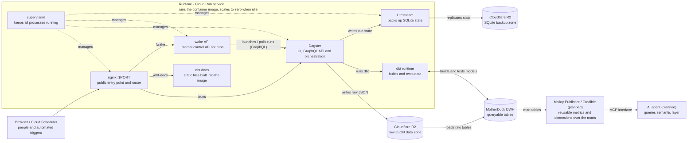
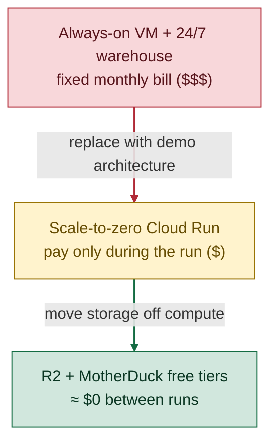

# Project: Automated XKCD Comics Pipeline (Analytics Engineering)

Repository: [antipev/analytics-engineering](https://github.com/antipev/analytics-engineering/blob/main/README.md)

## Summary

| Element | Summary |
|---|---|
| **Situation** | XKCD has published three comics a week since 2005, covering technology, science, geek culture, and everyday life. Its JSON API exposes every comic, but no automated system collected, validated, stored, cleaned, or documented the archive for trend analysis. |
| **Task** | Build a reliable, version-controlled analytics-engineering platform that ingests every comic, models the archive in tested layers, and documents it so two decades of shifting technology, science, and gaming themes can be analyzed. |
| **Action** | Implemented on one shared platform: Dagster for orchestration, Cloudflare R2 for raw JSON and Dagster state backups, MotherDuck/DuckDB for storage, dbt for staging, intermediate, and mart models, and Cloud Run for delivery. The same platform also runs a second, independent Jaffle Shop domain. |
| **Result** | 3,302 comics ingested and modeled end to end, with matching raw and mart row counts. The public Dagster UI and dbt docs run on Cloud Run in one scale-to-zero container; Cloud Scheduler triggers the monthly run and Litestream preserves state in R2. |

## Full write-up

Architecture, component responsibilities, data lineage, validation, and deployment details: [README.md — Analytics Engineering: XKCD & Jaffle Shop](https://github.com/antipev/analytics-engineering/blob/main/README.md).

## Skills demonstrated

Python, SQL, dbt, Dagster, MotherDuck (DuckDB), Cloudflare R2, Docker, Google Cloud Run, Cloud Build, Cloud Scheduler, Secret Manager, Litestream, schema validation, data testing, and technical documentation.

*`In order to keep costs low for this demo`, the architecture deliberately uses `managed, pay-as-you-go` services `instead of always-on infrastructure`: 1) one Cloud Run container serves the UI, docs, orchestration, and wake API, then scales to zero. 2) Cloud Scheduler wakes it monthly; 3) R2 and MotherDuck `free tiers keep fixed storage cost low`. 4) The Malloy/Credible semantic layer and AI agent consumption are roadmap items, not deployed yet.*

*Cost path: high fixed spend → pay-per-run compute → minimum idle cost for a demo.*

